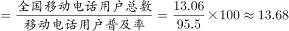
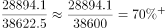
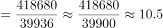
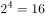

# 综合分析·正误判断（普及率推人口、比重与成数、增速差值比较、翻番倍数）

考点：[[20-考点/资料分析/综合/综合分析·正误判断（普及率推人口、比重与成数、增速差值比较、翻番倍数）|综合 / 综合分析·正误判断（普及率推人口、比重与成数、增速差值比较、翻番倍数）]]
材料：[[15-材料/资料分析/310781 2015年全国电话用户发展情况：电话|310781 2015年全国电话用户发展情况：电话]]

**问法模型**：'以下说法正确的一项是'→对A/B/C/D逐项定位材料（文字+图一+图二）套对应公式验证，排除三项锁定正确项

## 推理链
1. 第1步：A项用文字段1：移动电话用户13.06亿户、普及率95.5部/百人（即95.5%），全国人口=13.06亿÷95.5%≈13.68亿人，并非'接近13.5亿'，A错误
2. 第2步：B项用文字段2：4G新增28894.1万户、总数38622.5万户，新入4G用户占比=28894.1÷38622.5≈74.8%，是'超7成'而非'近7成'，B错误
3. 第3步：C项读图一双线逐年作差：2010年23.8−15.0=8.8、2011年18.6−14.8=3.8、2012年12.8−10.2=2.6、2013年10.5−5.0=5.5、2014年4.6−1.0=3.6、2015年1.5−(−2.6)=4.1（个百分点）
4. 第4步：差值最小为2012年的2.6个百分点，C正确
5. 第5步：D项读图二：2015年流量418680亿G、2010年（5年前）39936亿G，倍数=418680÷39936≈10.5倍，而翻4番应为2^4=16倍，10.5<16，D错误
6. 第6步：A错、B错、C对、D错，故选C

**最快解法**：⚡ 综合分析先做纯读图可心算的C项：图一两线逐年作差，12.8−10.2=2.6为六年最小即锁定C；再用截位直除快速排除其余三项：A项13.06÷0.955≈13.7亿，B项28894÷38622≈75%>70%，D项418680÷39936≈10.5<16（翻4番=16倍）

## 易错点
- ⚠ A项普及率口径：95.5部/百人即95.5%，求人口须'用户数÷普及率'，倒置成相乘会得到错误人口数
- ⚠ B项文字措辞陷阱：实际占比≈74.8%是'超7成'，与选项'近7成'不符，须严格对照计算结果与选项用语
- ⚠ D项'翻n番=×2^n'：翻4番是16倍而非10倍，≈10.5倍只约翻3.4番；且'5年前'指2010年（39936），基期勿取错
- ⚠ C项2015年移动电话用户增速为−2.6%，差值=1.5−(−2.6)=4.1，忽略负号会误判各年差值大小

## 母题抽象
> 🧩 当题干出现'以下说法正确/错误的一项是'时，按'文字两段+两图'逐项定位套公式：普及率题用人口=用户数÷普及率，占比题用部分÷整体并与'成数'表述严格对照，双线增速比较逐项作差取最值，'翻n番'一律验证2^n倍；先做可心算的读图项，再验算计算项。

**同类特征**：以下说法正确的一项是、普及率95.5部/百人推全国人口、新入4G用户占比近7成、同比增长率差值最小、较5年前翻了4番、文字+双图逐项验证

## 相关题
（暂无）

---

### 题干
根据材料，以下说法正确的一项是：

### 选项
- A. 2015年全国人口接近13.5亿人
- B. 2015年，4G移动电话用户中，新入4G用户占比近7成
- C. 移动电话去话通话时长与移动电话用户同比增长率差值最小是2012年
- D. 2015年移动互联网接入流量较5年前翻了4番

### 官方解析

A项：定位文字材料第一段可得：2015年全国移动电话用户总数为13.06亿户，移动电话用户普及率达95.5部／百人。则2015年全国人口数亿人，错误；

B项：定位文字材料第二段可得：2015年，4G移动电话用户新增28894.1万户，总数达38622.5万户。根据公式：比重，则2015年新入4G用户占4G移动电话用户的占比为，则2015年新入4G用户占4G移动电话用户的占比超过7成，错误；

C项：定位图一可得：2010-2015年移动电话去话通话时长增速与移动电话用户增速。则2010-2015年两者增速差值分别为23.8%-15%=8.8%、18.6%-14.8%=3.8%、12.8%-10.2%=2.6%、10.5%-5%=5.5%、4.6%-1.0%=3.6%、1.5%-（-2.6%）=4.1%，故移动电话去话通话时长与移动电话用户同比增长率差值最小是2012年，正确；

D项：定位图二可得：2015年移动互联网接入流量为418680万G，2010年移动互联网接入流量为39935万G。则所求倍数倍，而翻四番应为倍，错误。

故正确答案为C。

### 给定材料

        2015年，全国电话用户净增121.1万户，总数达到15.37亿户，增长0.1%，比上年回落2.5个百分点。其中，移动电话用户净增1964.5万户，总数达13.06亿户，移动电话用户普及率达95.5部／百人。固定电话用户总数2.31亿户。

        2015年，2G移动电话用户减少1.83亿户，是上年净减数的1.5倍，占移动电话用户的比重由上年的54.7%下降至39.9%。4G移动电话用户新增28894.1万户，总数达38622.5万户。

> [!note] 复核版本状态
> 原题不可计分（underdetermined；来源记录的答案键/竞争项：C）；仅当前明确标注的编辑版按答案C计分。
> 详细原题疑点、修订题面、解析和证据见下方独立复核记录。

<!-- CODEX-ANSWER-REVIEW:BEGIN -->
### 本次独立复核

**复核结论：** `resolved`（答案与解析已核定）

**原题计分状态：** 不计分（`underdetermined`：原题证据不足以唯一判定）。来源中记录的答案键/竞争项：C；这些记录不代表原题已核准答案。

**原题疑点与处理：**

原题A“接近13.5亿”和B“近7成”均未设定容差，措辞无法严格排除第二个成立选项。题源官方解析与可读回忆卷答案键均给C；以工信部数据计算A约13.675亿、B约74.81%，可说明出题者预期，但自然语言“接近/近”没有稳定量化界限。为题库可唯一判分，复核附录提供明确修订版选项，保留C并将A、B改为可核查数值命题。

**当前计分版本：** 明确标注的编辑版；未列出的题干、材料或选项沿用固定题源。答案不回填为原题答案。

**计分答案：** C（可计分）

**复核解析：**

【编辑修订版】原题A项“接近13.5亿”、B项“近7成”都未规定“接近/近”的容差，原题答案键和公开同题回忆卷虽均支持C，但仅凭原文措辞不能严格排除A或B。编辑版将A、B改为明确命题后逐项复核：A，13.06亿÷0.955≈13.6754亿人，四舍五入至0.1亿为13.7亿，不是13.5亿；B，28894.1÷38622.5≈74.8116%，不是70.0%；C，2010—2015年两项增速差依次为8.8、3.8、2.6、5.5、3.6、4.1个百分点，最小值为2012年的2.6个百分点；D，418680÷39936≈10.48倍，小于翻4番所需的16倍。故编辑版唯一答案为C。

**修订题干：**

【编辑修订版】原题A、B项中的“接近”“近”没有给出容差，无法严格判断唯一性。为使单选答案可复核，以下两项改成明确的数值命题；其余选项按原题保留。根据材料，以下说法正确的一项是：

**修订/采用选项：**

A. 按材料数值计算并四舍五入到0.1亿人，2015年全国人口为13.5亿人
B. 2015年新入4G用户占4G移动电话用户总数的比重为70.0%
C. 移动电话去话通话时长与移动电话用户同比增长率差值最小是2012年
D. 2015年移动互联网接入流量较5年前翻了4番

**相关信息：**

“接近”“近”不是固定数值容差；修订版应把比较标准写成精确值或明确舍入规则。工信部数据可独立复算人口、4G占比及流量倍数，图表数据可核验C项。

**核对依据与来源边界：**

- 固定题源：[原题文件](https://github.com/Mentat-Uran/kaogongzhentizhengliu/blob/84ab93d4b64b61d897bece8a1c0a5bab06b4feb2/10-%E7%9C%9F%E9%A2%98/%E8%B5%84%E6%96%99%E5%88%86%E6%9E%90/%E7%BB%BC%E5%90%88/4737862%20%E7%BB%BC%E5%90%88%E5%88%86%E6%9E%90%C2%B7%E6%AD%A3%E8%AF%AF%E5%88%A4%E6%96%AD%EF%BC%88%E6%99%AE%E5%8F%8A%E7%8E%87%E6%8E%A8%E4%BA%BA%E5%8F%A3%E3%80%81%E6%AF%94%E9%87%8D%E4%B8%8E%E6%88%90%E6%95%B0%E3%80%81%E5%A2%9E%E9%80%9F%E5%B7%AE%E5%80%BC%E6%AF%94%E8%BE%83%E3%80%81%E7%BF%BB%E7%95%AA%E5%80%8D%E6%95%B0%EF%BC%89.md)；内容版本 `84ab93d4b64b61d897bece8a1c0a5bab06b4feb2`，源 Markdown blob `66f48e60f2c5e1e7f8927556108ef71263417757`.
- [工业和信息化部《2015年通信运营业统计公报》](https://wap.miit.gov.cn/gxsj/tjfx/txy/art/2020/art_1e2732395d114d16bbac94678f73a575.html)
- [国家统计局《中华人民共和国2015年国民经济和社会发展统计公报》](https://www.stats.gov.cn/sj/zxfb/202302/t20230203_1899041.html)
- 固定题图/公式图：`90-图片/公式图/formula-cbeed45fd012742c.png`, `90-图片/公式图/formula-cb6b8feefd07c1b9.png`, `90-图片/公式图/formula-3f919a6d770d0d27.png`, `90-图片/公式图/formula-b9c2ed3068c44b65.png`, `90-图片/公式图/formula-71dc638677fda482.png`, `90-图片/题目图/17f2b011da8253b.png`, `90-图片/题目图/17f2b013dfc617b.png`.

<!-- CODEX-ANSWER-REVIEW:END -->
