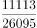
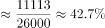

# 综合判断题（看图趋势判断+比重直除+数据充分性排除法）

考点：[[20-考点/资料分析/综合/综合判断题（看图趋势判断+比重直除+数据充分性排除法）|综合 / 综合判断题（看图趋势判断+比重直除+数据充分性排除法）]]
材料：[[15-材料/资料分析/310902 2018年第一季度（含3月份当月）全|310902 2018年第一季度（含3月份当月）全]]

**问法模型**：“根据以上材料，可以判断”→综合判断四选一，逐项代入材料验证：能硬算的算（比重直除）、能看图的看（增速趋势）、只有增速没绝对额的判“无法确定”，用排除法锁定答案

## 推理链
1. 第1步：提取条件——图中2017年3月至2018年3月共12个同比增速点全部为正（最低9.4%、最高11.0%，2018年1-2月为合并点9.7%）；文字给3月商品零售额26095亿元、限额以上单位商品零售11113亿元，以及吃/穿/用类增速46.5%/33.9%/33.3%
2. 第2步：验证B项——图中2017年5月增速10.7%低于6月11.0%（且4月与5月同为10.7%持平），增速并非持续下降，排除B
3. 第3步：验证C项——材料只给吃、穿、用三类商品的增速，未给各类绝对额，无法计算占比，更无法判断谁最高（增速最高≠占比最高），排除C
4. 第4步：验证D项——比重=限额以上商品零售÷商品零售总额=11113÷26095≈42.6%≠50%，排除D
5. 第5步：验证A项——图中各月同比增速均为正，说明2017年3月至2018年3月各月社零总额均高于上年同月，即（同比意义上）持续增加，A成立
6. 第6步：对照结论——B、C、D均已排除，锁定A为正确答案

**最快解法**：⚡ 排除法+截位直除：B项看图即排除（5月10.7%→6月11.0%回升，且4、5月持平）；C项“只给增速未给绝对额”直接判无法比较；D项11113/26095截位直除≈42.6%≠50%；剩余A——图中最小增速9.4%仍为正，各月总额均高于上年同期，故（同比）持续增加，选A

## 易错点
- ⚠ A项口径陷阱：若把“持续增加”理解为逐月环比递增，则材料无环比数据、确实无法判定（官方解析即按此口径判A错误）；按官方答案口径应取“各月同比增速均为正→各月均高于上年同月→同比持续增加”
- ⚠ D项部分与整体颠倒：限额以上商品零售11113亿元是商品零售额26095亿元中的部分，比重=11113/26095≈42.6%，勿倒除成26095/11113，也勿误用23.2%（那是限额以上餐饮收入占餐饮总收入的比重）
- ⚠ C项增速当占比：吃类增速46.5%最高只说明增长最快，不代表占比最高；1-2月为合并增速点9.7%，不能拆出单月判断趋势

## 母题抽象
> 🧩 当题干出现“根据材料可以判断/以下说法正确的是”且选项混有趋势判断、占比计算与数据充分性问题时，用排除法：先硬算可算项（部分÷整体直除）、看图验趋势项、以“只给增速未给绝对额则无法判占比”排掉，剩余项用“同比增速全为正→总额同比持续增加”锁定

**同类特征**：根据以上材料，可以判断、综合判断四选一、持续增加/持续下降（看图趋势）、占比最高但只给增速、限额以上占商品零售比重、图文跨来源拼数据

## 相关题
- [[10-真题/资料分析/综合/2024180 综合分析判断（增长率比较＋基期比重计算＋无中生有排除）|2024180]]（重庆 2016，相关度1）
- [[10-真题/资料分析/综合/4628161 综合判断题（基期量+比重+结构差额+平均数四模型逐项验证）|4628161]]（新疆 2021，相关度1）
- [[10-真题/资料分析/综合/4737739 综合判断题（基期量计算+两期比重升降结论+份额倍数比较+增速对比）|4737739]]（福建 2017，相关度1）
- [[10-真题/资料分析/综合/2187642 综合判断题——城乡及东中西部两周就诊率大小比较（读数比较＋权重合成可行性判断）|2187642]]（选调 2018，相关度1）
- [[10-真题/资料分析/综合/2448411 综合判断题（两期平均数比较+区间累计求和+同比增量比较+增长量验算）|2448411]]（国考 2020，相关度1）

---

### 题干
根据以上材料，可以判断（    ）。

### 选项
- A. 2017年3月-2018年3月，我国社会消费品零售总额持续增加　✅
- B. 2017年3月-2018年3月，我国社会消费品零售总额增速持续下降
- C. 2018年第一季度我国实物商品网上零售额中，吃类商品占比最高
- D. 2018年3月份，限额以上单位商品零售额占商品零售总额的50%

### 官方解析

A项：根据图形材料可得：2018年3月份社会消费品零售总额，以及2017年3月-2018年3月的每个月同比增速。但不知道每个月的环比增长情况，则无法判定我国社会消费品零售总额是否持续增加，错误；

B项：根据图形材料可得：2017年5月社会消费品零售总额同比增长10.7%，2017年6月社会消费品零售总额同比增长11.0%，前者低于后者，并非持续下降，错误；

C项：定位文字材料第二段可得：2018年1-3月份，实物商品网上零售额14567亿元。在实物商品网上零售额中，吃、穿、用类商品分别增长46.5%、33.9%和33.3%。仅给出吃类商品的同比增速，但无法计算其占比情况，则无法判断其是否最高，错误；

D项：定位文字材料第一段可得：（2018年）3月份······商品零售额26095亿元，限额以上单位商品零售总额11113亿元。根据比重公式：比重，可得限额以上单位商品零售额占商品零售总额的比重为，错误。

故本题无正确答案。

### 给定材料

        2018年第一季度，全国社会消费品零售总额90275亿元，同比增长9.8%。其中，3月份，社会消费品零售总额29194亿元，餐饮收入3099亿元，限额以上单位餐饮收入占餐饮总收入的23.2%；商品零售额26095亿元，限额以上单位商品零售总额11113亿元，同比增长8.9%。

        2018年1-3月份，全国网上零售额19318亿元，同比增长35.4%。其中，实物商品网上零售额14567亿元，增长34.4%，占社会消费品零售总额的比重为16.1%。在实物商品网上零售额中，吃、穿、用类商品分别增长46.5%、33.9%和33.3%。

> [!warning] 疑点（官方解析可能有误，待人工复核）
> 官方答案与官方解析自相矛盾：答案键给A，但解析对A/B/C/D逐项均判“错误”并结论“本题无正确答案”（解析认为不知各月环比故无法判定A）。按答案A成立，其口径应为“图中12个月同比增速均为正（9.4%~11.0%），各月总额均高于上年同月，即同比持续增加”；若严格要求逐月环比递增则材料确实无法判定。本笔记以官方答案A为准，仅记录口径分歧

<!-- CODEX-ANSWER-REVIEW:BEGIN -->
### 本次独立复核

**复核状态：** `resolved`（答案与解析已核定）

**计分答案：** A（可计分）

**复核解析：**

修订A项后，唯一能由资料确认的是A。图表列出的2017年3月至2018年3月同比增速依次为10.9%、10.7%、10.7%、11.0%、10.4%、10.1%、10.3%、10.0%、10.2%、9.4%、9.7%、10.1%，均大于0，所以每个月的社会消费品零售总额都高于上年同月。原A项“持续增加”容易被理解为逐月环比增加，而材料没有给环比量，故将其改成可由同比增速直接证明的表述。B错误：5月同比增速10.7%到6月升至11.0%，不是持续下降。C无法由资料推出：材料给了吃、穿、用类增速46.5%、33.9%、33.3%，没有给各类销售额或占比。D错误：11113÷26095≈42.6%，不是50%。

**修订材料：**

材料给出：2018年一季度全国社会消费品零售总额90275亿元；2018年3月社会消费品零售总额29194亿元，其中商品零售额26095亿元，限额以上单位商品零售额11113亿元。2018年1—3月实物商品网上零售额14567亿元，吃、穿、用类商品分别同比增长46.5%、33.9%、33.3%。图表“社会消费品零售总额分月同比增长速度”中，2017年3月至2018年3月依次为：10.9%、10.7%、10.7%、11.0%、10.4%、10.1%、10.3%、10.0%、10.2%、9.4%、9.7%、10.1%。

**修订选项：**

A. 2017年3月至2018年3月，各月社会消费品零售总额均高于上年同月
B. 2017年3月至2018年3月，我国社会消费品零售总额增速持续下降
C. 2018年第一季度我国实物商品网上零售额中，吃类商品占比最高
D. 2018年3月份，限额以上单位商品零售额占商品零售总额的50%

**相关信息：**

资料分析—同比增速只说明本月与上年同月的比较，不能替代环比趋势。正同比增速可推出“高于上年同月”，不能推出相邻月份的绝对额逐月增加。

**题源依据：** [固定版本原题](https://github.com/Mentat-Uran/kaogongzhentizhengliu/blob/84ab93d4b64b61d897bece8a1c0a5bab06b4feb2/10-%E7%9C%9F%E9%A2%98/%E8%B5%84%E6%96%99%E5%88%86%E6%9E%90/%E7%BB%BC%E5%90%88/4743044%20%E7%BB%BC%E5%90%88%E5%88%A4%E6%96%AD%E9%A2%98%EF%BC%88%E7%9C%8B%E5%9B%BE%E8%B6%8B%E5%8A%BF%E5%88%A4%E6%96%AD%2B%E6%AF%94%E9%87%8D%E7%9B%B4%E9%99%A4%2B%E6%95%B0%E6%8D%AE%E5%85%85%E5%88%86%E6%80%A7%E6%8E%92%E9%99%A4%E6%B3%95%EF%BC%89.md)；固定内容 commit `84ab93d4b64b61d897bece8a1c0a5bab06b4feb2`，Markdown blob `7b63297da4dc245793a89ff029db22d40b1556ee`。
<!-- CODEX-ANSWER-REVIEW:END -->
