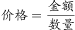
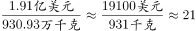
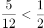

# 综合分析·逐项判断（单价换算＋全年合计估算＋连续环比下降＋万吨-万千克单位换算）

考点：[[20-考点/资料分析/综合/综合分析·逐项判断（单价换算＋全年合计估算＋连续环比下降＋万吨-万千克单位换算）|综合 / 综合分析·逐项判断（单价换算＋全年合计估算＋连续环比下降＋万吨/万千克单位换算）]]
材料：[[15-材料/资料分析/311726 2015年1-12月中国多晶硅逐月进|311726 2015年1-12月中国多晶硅逐月进]]

**问法模型**：题干'能够从上述资料中推出的是'→综合分析四选一，对四个选项逐项验证（单价=金额÷数量并换算量级、金额逐月加总、数量序列找连续3月环比下降、万吨换算万千克后计数），用排除法锁定正确项

## 推理链
1. 第1步：读图定角色——柱读数量（左轴万千克）、线读金额（右轴亿美元），1月量930.93、额1.91，12个月数据齐全
2. 第2步：验A项：1月单价=1.91×10^8美元÷930.93×10^4千克=1.91÷930.93×10^4≈20.5美元/千克，≠约200美元/千克，A错误
3. 第3步：验B项：12个月金额取整加总1.9+1.5+2.1+2.1+2.0+1.6+1.5+1.4+1.6+1.2+1.7+1.6≈20.2亿美元（精确20.26），未超过25亿美元，B错误
4. 第4步：验C项：数量序列逐月环比，5月1108.50→6月928.41→7月868.90→8月856.07，6、7、8月连续3个月环比下降，C正确
5. 第5步：验D项：1万吨=1000万千克，单月量>1000万千克的有3月1029.66、4月1089.71、5月1108.50、11月1002.79、12月1044.43共5个月，不足12个月的一半（6个月），D错误
6. 第6步：仅C可推出，故正确答案为C

**最快解法**：⚡ 综合判断优先找免计算观察项：C项直接看柱高走势找'连续变矮3根'（5→6→7→8月），锁定后A、B、D只做粗验排除——A抓量级'亿美元(10^8)÷万千克(10^4)=10^4美元/千克'得约20.5≠200；B金额取整加总约20.2<25；D按1万吨=1000万千克数柱子只有5根超过1000

## 易错点
- ⚠ A项量级陷阱：亿美元÷万千克隐含10^4换算，1.91÷930.93×10^4≈20.5美元/千克；不处理10的幂次会错算成0.002量级或误判与200接近
- ⚠ D项单位换算陷阱：1万千克=10吨（即1万吨=1000万千克），若误当1万吨=100万千克，会把930.93、928.41等月份也计入；且满足的仅5个月，'一半'应为6个月
- ⚠ C项'连续环比'须逐月成对比较：全年下降仅出现在2月（1个月）、6→7→8月（3个月）、10月（1个月），10月693.95虽是全年最低但只降1个月，勿把'单月最低'误当'连续下降'

## 母题抽象
> 🧩 当综合分析题出现'能够从上述资料中推出的是'且选项混合单价、合计、环比、单位换算四类判断时，先用免计算的走势/计数类选项（连续环比、超阈值计数）锁定答案，其余选项只做量级换算与取整粗验排除

**同类特征**：能够从上述资料中推出的是（综合分析四选一）、选项带复合单位'美元/千克'（考量级换算）、全年合计判断'超过25亿美元'（考逐月加总）、'连续3个月环比下降'（考序列逐对比较）、'高于1万吨'（考万吨与万千克换算）、双轴复合图：柱读量、线读额、标签对号

## 相关题
- [[10-真题/资料分析/综合/2571815 综合分析'能够推出'逐项验证（核心为增长量=现期×r-(1+r)的下界估算与比重判定）|2571815]]（山东 2020，相关度1）
- [[10-真题/资料分析/综合/2049872 综合分析题（四选项真伪判断：基期倍数计算+数据可判性排除）|2049872]]（湖南 2017，相关度1）
- [[10-真题/资料分析/综合/2376605 综合分析·逐项正误判断（正确项C为'图文数据逐年加总+比例比较'，干扰项涉及增长量还原、占比反推总数、两年排名比对）|2376605]]（黑龙江 2019，相关度1）

---

### 题干
能够从上述资料中推出的是：

### 选项
- A. 2015年1月多晶硅进口价格约为200美元/千克
- B. 2015年多晶硅进口金额超过25亿美元
- C. 2015年多晶硅进口量曾连续3个月环比下降　✅
- D. 2015年有一半的月份多晶硅进口量高于1万吨

### 官方解析

A项：定位统计图可知，2015年1月多晶硅进口金额为1.91亿美元，进口数量为930.93万千克。根据公式：，则2015年1月多晶硅进口价格为美元/千克，错误；

B项：定位统计图可知，2015年1-12月多晶硅进口金额。则2015年多晶硅进口金额为1.91+1.47+2.14+2.14+2.04+1.55+1.49+1.40+1.59+1.22+1.70+1.611.9+1.5+2.1+2.1+2.0+1.6+1.5+1.4+1.6+1.2+1.7+1.6=20.2亿美元，未超过25亿美元，错误；

C项：定位统计图可知，2015年1-12月多晶硅进口数量。则2015年1-12月多晶硅进口数量大小关系为930.93＞755.80＜1029.66＜1089.71＜1108.50＞928.41＞868.90＞856.07＜912.94＞693.95＜1002.79＜1044.43，观察发现，6月、7月、8月多晶硅进口数量连续环比下降，正确；

D项：定位统计图可知，2015年1-12月多晶硅进口数量。根据1吨=1000千克，若满足单月多晶硅进口量高于1万吨，则统计图中单月多晶硅进口数量＞1000万千克即可。查找可知3月（1029.66万千克）、4月（1089.71万千克）、5月（1108.50万千克）、11月（1002.79万千克）、12月（1044.43万千克）满足条件，共5个月，，错误。

故正确答案为C。

### 给定材料

