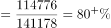
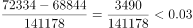

# 综合判断题（基期量逆推+比重计算+数据可得性检验）

考点：[[20-考点/资料分析/综合/综合判断题（基期量逆推+比重计算+数据可得性检验）|综合 / 综合判断题（基期量逆推+比重计算+数据可得性检验）]]
材料：[[15-材料/资料分析/312967 2020年第七次全国人口普查数据：全|312967 2020年第七次全国人口普查数据：全]]

**问法模型**：题干问'能够从上述资料推出的是'→ 逐项验证模型：每一选项定位数据源，基期类用现期/(1+r)逆推、比重类用部分÷总量比较阈值、无数据项直接判'无法推出'，锁定唯一正确项

## 推理链
1. 第1步：提取公共数据：2020年全国人口141178万人，比2010年增长5.38%；60岁及以上26402万人；男性72334万人、女性68844万人；城镇十年+23642万、乡村十年-16436万
2. 第2步：验A（基期模型）：2010年人口=141178÷(1+5.38%)≈133972万人≈13.4亿（或城乡增量法141178-(23642-16436)=133972万），13.4亿<13.5亿，A错误
3. 第3步：验B（数据可得性）：材料仅给2020年全国少数民族12547万人，未给西部地区少数民族人口数据，无法推出，B错误
4. 第4步：验C（比重模型）：60岁以下人口=141178-26402=114776万人，占比=114776÷141178≈81.3%>80%，C正确
5. 第5步：验D（占比差模型）：男性占比-女性占比=(72334-68844)÷141178=3490÷141178≈2.47个百分点<3个百分点，D错误
6. 第6步：对照选项，仅C能从材料推出，选C

**最快解法**：⚡ 反向验证+阈值比较：先验C一步判定——141178×20%≈28236万>26402万，即60岁及以上占比<20%，60岁以下必然>80%，C直接成立；排除法快验其余：A用13.5亿×1.0538≈14.23亿>14.12亿矛盾即排除（或141178÷1.0538≈13.4亿）；D用3490万<141178×3%≈4235万即排除；B无分地区民族数据直接排除

## 易错点
- ⚠ A项基期陷阱：把'增长5.38%'直接乘现期当增量（141178×5.38%≈7595万），漏除(1+r)即漏用141178×5.38%/105.38%模型，基期会算错
- ⚠ C项嵌套口径：'60岁以下（不含60岁）'=总量-60岁及以上26402万；65岁及以上19064万已包含在26402万之内，若再单独减一次属重复扣减
- ⚠ D项混淆'%'与'个百分点'：3490÷141178≈2.47%是占比之差（2.47个百分点），易直接拿3490万与'3'比较、或不除以总量就下结论
- ⚠ B项脑补陷阱：材料只有全国少数民族总量，无分地区民族数据，不能凭常识补充'西部少数民族多'来推算

## 母题抽象
> 🧩 当题干出现'能够从上述资料推出的是'时，用逐项验证法：基期类用现期/(1+r)反向检验阈值，比重类用'总量×阈值与部分量比较'回避除法，数据缺失项直接判'无法推出'，锁定唯一正确项

**同类特征**：能够从上述资料推出的是、综合判断四选一、基期量超过/不足某数值、80%以上人口占比判断、占比差超过3个百分点、分区域数据缺失判无法推出

## 相关题
- [[10-真题/资料分析/综合/2616172 综合分析题（基期可求性判断+环比降幅比较+现期倍数比较+现期比重计算混合验证）|2616172]]（青海 2020，相关度2）
- [[10-真题/资料分析/综合/5509996 综合判断题（排除法）+倍数计算（排名前三之和÷后三之和）|5509996]]（江西 2023，相关度2）
- [[10-真题/资料分析/综合/13319330 综合分析（可推出判断），涉及增长n倍求基期量、年均增速时间口径、'四成以上'方向词甄别、增长倍数比较|13319330]]（江苏 2025，相关度1）
- [[10-真题/资料分析/综合/2024180 综合分析判断（增长率比较＋基期比重计算＋无中生有排除）|2024180]]（重庆 2016，相关度1）
- [[10-真题/资料分析/综合/2051138 综合判断（顺差比较+基期回推+单价计算混合验证）|2051138]]（黑龙江 2017，相关度1）

---

### 题干
能够从上述资料推出的是：

### 选项
- A. 2010年，全国人口超过13.5亿人
- B. 2010年，我国西部地区各少数民族人口不超过5000万人
- C. 2020年，我国80%以上人口都在60岁以下（不含60岁）　✅
- D. 2020年，男性人口占比超过女性人口占比3个百分点以上

### 官方解析

A项：方法一：定位文字材料第一段可得：2020年全国人口共141178万人，比2010年增长了约5.38%。根据公式：基期量，可得2010年全国人口为万人=13.4亿人&lt;13.5亿人，错误；

方法二：定位文字材料第一段可得：2020年全国人口共141178万人；定位文字材料第二段可得：从城乡分布上看······与2010年相比，城镇人口增加23642万人，乡村人口减少16436万人。根据公式：基期量=现期量-增长量，可得2010年全国人口=141178-（23642-16436）=141178-7206=133972万人亿人&lt;13.5亿人，错误；

B项：文字材料第二段只给出了2020年全国各少数民族人口的数据，未给出西部地区各少数民族人口的相关数据，因此该项无法推出，错误；

C项：定位文字材料第一段可得：2020年全国人口共141178万人；定位文字材料第二段可得：2020年60岁及以上人口为26402万人。则2020年60岁以下（不含60岁）人口为141178-26402=114776万人，占全国人口的比重，正确；

D项：定位文字材料第一段可得：2020年全国人口共141178万人；定位文字材料第二段可得：2020年男性人口为72334万人，女性人口为68844万人。则2020年，男性人口占比比女性人口多，即男性人口占比超过女性人口占比不足3个百分点，错误。

故正确答案为C。

### 给定材料

        2020年全国人口共141178万人，比2010年增长了约5.38%。从地区分布上看，2020年东部地区人口占39.93%，中部地区占25.83%，西部地区占27.12%，东北地区占6.98%。与2010年相比，东部地区人口所占比重上升2.15个百分点，中部地区下降0.79个百分点，西部地区上升0.22个百分点，东北地区下降1.20个百分点。

        从性别构成上看，2020年男性人口为72334万人，女性人口为68844万人。从年龄构成上看，2020年0-14岁人口为25338万人，15-59岁人口为89438万人，60岁及以上人口为26402万人（其中，65岁及以上人口为19064万人）。从城乡分布上看，2020年居住在城镇的人口为90199万人，居住在乡村的人口为50979万人，与2010年相比，城镇人口增加23642万人，乡村人口减少16436万人。从民族构成上看，2020年汉族人口为128631万人，各少数民族人口为12547万人，与2010年相比，汉族人口增长4.93%，各少数民族人口增长10.26%，少数民族人口比重上升0.40个百分点。

