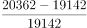
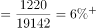
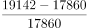
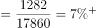
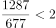
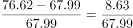
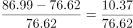
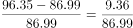
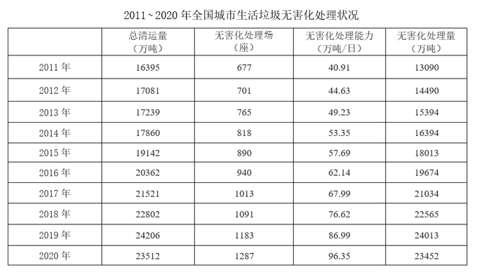

# 综合判断题——同比增速计算与比较（辅以倍数判断与增长量比较）

考点：[[20-考点/资料分析/综合/综合判断题——同比增速计算与比较（辅以倍数判断与增长量比较）|综合 / 综合判断题——同比增速计算与比较（辅以倍数判断与增长量比较）]]
材料：[[15-材料/资料分析/323355 2011~2020年全国城市生活垃圾|323355 2011~2020年全国城市生活垃圾]]

**问法模型**：题干为'能够从上述资料中推出的是'的四选项综合判断→逐项将说法化为增长率、倍数或增长量的计算模型并与门槛值比较

## 推理链
1. 第1步：从表中提取数据：总清运量2015=19142、2016=20362；处理场2011=677、2020=1287；处理能力2017=67.99、2018=76.62、2019=86.99、2020=96.35（万吨/日）；清运量2016=20362、2017=21521，处理量2016=19674、2017=21034
2. 第2步：公式：增长率=(现期−基期)/基期；'翻一番'即现期=基期×2；增长量=现期−基期
3. 第3步：A项验证：2016年清运量增速=1220/19142≈6.4%，2015年增速=1282/17860≈7.2%，6.4%<7.2%，2016年增速低于上年，A错误
4. 第4步：B项验证：677×2=1354座，而2020年为1287座（1287/677≈1.9倍），未翻一番，B错误
5. 第5步：C项验证（增速>10%等价于增量>基期×10%）：2018年增量8.63>67.99×10%=6.8，2019年增量10.37>76.62×10%=7.66，2020年增量9.36>86.99×10%=8.7，三年增速分别约12.7%、13.5%、10.8%，均超10%，C正确
6. 第6步：D项验证：2017年清运量增量21521−20362=1159万吨，处理量增量21034−19674=1360万吨，均<1500万吨，D错误
7. 第7步：四个选项中仅C成立，与官方答案一致

**最快解法**：⚡ 考场最快解法：C项'增量与基期10%比较法'（十分之一法）：8.63>6.8、10.37>7.66、9.36>8.7三式心算即过，锁定C；再快速排除法兜底——B项677×2=1354>1287一眼排除，D项1159、1360均小于1500一眼排除，A项分子1220<1282且分母19142>17860，增速必更低

## 易错点
- ⚠ C项2020年增速9.36/86.99≈10.8%仅略超10%，粗算不精或直接用96.35−86.99≈9.4与基期比错位，易误判'未超过'而漏掉正确答案
- ⚠ B项'翻一番'需严格等于基期×2=1354座，1287/677≈1.9倍不是翻番，把'接近两倍'当'翻番'是高频错误
- ⚠ D项看串列：'总清运量'与'无害化处理量'两列数值咬得近（20362对19674、21521对21034），需分别作差1159与1360，只验一列或读串列都会误判
- ⚠ A项'快于上年水平'必须先算2015年增速再对比，只算2016年当年增速无法判断，且两年分子分母位置不能放反

## 母题抽象
> 🧩 当题干出现'能够从上述资料中推出的是'且选项混排增速、倍数、增量时，先攻可心算的硬门槛项（翻番比基期×2、增量比固定门槛、增速用增量>基期×10%判定），逐项排除锁定唯一正确项

**同类特征**：能够从上述资料中推出的是、同比增速快于上年水平、翻了一番、同比增速都超过10%、超过1500万吨以上、四选项混合增长率/倍数/增长量验证

## 相关题
- [[10-真题/资料分析/综合/5102733 综合分析判断题（混合验证：两期增速比较+翻番倍数判定+逐年增速超阈值验证+两期作差比较）|5102733]]（湖南 2022，相关度3）
- [[10-真题/资料分析/综合/2274545 综合分析判断题（平均数计算+增长量计算+翻番倍数+同比增长率多考点混合验证）|2274545]]（北京 2019，相关度2）
- [[10-真题/资料分析/综合/2307743 综合判断题——年均量计算为主（区间加总÷年数），辅以两年加总换算、无基期倍数排除、同比下降年份占比计数|2307743]]（辽宁 2018，相关度2）
- [[10-真题/资料分析/综合/2448424 综合判断题（五年加总求和、两期增速比较、等增量外推年份，逐项验证）|2448424]]（国考 2020，相关度2）
- [[10-真题/资料分析/综合/2448546 综合判断题（翻番验证+单产最低比较+同比增速连续下降+比重与'两成'比较）|2448546]]（国考 2020，相关度2）

---

### 题干
关于全国城市生活垃圾清运和无害化处理状况，能够从上述资料中推出的是：

### 选项
- A. 2016年，总清运量同比增速快于上年水平
- B. 2020年，无害化处理场数量比2011年翻了一番
- C. 2018~2020年，每年的无害化处理能力同比增速都超过10%　✅
- D. 2017年总清运量与无害化处理量均超过2016年1500万吨以上

### 官方解析

A项：定位统计表可知2014~2016年全国城市生活垃圾总清运量的数据，根据公式：增长率，可得2016年总清运量同比增速为，2015年总清运量同比增速为，故2016年，总清运量同比增速低于上年水平，错误；

B项：定位统计表可得：2011年、2020年全国城市生活垃圾无害化处理场数量分别为677座、1287座。由于，故2020年，无害化处理场数量并未比2011年翻一番，错误；

C项：定位统计表可知2017~2020年全国城市生活垃圾无害化处理能力的数据，根据公式：增长率，可得2018年无害化处理能力同比增速为，2019年无害化处理能力同比增速为，2020年无害化处理能力同比增速为，故2018~2020年，每年的无害化处理能力同比增速都超过10%，正确；

D项：定位统计表可知2016年、2017年全国城市生活垃圾总清运量与无害化处理量的数据，根据公式：增长量=现期量-基期量，可得2017年总清运量超过2016年：万吨&lt;1500万吨，2017年无害化处理量超过2016年：万吨&lt;1500万吨，故2017年总清运量与无害化处理量均未超过2016年1500万吨以上，错误。

故正确答案为C。

### 给定材料

