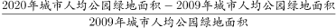

# 综合推断（倍数关系+年均增长量+增长率+人均总量换算四项逐项验证）

考点：[[20-考点/资料分析/综合/综合推断（倍数关系+年均增长量+增长率+人均总量换算四项逐项验证）|综合 / 综合推断（倍数关系+年均增长量+增长率+人均总量换算四项逐项验证）]]
材料：[[15-材料/资料分析/323357 2009~2020年全国城市绿化状况|323357 2009~2020年全国城市绿化状况]]

**问法模型**：题干为'能够从上述资料中推出的是'的综合判断问法 → 对A/B/C/D四个选项分别套用对应公式逐一验证（倍数=部分/(整体-部分)、年均增长量=(末值-首值)/间隔年数、人口不变时总量增长率=人均增长率、总量=人口×人均并做面积单位换算），排除三项错误项锁定正确项

## 推理链
1. 第1步：从图中提取四个选项所需数据——2014年建成区绿化覆盖率40.22%；2009年与2020年建成区绿地率34.17%、38.24%；2009年与2020年人均公园绿地面积10.66、14.78平方米
2. 第2步：A项规则：覆盖面积/未覆盖面积=覆盖率/(1-覆盖率)；B项规则：年均增长量=(38.24-34.17)/(2020-2009)=4.07/11；C项规则：总人口不变时公园绿地面积增长率=人均公园绿地面积增长率=(14.78-10.66)/10.66
3. 第3步：A项代入：40.22/59.78≈0.67<1.5（覆盖率不足50%，覆盖面积本就小于未覆盖面积），A错误
4. 第4步：B项代入：4.07/11≈0.37个百分点<0.4个百分点，年均上升不到0.4个百分点，B错误
5. 第5步：C项代入：4.12/10.66≈38.7%<50%，C错误
6. 第6步：D项代入：800万人×14.78平方米/人=11824万平方米=118.24平方千米>100平方千米，D正确
7. 第7步：综上，只有D项能够从资料中推出，选D

**最快解法**：⚡ 截位直除+单位换算秒杀：A项看覆盖率40.22%<50%，覆盖面积必小于未覆盖面积，倍数必小于1，直接排除不计算；B项4.07/11直除首位得3，即0.37<0.4排除；C项4.12/10.66直除首位得3，即约38%<50%排除；D项800×14.78=11824万平方米，万平方米→平方千米除以100得118.24>100，选D

## 易错点
- ⚠ A项口径陷阱：倍数是'覆盖面积/未覆盖面积'而非'覆盖/总建成区面积'，须用40.22/(1-40.22)≈0.67，误用40.22%与1.5直接比较或除以60以外口径即出错
- ⚠ B项两个陷阱：年均增长量分母是年份间隔11（2020-2009）而非数据个数12；且指标为比率，差值单位是'百分点'不是'%'，4.07÷11≈0.37个百分点的表述需与选项'0.4个百分点'同口径比较
- ⚠ D项单位换算陷阱：1平方千米=100万平方米，11824万平方米须÷100换算为118.24平方千米；同时人口800万=800×10⁴人，人均14.78平方米，两处'万'级不能丢失或重复，否则得1.18或11824均会误判

## 母题抽象
> 🧩 当题干出现'能够从资料中推出的是'且选项混合倍数、年均量、增长率、总量换算时，逐项套公式排除：覆盖率与未覆盖之比用'部分/(1-部分)'且覆盖率<50%时倍数必小于1可秒杀；年均增长量=(末-首)/年份间隔；人口不变时总量增长率等于人均增长率；人均类总量=人口×人均，并牢记万平方米÷100=平方千米

**同类特征**：能够从上述资料中推出的是、覆盖区域面积是未覆盖区域面积的倍数、以某年为基期年均上升X个百分点、城市总人口保持不变时总量增长率、按全国城市平均数计算某人口规模城市的总量、公园绿地面积平方千米与万平方米换算

## 相关题
- [[10-真题/资料分析/综合/19283943 综合分析判断题（倍数比较+求和判断+隐含平均每场座位数反推）|19283943]]（国考 2025，相关度1）
- [[10-真题/资料分析/综合/1796162 综合判断（月均计算、平均运输距离、比重对比、增长量比较逐项验证）|1796162]]（贵州 2016，相关度1）
- [[10-真题/资料分析/综合/2133504 综合判断题（现期比重+现期平均数多项验证，一对三错）|2133504]]（国考 2018，相关度1）
- [[10-真题/资料分析/综合/2444706 综合判断题（增长量+比重+倍数逐项验证）|2444706]]（四川 2019，相关度1）
- [[10-真题/资料分析/综合/2571728 综合分析逐项判断（等差递推求和＋单位换算＋比值估算）|2571728]]（山东 2020，相关度1）

---

### 题干
关于全国城市绿化状况，能够从上述资料中推出的是:

### 选项
- A. 2014年，城市建成区绿化覆盖区域面积是未覆盖区域面积的1.5倍以上
- B. 以2009年为基期计算，2009～2020年城市建成区绿地率年均上升0.4个百分点以上
- C. 如城市总人口保持不变，则2020年城市公园绿地面积比2009年增长了50%以上
- D. 如按全国城市平均数计算，2020年一个800万人口的城市拥有公园绿地超过100平方千米　✅

### 官方解析

A项：定位统计图可知：2014年全国城市建成区绿化覆盖率为40.22%。则2014年全国城市建成区绿化未覆盖率为1-40.22%=59.78%，所求为，错误；

B项：定位统计图可知：2009年和2020年全国城市建成区绿地率分别为34.17%和38.24%。根据公式：年均增长量，所求为，即年均上升了不到0.4个百分点，错误；

C项：定位统计图可知：2009年和2020年全国城市人均公园绿地面积分别为10.66平方米和14.78平方米。根据公式：城市公园绿地面积=城市人口×城市人均公园绿地面积，由于城市总人口保持不变，则所求增长率为，错误；

D项：定位统计图可知：2020年全国城市人均公园绿地面积为14.78平方米。根据公式：城市公园绿地面积=城市人口×城市人均公园绿地面积，则所求为800×14.78=11824万平方米=118.24平方千米&gt;100平方千米，正确。

故正确答案为D。

### 给定材料

