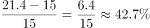

# 综合判断题——逐项验证（核心为跨图现期比重计算：TOP5之和÷全国总量，辅以增速比较、数据计数与可得性判断）

考点：[[20-考点/资料分析/综合/综合判断题——逐项验证（核心为跨图现期比重计算：TOP5之和÷全国总量，辅以增速比较、数据计数与可得性判断）|综合 / 综合判断题——逐项验证（核心为跨图现期比重计算：TOP5之和÷全国总量，辅以增速比较、数据计数与可得性判断）]]
材料：[[15-材料/资料分析/323376 2015—2021年我国新能源汽车销|323376 2015—2021年我国新能源汽车销]]

**问法模型**：'下列选项能够从上述资料中推出的是'→逐项排除模型：A查数据可得性、B按'超5万台'计数、C逐年算增速找最小、D用'部分（图2前5名）÷整体（图1全国总量）'算现期比重

## 推理链
1. 第1步：A项问2022年公共充电桩数量，图1数据止于2021年114.7万台，文字材料亦无2022年及预测信息，无法推出，排除A
2. 第2步：B项'超过5万台'即超过50000台，图2中广东181846、上海103249、江苏97265、北京96840、浙江82041、山东60251、湖北58627、安徽58307共8个达标（河南43556、福建39853不足），并非7个，排除B
3. 第3步：C项逐年算增速：2016年(15−5.7)/5.7≈163.2%、2017年(21.4−15)/15≈42.7%、2018年(30−21.4)/21.4≈40.2%、2019年(51.6−30)/30=72%、2020年(80.7−51.6)/51.6≈56.4%、2021年(114.7−80.7)/80.7≈42.1%，最小是2018年而非2017年，排除C
4. 第4步：D项分子——图2前5名加和：181846+103249+97265+96840+82041≈561241台≈56.1万台
5. 第5步：D项分母——全国总量必须回图1取2021年114.7万台（=1147000台），与分子统一单位（差10⁴倍）
6. 第6步：比重=56.1万÷114.7万≈0.489，即约48.9%，与选项一致，D可推出，故选D

**最快解法**：⚡ 截位直除+同单位相除：前5名按万台截两位加和18.2+10.3+9.7+9.7+8.2≈56.1（万台），分母直接取图1的114.7万台，56.1/114.7≈56/115≈0.487→约48.9%；配合排除法提速——A项无2022年数据直接砍、B项数超5万台的为8个、C项只比2017(42.7%)与2018(40.2%)即可知2017非最小

## 易错点
- ⚠ 跨图单位陷阱：图2单位'台'、图1单位'万台'，分母须用114.7万台=1147000台，不换算则比重错1万倍；最优做法是分子也化成万台再同单位相除
- ⚠ 图2仅为'部分省级行政区域TOP10'，十省之和不是全国总数，分母必须回图1取114.7万台，误用TOP10之和作分母会严重偏高
- ⚠ C项须逐年计算增速：2017年42.7%略高于2018年40.2%，最小是2018年；若目测柱高差或漏算2021年42.1%易误选'2017年最小'的说法；B项计数时注意湖北58627、安徽58307均超过5万台，共8个而非7个

## 母题抽象
> 🧩 当综合判断题出现'前N名之和占全国总数的比重'时，分子取排名列表截位加和，分母必须回到全国总量的原始数据源（柱状图总量），先统一单位（万台vs台差10⁴倍）再截位直除，对照选项百分比即可锁定正项；其余选项分别用'无数据不可推''达标计数''逐项增速比较'快速排除

**同类特征**：能够从上述资料中推出的是（综合判断）、前5名之和占全国总数的比重约为、跨图取数：图2台与图1万台拼接、同比增速最小的年份、超过5万台的省级行政区域个数、2022年（材料时间范围之外）

## 相关题
- [[10-真题/资料分析/综合/2030136 综合分析判断题（倍数判定＋比重结构商＋百分点还原＋年均增量比较）|2030136]]（四川 2016，相关度1）
- [[10-真题/资料分析/综合/16592992 综合判断题（基期比值+平均价格比较+链式现期+整体推算多模型混合验证）|16592992]]（河北 2024，相关度1）
- [[10-真题/资料分析/综合/17764866 综合判断题（产销差值的基期比较为正确项，环比增速走势-销量比值走势-两年基期总量为干扰项）|17764866]]（湖北 2024，相关度1）
- [[10-真题/资料分析/综合/19526375 综合分析判断（累计值做差求当期+基期倒推+比重计算与比重差比较）|19526375]]（国考 2026，相关度1）
- [[10-真题/资料分析/综合/2030148 综合判断题·环比升降月份计数为主验证（兼客座率定义转化、天数加权平均、日利用率×天数换算）|2030148]]（四川 2016，相关度1）

---

### 题干
下列选项能够从上述资料中推出的是：

### 选项
- A. 2022年我国公共充电桩数量超过180万台
- B. 2021年我国公共充电桩数量超过5万台的省级行政区域有7个
- C. 2016—2021年我国公共充电桩数量同比增速最小的年份是2017年
- D. 2021年我国省级行政区域公共充电桩数量前5名之和占全国总数的比重约为48.9%　✅

### 官方解析

A项：材料中没有给出2022年我国公共充电桩数量的相关数据，因此无法计算，不能推出，错误；

B项：定位图2可得，2021年我国公共充电桩数量超过5万台的省级行政区域有8个，分别是广东省、上海市、江苏省、北京市、浙江省、山东省、湖北省、安徽省，并非7个，错误；

C项：定位图1可得，2017年我国公共充电桩数量同比增速为，2018年我国公共充电桩数量同比增速为，2017年我国公共充电桩数量同比增速高于2018年，并非最小，错误；

D项：定位图1、2可得，2021年我国公共充电桩数量为114.7万台，2021年我国省级行政区域公共充电桩数量前5名之和为181846+103249+97265+96840+82041182000+103000+97000+97000+82000=561000=56.1万台，占全国总数的比重为，正确。

故正确答案为D。

### 给定材料

        近年来，我国新能源汽车销量及保有量快速提升，充电基础设施布局也日渐完善。2021年新能源汽车销量达352.1万辆，同比增长157.51%；截至2021年，我国新能源汽车保有量达784万辆，同比增长59.25%。

> [!warning] 疑点（官方解析可能有误，待人工复核）
> 官方解析D项算式存在排版粘连（精确和561241与截位和561000两段混写为'82041182000+…'），但56.1万/114.7万≈48.9%的结论与正确答案D一致，不影响判定
