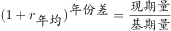
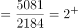
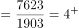
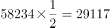

# 综合推断（年均增速比较+进出口总额加总换算+倍数比较+最值定位，逐项排除）

考点：[[20-考点/资料分析/综合/综合推断（年均增速比较+进出口总额加总换算+倍数比较+最值定位，逐项排除）|综合 / 综合推断（年均增速比较+进出口总额加总换算+倍数比较+最值定位，逐项排除）]]
材料：[[15-材料/资料分析/323388 2014-2020年中国钓鱼钩、钓鱼|323388 2014-2020年中国钓鱼钩、钓鱼]]

**问法模型**：'能从上述资料中推出的是'→四个选项各为独立命题，逐项转化为对应模型验证（年均增速比倍数、总额加总换亿美元、半数比较、最低年份定位），排除三项得正确项

## 推理链
1. 第1步：D项秒验——钓鱼钩进口最低为2017年748万美元，钓鱼竿进口最低为2017年2184万美元，两类最低年份相同，D说'不同'，错误
2. 第2步：A项验算——钓鱼竿进口2017年2184→2020年5081万美元，末首倍数5081/2184≈2.33；钓线轮1903→7623万美元，倍数7623/1903≈4.01
3. 第3步：年份差同为3年，年均增速比较只需比末年/基期倍数（(1+r)³=末年/基期），倍数大者年均增速大，故钓线轮快于钓鱼竿，A'钓鱼竿快于钓线轮'错误
4. 第4步：C项验算——2019年钓线轮出口27426万美元，钓鱼竿出口58234万美元的一半=29117万美元，27426<29117，该年不满足'超过一半'，C错误
5. 第5步：B项验算——钓鱼钩进出口总额=出口+进口，1亿美元=10000万美元：2014年10667+1058=11725、2015年9455+1156=10611、2016年9525+938=10463、2017年9280+748=10028、2018年10110+903=11013、2019年10279+993=11272、2020年9935+1070=11005万美元
6. 第6步：7年总额全部>10000万美元=1亿美元（最紧的2017年为10028万美元），B'每年都超过1亿美元'正确，故选B

**最快解法**：⚡ 排除法+口算加总：先扫D（两类最低值同为2017年，直接排除），A只比末年/首年倍数（2.33 vs 4.01，排除），C找单点反例（2019年27426<29117，排除），最后精确加总验B——唯一需细算的是2017年9280+748=10028>10000这一临界值，其余年份明显破亿可估判

## 易错点
- ⚠ 单位换算：1亿美元=10000万美元，2017年钓鱼钩总额10028万美元仅略高于1亿美元，粗估或漏加进口额（748）会误判B错误
- ⚠ A项年均增速比较：年份差相同（2017与2020差3年）时只需比较末年/基期倍数，无需算出具体增速；且要比的是倍数（比值）而非增量，不能混用口径
- ⚠ D项易只看钓鱼钩或只看钓鱼竿单类的最低值，忽略题干要求比较'两类最低年份是否不同'；C项'超过一半'需用钓鱼竿出口÷2再与钓线轮出口比较，2019年为反例陷阱年

## 母题抽象
> 🧩 当题干出现'能从资料中推出的是'的综合判断特征时，用排除法逐项验证：先扫最值/临界年份（D项、2017年），年均增速比较化归为末年÷基期倍数（A项），全称判断（'每年都''都超过'）找单点反例即可否定（C项2019年），最后对剩余项做精确加总并完成亿美元/万美元换算（B项）

**同类特征**：能从上述资料中推出的是、年均同比增速快慢比较、进出口总额超过1亿美元（万美元换算）、出口额超过一半、进口额最低的年份、逐年判定+四选项排除

## 相关题
- [[10-真题/资料分析/综合/2030170 综合推断（占比×样本量 + 平均数计算与两期倍数比较）|2030170]]（四川 2016，相关度1）
- [[10-真题/资料分析/综合/2015342 综合判断题+贷款总额间接换算（不良贷款余额÷不良贷款率）|2015342]]（重庆 2016，相关度1）

---

### 题干
关于中国部分钓具进出口贸易状况，能从上述资料中推出的是：

### 选项
- A. 2017-2020年，进口额年均同比增速钓鱼竿快于钓线轮
- B. 2014-2020年，每年钓鱼钩进出口总额都超过1亿美元　✅
- C. 2017-2020年，每年出口额钓线轮都超过钓鱼竿的一半
- D. 2014-2020年，钓鱼钩和钓鱼竿进口额最低的年份不同

### 官方解析

A项：定位统计表，可知2017年钓鱼竿、钓线轮的进口额分别为2184万美元、1903万美元；2020年中国钓鱼竿、钓线轮的进口额分别为5081万美元、7623万美元。根据年均增长率公式：，当年份差相同时，越大，年均同比增速越大。则钓鱼竿：；钓线轮：，故2017-2020年进口额年均同比增速钓鱼竿慢于钓线轮，错误；

B项：定位统计表，可知2014-2020年每年钓鱼钩进口额与出口额数据。故2014-2020年钓鱼钩进出口总额分别为：2014年，10667万美元+1058万美元＞1.1亿美元；2015年，9455万美元+1156万美元＞1.0亿美元；2016年：9525万美元+938万美元＞1.0亿美元；2017年：9280万美元+748万美元＞1.0亿美元；2018年：10110万美元+903万美元＞1.1亿美元；2019年：10279万美元+993万美元＞1.1亿美元；2020年：9935万美元+1070万美元＞1.1亿美元，正确；

C项：定位统计表，可知2017-2020年每年钓线轮、钓鱼竿的出口额。2019年钓线轮出口额（27426万美元）＜钓鱼竿出口额的一半（万美元），错误；

D项：定位统计表，可知2014-2020年钓鱼钩进口额最低的年份为2017年（748万美元），钓鱼竿进口额最低的年份也为2017年（2184万美元），错误。

故正确答案为B。

### 给定材料

> [!warning] 疑点（官方解析可能有误，待人工复核）
> 官方解析中A项的年均增长率公式显示为空白（'根据年均增长率公式：，当年份差相同时…'），属排版缺失，应为(1+r)^n=末年/基期，不影响其'钓鱼竿慢于钓线轮'的结论；解析对2015-2017年以'>1.0亿'表述（实为10611、10463、10028万美元），其中2017年10028万美元为最贴近1亿美元的临界值，需精确加总确认，官方B项结论无误
