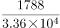
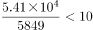

# 综合判断题（比重计算＋倍数计算＋基期增量还原＋增速百分点比较，逐项验证）

考点：[[20-考点/资料分析/综合/综合判断题（比重计算＋倍数计算＋基期增量还原＋增速百分点比较，逐项验证）|综合 / 综合判断题（比重计算＋倍数计算＋基期增量还原＋增速百分点比较，逐项验证）]]
材料：[[15-材料/资料分析/323435 2022年1月我国金融统计数据：人民|323435 2022年1月我国金融统计数据：人民]]

**问法模型**：'能够从上述资料中推出的是'→四选项分别套用比重、倍数、基期量还原、百分点逆推四个基础模型，逐一判断正误，排除三个错误项锁定正确项

## 推理链
1. 第1步：A项——材料给出2022年1月票据融资增加1788亿元、企（事）业单位贷款增加3.36万亿元，统一单位后为33600亿元
2. 第2步：A验证——比重=1788÷33600≈5.3%＞5%，故'不足5%'错误，排除A
3. 第3步：B项——材料给出住户存款增加5.41万亿元=54100亿元、财政性存款增加5849亿元
4. 第4步：B验证——倍数=54100÷5849≈9.25倍＜10倍，故'10倍以上'错误，排除B
5. 第5步：C项——2022年1月外币贷款增加181亿美元且同比少增269亿美元，'少增'说明基期更大，2021年1月增量=181+269=450亿美元<500亿美元，故'超过500亿美元'错误，排除C
6. 第6步：D项——2022年1月末人民币存款同比增速9.2%，'比上月末低0.1个百分点'逆推2021年12月末=9.2%+0.1%=9.3%；'比上年同期低1.2个百分点'逆推2021年1月末=9.2%+1.2%=10.4%
7. 第7步：D验证——9.3%−10.4%=−1.1个百分点，即2021年12月末增速比2021年1月末低1.1个百分点，表述正确，选D

**最快解法**：⚡ 综合判断＋截位直除/放缩排除：A项1788/33600首位商5且余数大≈5.3%＞5%秒排；B项54100÷5849，因5849×10=58490＞54100，不足10倍秒排；C项181+269=450<500秒排；D项用'低0.1/低1.2个百分点'逆推加法得9.3%与10.4%，差1.1个百分点，正确

## 易错点
- ⚠ 万亿元与亿元混排：A项3.36万亿元需换算为33600亿元、B项5.41万亿元=54100亿元再与5849亿元相除，不统一单位必错
- ⚠ '同比少增'是还原基期增量的差额：2021年1月外币贷款增量=181+269=450亿美元（'少增'做加法），方向弄反得负数；且C项问的是'增加额'（当月增量）而非'余额9308亿美元'，口径勿混
- ⚠ '增速分别比上月末和上年同期低0.1个和1.2个百分点'两数对应易错位；'比上月末低0.1个百分点'意味着上月末增速更高，逆推要用加法9.2%+0.1%=9.3%，易误做减法；且单位是百分点不是百分数

## 母题抽象
> 🧩 当题干出现'能够从上述资料中推出的是'且四个选项各占一个基础模型时，按'比重/倍数先统一单位再截位直除、基期增量用多增减/少增加还原、增速比较用百分点逆推加减'逐项快验，能放缩比较的直接放缩排除

**同类特征**：能够从上述资料中推出的是、综合判断四选一、万亿元与亿元混排需统一单位、同比多增/少增还原基期增量、增速比上月末和上年同期分别低0.1个和1.2个百分点、百分点与百分数区分

## 相关题
- [[10-真题/资料分析/综合/4628161 综合判断题（基期量+比重+结构差额+平均数四模型逐项验证）|4628161]]（新疆 2021，相关度2）
- [[10-真题/资料分析/综合/2448411 综合判断题（两期平均数比较+区间累计求和+同比增量比较+增长量验算）|2448411]]（国考 2020，相关度2）
- [[10-真题/资料分析/综合/2448579 综合判断题（现期比重直验+增长量验证）|2448579]]（国考 2020，相关度2）
- [[10-真题/资料分析/综合/2097116 综合判断题（基期量估算+数据缺口排除）|2097116]]（四川 2017，相关度2）
- [[10-真题/资料分析/综合/2097178 综合判断题（现期比重+比重比较+多期求和+趋势判断混合验证）|2097178]]（重庆 2017，相关度2）

---

### 题干
能够从上述资料中推出的是：

### 选项
- A. 2022年1月末，我国票据融资增加额占企（事）业贷款增加额的比重不足5%
- B. 2022年1月，我国住户存款增加额是财政性存款增加额的10倍以上
- C. 2021年1月末，我国外币贷款增加超过500亿美元
- D. 2021年12月末，我国人民币存款余额的同比增速比2021年1月末我国人民币存款余额的同比增速低1.1个百分点　✅

### 官方解析

A项：定位文字资料可得：2022年1月末，我国企（事）业单位贷款增加3.36万亿元，票据融资增加1788亿元。根据公式：比重，则所求为，错误；

B项：定位文字资料可得：2022年1月末，我国住户存款增加5.41万亿元，财政性存款增加5849亿元。则所求倍数为倍，错误；

C项：定位文字资料可得：2022年1月份，我国外币贷款增加181亿美元，同比少增269亿美元。则2021年1月份，我国外币贷款增加181+269&lt;200+300=500亿美元，错误；

D项：定位文字资料可得：2022年1月末，我国人民币存款余额236.07万亿元，同比增长9.2%，增速分别比上月末和上年同期低0.1个和1.2个百分点。则所求为（9.2%+0.1%）-（9.2%+1.2%）=-1.1%，即低1.1个百分点，正确。

故正确答案为D。

### 给定材料

        2022年1月末，我国人民币贷款余额196.65万亿元，同比增长11.5%，增速分别比上月末和上年同期低0.1个和1.2个百分点。1月份我国人民币贷款增加3.98万亿元，同比多增3944亿元。分部门看，住户贷款增加8430亿元；企（事）业单位贷款增加3.36万亿元，其中，短期贷款增加1.01万亿元，中长期贷款增加2.1万亿元，票据融资增加1788亿元。2022年1月末，我国外币贷款余额9308亿美元，同比增长2%。1月份外币贷款增加181亿美元，同比少增269亿美元。

        2022年1月末，我国人民币存款余额236.07万亿元，同比增长9.2%，增速分别比上月末和上年同期低0.1个和1.2个百分点，1月份人民币存款增加3.83万亿元，同比多增2627亿元，其中，住户存款增加5.41万亿元，非金融企业存款减少1.4万亿元，财政性存款增加5849亿元。1月末，外币存款余额1.02万亿美元，同比增长9%。1月份外币存款增加272亿美元，同比少增228亿美元。

        2022年1月份，我国银行间人民币市场以拆借、现券和回购方式合计日均成交6.31万亿元，日均成交同比增长18%。其中，同业拆借日均成交同比增长9.3%，现券日均成交同比增长22.9%，质押式回购日均成交同比增长18.2%。

> [!warning] 疑点（官方解析可能有误，待人工复核）
> 官方解析D项写'（9.2%+0.1%）-（9.2%+1.2%）=-1.1%，即低1.1个百分点'，结果单位应为'百分点'而非'%'，属解析表述笔误，计算逻辑与结论无误；C项问法'2021年1月末……增加超过500亿美元'中'增加'实指1月当月增量，与官方按增量450亿美元判断的口径一致。

<!-- CODEX-ANSWER-REVIEW:BEGIN -->
### 本次独立复核

**复核状态：** `confirmed`（独立复算确认答案）

**计分答案：** D（可计分）

**复核解析：**

2022年1月存款余额同比增速9.2%，较2021年1月低1.2个百分点，故2021年1月为10.4%；又比2021年12月低0.1个百分点，倒推2021年12月为9.3%，差−1.1个百分点，D成立。A票据占比约5.32%，B住户/财政性存款增额不足10倍，C外币贷款增加181亿美元。

**相关信息：**

独立复核：按题干定义逐项检验，关键基数、比值、增速与图表读数写明以便复算。

**题源依据：** [固定版本原题](https://github.com/Mentat-Uran/kaogongzhentizhengliu/blob/84ab93d4b64b61d897bece8a1c0a5bab06b4feb2/10-%E7%9C%9F%E9%A2%98/%E8%B5%84%E6%96%99%E5%88%86%E6%9E%90/%E7%BB%BC%E5%90%88/5104875%20%E7%BB%BC%E5%90%88%E5%88%A4%E6%96%AD%E9%A2%98%EF%BC%88%E6%AF%94%E9%87%8D%E8%AE%A1%E7%AE%97%EF%BC%8B%E5%80%8D%E6%95%B0%E8%AE%A1%E7%AE%97%EF%BC%8B%E5%9F%BA%E6%9C%9F%E5%A2%9E%E9%87%8F%E8%BF%98%E5%8E%9F%EF%BC%8B%E5%A2%9E%E9%80%9F%E7%99%BE%E5%88%86%E7%82%B9%E6%AF%94%E8%BE%83%EF%BC%8C%E9%80%90%E9%A1%B9%E9%AA%8C%E8%AF%81%EF%BC%89.md)；固定内容 commit `84ab93d4b64b61d897bece8a1c0a5bab06b4feb2`，Markdown blob `5b713151fcc0f86c068da16dccfb0ae63b62b6b1`。
<!-- CODEX-ANSWER-REVIEW:END -->
