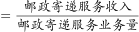
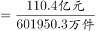
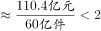

# 综合分析-逐项判断正误（基期量计算、月均比较、平均数、比重临界值）

考点：[[20-考点/资料分析/综合/综合分析-逐项判断正误（基期量计算、月均比较、平均数、比重临界值）|综合 / 综合分析-逐项判断正误（基期量计算、月均比较、平均数、比重临界值）]]
材料：[[15-材料/资料分析/335236 2019年一季度（及其中3月当月）我|335236 2019年一季度（及其中3月当月）我]]

**问法模型**：题干为'能够从上述资料中推出的是'的四选一综合分析 → 对A/B/C/D逐项换算验证（基期量=现期/(1+增速)、月均=（一季度−3月）÷2、平均数=收入÷业务量、比重=子项和÷总量），排除三项错误项

## 推理链
1. 第1步：A项从表中提取2019年3月快递业务收入596.0亿元、同比增速23.0%，需倒推2018年3月基期量
2. 第2步：基期量=现期/(1+增速)，596.0/(1+23.0%)=596.0/1.23≈484.6亿元<500亿元，A错误
3. 第3步：B项从表中提取2019年一季度快递业务量1214633.0万件、3月486392.8万件，先做跨行减法得1~2月合计：1214633.0−486392.8=728240.2万件
4. 第4步：1~2月月均=728240.2÷2=364120.1万件<486392.8万件，即3月高于1~2月平均水平，B正确
5. 第5步：C项寄递服务收入110.4亿元=1104000万元，÷601950.3万件≈1.83元/件<2元，C错误（注意亿元与万件量级差4个零）
6. 第6步：D项函件62454.9+包裹588.1+汇兑498.9=63541.9，÷601950.3≈10.6%<20%（或用临界值601950.3×20%≈120390对照），D错误
7. 第7步：A、C、D均错误，对照选项得出正确答案为B

**最快解法**：⚡ 综合分析按序验证+估算排除：A项用口算估算596/1.23≈485（因1.23×485≈590）<500秒杀；B项截位直除：(1214633−486393)/2≈364120<486393，减法与除以2两步直除即判正确；C项把110.4亿化为1104000万元后直除≈1.83<2；D项用临界值法：20%×601950.3≈120390，而三子项之和63541.9远小于此，直接排除

## 易错点
- ⚠ A项基期换算陷阱：应除以(1+23.0%)而非乘以(1−23.0%)，也不能误用3月当月增速与一季度增速混淆（23.0% vs 21.4%）
- ⚠ B项两步都不能漏：先'一季度−3月'得1~2月合计，再除以2得月均；若误用一季度÷3=404877.7与3月比较，口径虽错但碰巧结论同向，正解必须按1~2月月均计算
- ⚠ C项单位与同名指标陷阱：'邮政寄递服务'收入(110.4亿元)与业务量(601950.3万件/万份/万笔)是两个不同行，亿元换万元需×10⁴（量级差4个零），漏换算会得出荒谬结果；D项三子项单位混排（万件/万笔），按官方备注以'每件'统一口径直接加总

## 母题抽象
> 🧩 当题干出现'能够从上述资料中推出的是'时，逐项套用四类模板：基期量=现期/(1+增速)、月均=（累计−当月）÷月数、平均数=收入÷业务量（先统一单位量级）、比重与20%等临界值比较（用总量×临界值做对照免算大数），数据最简、纯减法除法的选项优先验证

**同类特征**：能够从上述资料中推出的是、四选一逐项判断、2018年3月基期倒推、1~2月平均水平（一季度−3月再除以2）、平均每件收入（亿元对万件跨量级）、占…20%以上（比重临界值对照）

## 相关题
- [[10-真题/资料分析/综合/2719378 综合分析题（四选一逐项判断：同比增量比较＋比重比较＋累计求和＋逐年大小验证）|2719378]]（国考 2021，相关度2）
- [[10-真题/资料分析/综合/19283943 综合分析判断题（倍数比较+求和判断+隐含平均每场座位数反推）|19283943]]（国考 2025，相关度1）
- [[10-真题/资料分析/综合/1796162 综合判断（月均计算、平均运输距离、比重对比、增长量比较逐项验证）|1796162]]（贵州 2016，相关度1）
- [[10-真题/资料分析/综合/2133504 综合判断题（现期比重+现期平均数多项验证，一对三错）|2133504]]（国考 2018，相关度1）
- [[10-真题/资料分析/综合/2444706 综合判断题（增长量+比重+倍数逐项验证）|2444706]]（四川 2019，相关度1）

---

### 题干
关于我国邮政行业发展状况，能够从上述资料中推出的是：

### 选项
- A. 2018年3月，快递业务收入高于500亿元
- B. 2019年3月，快递业务量高于同年1~2月平均水平　✅
- C. 2019年一季度，平均每件邮政寄递服务产生的收入高于2元
- D. 2019年一季度，函件、包裹和汇兑的业务量之和占邮政寄递服务业务量的20%以上

### 官方解析

A项：定位统计表可得：2019年3月，快递业务收入为596.0亿元，同比增速为23.0%。根据公式：基期量，可得2018年3月快递业务收入为亿元，错误；

B项：定位统计表可得：2019年一季度，快递业务量为1214633.0万件；2019年3月，快递业务量为486392.8万件。则2019年1~2月，快递业务量平均水平为万件&lt;486392.8万件，故2019年3月，快递业务量高于同年1~2月平均水平，正确；

C项：定位统计表可得：2019年一季度，邮政寄递服务收入为110.4亿元，邮政寄递服务业务量为601950.3万件。平均每件邮政寄递服务产生的收入元/件，错误；

D项：定位统计表可得2019年一季度，函件、包裹和汇兑的业务量以及邮政寄递服务业务量。根据公式：比重，可得，故2019年一季度，函件、包裹和汇兑的业务量之和不到邮政寄递服务业务量的20%，错误。

故正确答案为B。

（备注：表格中邮政寄递服务量单位为万件/万份/万笔，C项所求为平均每件邮政寄递服务产生的收入，此处应为出题人统一用每件指代各类不同单位总数）

### 给定材料

