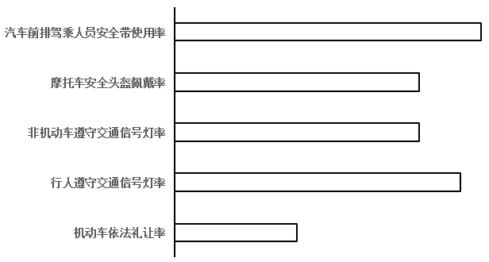

# 图形匹配（多项指标排序比对）

考点：[[20-考点/资料分析/综合/图形匹配（多项指标排序比对）|综合 / 图形匹配（多项指标排序比对）]]
材料：[[15-材料/资料分析/338026 2021年下半年（三、四季度）Z省A|338026 2021年下半年（三、四季度）Z省A]]

**问法模型**：条形图给出某市四季度5项守法率指标的大小关系 → 将E/F/G/H四市四季度5项指标逐一提取并从大到小排序，与图形排序特征（最高项、次高项、有无并列）匹配，唯一吻合者即答案

## 推理链
1. 第1步：锁定表格各行中'四季度'行，提取E市五项指标：礼让98.3、行人99.2、非机动车99.3、头盔98.9、安全带99.8
2. 第2步：同理提取F市98.2/99.0/98.8/98.8/99.1、G市100.0/98.2/98.2/95.6/98.2、H市99.3/99.3/99.4/99.0/99.4（单位均为%）
3. 第3步：E市排序为安全带99.8＞非机动车99.3＞行人99.2＞头盔98.9＞礼让98.3，排名第2的是非机动车率（99.3%），与条形图不符，排除A
4. 第4步：G市礼让率100.0为满值必排第1（行人/非机动车/安全带并列98.2、头盔95.6垫底），第1位为礼让率，与条形图不符，排除C
5. 第5步：H市非机动车=安全带99.4并列第1（礼让=行人99.3、头盔99.0），存在并列第1的图形特征不符，排除D
6. 第6步：F市排序为安全带99.1＞行人99.0＞非机动车=头盔98.8（并列）＞礼让98.2，与条形图五项指标大小关系完全吻合
7. 第7步：故条形图对应F市，正确答案为B

**最快解法**：⚡ 特征排除法（先抓图形最醒目特征）：①G市礼让率100.0满值必为该市最高项，若图形第1位不是礼让率直接排除C；②H市有99.4并列第1，若图形无并列第1排除D；③E市第2位是非机动车99.3，若图形次高位非非机动车排除A；④验证F市99.1＞99.0＞98.8=98.8＞98.2吻合，锁定B

## 易错点
- ⚠ 串行取数：表中5项指标三/四季度两行交替排列，易把三季度值（如E市行人95.7、G市头盔92.0）误当四季度，导致排序错乱
- ⚠ 忽视并列关系：F市非机动车与头盔同为98.8，H市有两对并列（99.4与99.3），若图形含并列柱而按严格大小排序比对，会误排正确项或错选
- ⚠ 口径混淆：本题比较的是同一季度（四季度）内5项指标的大小关系，不是两期提升幅度（那是第4题口径），且满值100.0不可能再'提升最大'，可作快速排除特征

## 母题抽象
> 🧩 当题干出现'条形图反映某主体多项指标之间的大小关系，问对应哪个主体'时，先从图形提取排序特征（最高项、次高项、有无并列），再逐一还原候选主体的数据排序，用最醒目特征（满值、并列、极值）优先排除，最后验证唯一剩余项

**同类特征**：条形图反映…五项指标之间的大小关系、排序匹配型图形题、四季度截面数据、四选一城市比对、交通守法率五项指标、查找定位+排序比较

## 相关题
（暂无）

---

### 题干

以下条形图反映了2021年四季度Z省哪个城市中心城市道路交通守法率五项指标之间的大小关系？

### 选项
- A. E市
- B. F市　✅
- C. G市
- D. H市

### 官方解析
定位表格材料可得2021年四季度E市、F市、G市、H市中心城市道路交通五项指标的守法率。逐一分析选项：
A项：2021年四季度E市中心城市道路交通机动车依法礼让率、行人遵守交通信号灯率、非机动车遵守交通信号灯率、摩托车安全头盔佩戴率、汽车前排驾乘人员安全带使用率五项指标的守法率依次为98.3%、99.2%、99.3%、98.9%、99.8%。即排名第2的指标为非机动车遵守交通信号灯率（99.3%），不符合条形图五项指标之间的大小关系，排除；
B项：2021年四季度F市中心城市道路交通机动车依法礼让率、行人遵守交通信号灯率、非机动车遵守交通信号灯率、摩托车安全头盔佩戴率、汽车前排驾乘人员安全带使用率五项指标的守法率依次为98.2%、99.0%、98.8%、98.8%、99.1%。即符合条形图五项指标之间的大小关系，正确；
C项：2021年四季度G市中心城市道路交通机动车依法礼让率、行人遵守交通信号灯率、非机动车遵守交通信号灯率、摩托车安全头盔佩戴率、汽车前排驾乘人员安全带使用率五项指标的守法率依次为100.0%、98.2%、98.2%、95.6%、98.2%。即排名第1的指标为机动车依法礼让率（100.0%），不符合条形图五项指标之间的大小关系，排除；
D项：2021年四季度H市中心城市道路交通机动车依法礼让率、行人遵守交通信号灯率、非机动车遵守交通信号灯率、摩托车安全头盔佩戴率、汽车前排驾乘人员安全带使用率五项指标的守法率依次为99.3%、99.3%、99.4%、99.0%、99.4%。即并列排名第1的指标为非机动车遵守交通信号灯率和汽车前排驾乘人员安全带使用率（99.4%），不符合条形图五项指标之间的大小关系，排除。
故正确答案为B。

### 给定材料

