# 综合分析选非题（基期量回推＋现期平均数比较＋两期比重升降判断）

考点：[[20-考点/资料分析/综合/综合分析选非题（基期量回推＋现期平均数比较＋两期比重升降判断）|综合 / 综合分析选非题（基期量回推＋现期平均数比较＋两期比重升降判断）]]
材料：[[15-材料/资料分析/340083 2021年全国公共文化服务两面画像：|340083 2021年全国公共文化服务两面画像：]]

**问法模型**：题干问'不能从上述资料中推出的是'→选非题，对四个选项逐项用基期公式、平均数公式、两期比重结论验证，锁定说法错误/推不出的一项

## 推理链
1. 第1步：A项从统计表取数：2021年训练班服务人次6119万、同比增长55.7%
2. 第2步：用基期公式基期量=现期÷(1+增长率)：2020年训练班服务人次=6119÷1.557≈3930万，超过3500万，A可推出
3. 第3步：B项取数：2021年公益性讲座41939次、同比增长36.9%，基期=41939÷1.369≈30635次，超过3万，B可推出
4. 第4步：C项平均每次活动服务人数=服务人次×10000÷活动次数：文艺621400000÷1391480≈447人，训练班61190000÷920740≈66人，展览142590000÷167497≈851人，讲座7680000÷41939≈183人
5. 第5步：比较得平均每次服务人数最多的是展览（约851人），训练班（约66人）反而最少，C说法错误，不能推出
6. 第6步：D项两期比重：部分（乡镇综合文化站）增长率a=-301÷(32524+301)≈-0.92%，整体（群众文化机构）增长率b=-156÷(43531+156)≈-0.36%
7. 第7步：两期比重结论'部分增速a＜整体增速b→比重下降'，-0.92%＜-0.36%，故2021年占比比2020年低，D可推出；选非题故答案为C

**最快解法**：⚡ 选非题逐项速验：A、B用截位直除估基期（6119÷1.557≈3900+、41939÷1.369≈3万+），量级明显达标即排除；C项抓'人次多且次数少'者胜——展览14259万人次仅16.7万次，人均约850，而训练班6119万人次摊92万次，人均约66，一眼锁定C错误；D项套两期比重口诀：a=-301/32825≈-0.92%＜b=-156/43687≈-0.36%→比重下降，直接确认。全程心算量级即可，无需精算。

## 易错点
- ⚠ 单位换算陷阱：服务人次为'万人次'，求平均每次服务人数必须×10000换回人（14259万人次÷167497次≈851人），不换算量级即崩
- ⚠ 直觉误判C：训练班服务人次增速55.7%最高、人次6119万看似很大，但其次数92万次同样巨大，平均每次仅约66人反而最少；展览次数少（16.7万次）人次多（14259万）才是平均数最大项
- ⚠ 负增长比较方向：D项两个增长率均为负，-0.92%＜-0.36%（负数绝对值大反而小），易把大小关系看反；且群众文化机构'减少156个'与从业人员'增加4931人'方向相反，取数勿错

## 母题抽象
> 🧩 当综合判断选非题出现'基期是否超过某值'用现期÷(1+增速)截位直除定性判定；出现'平均每次服务人数'用服务人次÷活动次数（万人次×10000）比大小；出现'占比比去年高/低'用部分增速与整体增速比大小口诀，找说法与计算矛盾的一项即答案。

**同类特征**：不能从上述资料中推出、选非题/选错误项、2020年基期量超过某值、平均每次活动服务人数最多、四项活动次数与人次、乡镇综合文化站占比较2020年

## 相关题
- [[10-真题/资料分析/综合/14355349 综合分析-选非题（增长率计算比较+人均值计算）|14355349]]（浙江 2024，相关度1）
- [[10-真题/资料分析/综合/2662212 综合分析·选非题（混合增速居中判定+比重乘基数+半数比较+饼图占比直读）|2662212]]（新疆 2020，相关度1）
- [[10-真题/资料分析/综合/2719459 综合分析选非题（现期比重+现期平均数+单位换算混合验证）|2719459]]（国考 2021，相关度1）
- [[10-真题/资料分析/综合/19283743 综合分析-选非题（平均数增长率+增长量比较+比重临界值验证）|19283743]]（国考 2025，相关度1）
- [[10-真题/资料分析/综合/12019706 综合分析·选非题（比重验算+数据可行性判断）|12019706]]（广东 2026，相关度1）

---

### 题干
关于全国群众文化机构相关情况，不能从上述资料中推出的是：

### 选项
- A. 2020年，训练班服务人次总量超过3500万
- B. 2020年，开展公益性讲座活动次数超过3万
- C. 2021年，四项活动中平均每次活动服务人数最多的是训练班　✅
- D. 2021年，乡镇综合文化站占全国群众文化机构的比例比2020年低

### 官方解析

A项：定位统计表可得，2021年训练班服务人次6119万人次，同比增长55.7%。根据公式：基期量，则2020年训练班服务人次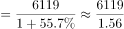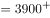万人次，超过3500万，正确；

B项：定位统计表可得，2021年开展公益性讲座41939次，同比增长36.9%。根据公式：基期量，则2020年开展公益性讲座活动次数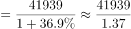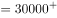次，超过3万，正确；

C项：定位统计表可得2021年四项活动开展的次数及服务人次，根据公式：平均数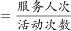，则四项活动平均每次活动服务人数分别为，文艺活动：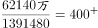人次；训练班：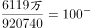人次；展览：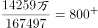人次；公益性讲座：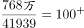人次。平均每次活动服务人数最多的是展览，并非训练班，错误；

D项：定位文字材料第三段可得，2021年末，全国共有群众文化机构43531个，比上年末减少156个。其中乡镇综合文化站32524个，减少301个。根据公式：增长率，则2021年乡镇综合文化站增长率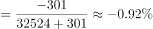（a），全国群众文化机构增长率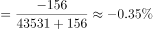（b）。根据两期比重比较结论：当部分增长率（a）＜整体增长率（b）时，比重下降。因-0.92%（a）＜-0.35%（b），故2021年，乡镇综合文化站占全国群众文化机构的比例比2020年低，正确。

此题为选非题，故正确答案为C。

### 给定材料

        2021年末，全国共有公共图书馆3215个，比上年末增加3个；从业人员59301人，增加1321人；其中具有高级职称人员7413人，占12.5%；具有中级职称人员18979人，占32.0%。

        全年公共图书馆实际持证读者10313.93万人，比上年增长0.6%；总流通人次74613.69万，增长37.8%；书刊文献外借58730.15万册次，增长39.5%；外借人次23809.24万，增长36.3%。全年共为读者举办各种活动202568次，比上年增长34.4%；参加人次11892.49万，增长28.2%。

        2021年末，全国共有群众文化机构43531个，比上年末减少156个。其中乡镇综合文化站32524个，减少301个。年末全国群众文化机构从业人员190007人，比上年末增加4931人。其中具有高级职称的人员7531人，占4.0%；具有中级职称人员17947人，占9.4%。

