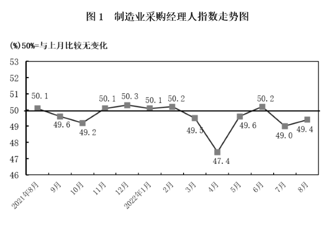

# 跨图表双指标读数筛选计数（50%临界点判断）

考点：[[20-考点/资料分析/综合/跨图表双指标读数筛选计数（50%临界点判断）|综合 / 跨图表双指标读数筛选计数（50%临界点判断）]]
材料：[[15-材料/资料分析/340943 2021年8月至2022年8月中国制|340943 2021年8月至2022年8月中国制]]

**问法模型**：题干问'某时段内两个指标均在临界点（50%）之上的月份有几个'→ 逐月提取两指标数值分别与50%比较，各自列出满足月份后取交集计数

## 推理链
1. 第1步：从文字段确认临界点为50%（PMI低于50%即为收缩），从表1提取2022年1~8月'PMI'列与'新订单'列两行数据
2. 第2步：PMI列2022年1~8月依次为50.1、50.2、49.5、47.5、49.6、50.2、49.0、49.4，其中>50%的月份为1月、2月、6月
3. 第3步：新订单列2022年1~8月依次为49.3、50.7、48.3、42.6、49.2、50.4、48.5、49.2，其中>50%的月份仅2月（50.7）、6月（50.4）
4. 第4步：取两集合交集，同时>50%的月份为2月、6月，共2个（1月PMI50.1虽达标但新订单49.3<50被淘汰）
5. 第5步：与选项对照，2个对应B项

**最快解法**：⚡ 先筛'稀缺列'：新订单>50%的只有2月50.7和6月50.4两个月，只需回验这两个月的PMI（均为50.2>50）即可锁定2个，无需8个月×2列逐格比对；注意排除1月（PMI50.1达标但新订单49.3不达标）

## 易错点
- ⚠ 只看PMI列（1、2、6月均>50）就数出3个而误选C，漏验新订单须同时>50%的交集条件
- ⚠ 把'临界点之上'误解为'环比上升'或'高于上月'：>50%是水平判断，与环比升降无关（如1月50.1属扩张但本题仍被新订单条件淘汰）
- ⚠ 时间范围陷阱：只统计2022年1~8月，2021年11月（50.1）、12月（50.3）等前期PMI>50的月份不能计入；且新订单数必须回表1取（图1只画PMI总指数），逐行对齐日期防止2022年4月（47.5）一行数字串位

## 母题抽象
> 🧩 当题干出现'某时间段内A、B两个指标同时满足某阈值（如均在50%之上）的月份/项有几个'时，先从取值满足条件更少的那个指标入手筛出候选，再回验另一指标取交集计数，并严守时间范围

**同类特征**：2022年1~8月、PMI指数和新订单指数、均在临界点之上、月份有几个、图1查PMI、表1查新订单的跨图表取数、双条件交集计数

## 相关题
- [[10-真题/资料分析/增长/17764858 环比增长逐月判断与计数（双列同时增长）|17764858]]（湖北 2024，相关度1）
- [[10-真题/资料分析/增长/4639657 同比增速大小比较（逐月配对计数）|4639657]]（国考 2022，相关度1）
- [[10-真题/资料分析/增长/5445931 增长量计算与比较（相邻月末时点做差计数）|5445931]]（国考 2023，相关度1）
- [[10-真题/资料分析/平均数/13504305 两期平均数比较（均价升降判断，分子a与分母b增速比较）|13504305]]（云南 2025，相关度1）
- [[10-真题/资料分析/增长/18643851 同比增速正负判断（高于上年同期）双条件交集筛选|18643851]]（四川 2026，相关度1）

---

### 题干
2022年1~8月，PMI指数和新订单指数均在临界点之上的月份有几个？

### 选项
- A. 1
- B. 2　✅
- C. 3
- D. 4

### 官方解析
定位文字材料第二段可得：指数临界点为50%。定位表格材料第二列和第四列可知，2022年1~8月，PMI指数在临界点（50%）之上的月份有1月、2月、6月，新订单指数在临界点（50%）之上的月份有2月、6月，则PMI指数和新订单指数均在临界点（50%）之上的月份有2个（2月和6月）。
故正确答案为B。

### 给定材料

        制造业采购经理人指数PMI由5个分类指数加权计算而成，5个分类指数及其权数是依据其对经济的先行影响程度确定的。具体包括：新订单指数，权数为30%；生产指数，权数为25%；从业人员指数，权数为20%；供应商配送时间指数，权数为15%；原材料库存指数，权数为10%。其中，供应商配送时间指数为逆指数，在合成制造业PMI指数时进行反向运算，即100%减供应商配送时间指数。

        2022年8月份，制造业PMI指数为49.4%，低于PMI指数临界点（50%），比上月上升0.4个百分点，制造业景气水平有所回升。下面给出2021年8月至2022年8月制造业PMI指数走势图及相关分类指数数据。

> [!warning] 疑点（官方解析可能有误，待人工复核）
> 材料内部小出入：表1中2022年4月PMI为47.5，图1标注为47.4，口径略有不一致；因4月两指标均远低于50%，不影响本题答案（官方解析无误）
