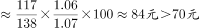
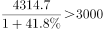

# 综合分析选非题（基期利润比较、基期平均数、基期量计算、正增长读数计数）

考点：[[20-考点/资料分析/综合/综合分析选非题（基期利润比较、基期平均数、基期量计算、正增长读数计数）|综合 / 综合分析选非题（基期利润比较、基期平均数、基期量计算、正增长读数计数）]]
材料：[[15-材料/资料分析/340950 2022年规模以上工业企业经营效益：|340950 2022年规模以上工业企业经营效益：]]

**问法模型**：题干为'下列不能推出'的选非综合分析问法 → 对四个选项逐项验证，A用'利润=收入×利润率'构造两年比较，B用基期平均数公式，C用基期量公式，D直接在第三段数正增速个数，找出唯一不成立项。

## 推理链
1. 第1步：定位第一段：2022年营业收入137.91万亿元（+5.9%）、营业成本116.84万亿元（+7.1%）、营业收入利润率6.09%（同比下降0.64个百分点），四个选项中A/B在此验证。
2. 第2步：A项用'利润=收入×利润率'：2022年利润=137.91×6.09%≈8.40万亿元；2021年利润率=6.09%+0.64=6.73%，2021年收入=137.91/1.059≈130.23万亿元，2021年利润≈130.23×6.73%≈8.76万亿元，8.40<8.76，A可以推出。
3. 第3步：B项用基期平均数公式：2021年每百元营业收入中的成本=(116.84/1.071)/(137.91/1.059)×100≈(116.84/137.91)×(1.059/1.071)×100≈84.7%×98.9%×100≈83.8元，远高于70元，B不能推出。
4. 第4步：C项用基期量公式：2021年利润=4314.7/(1+41.8%)≈4314.7/1.418≈3043亿元>3000亿元，C可以推出。
5. 第5步：D项在第三段前十行业中数正增速：煤炭开采和洗选业44.3%、电气机械31.2%、汽车0.6%、石油和天然气开采109.8%、通用设备0.4%、电力热力86.3%，共6个正增长（计算机-13.1%、化学原料-8.7%、非金属矿物-15.5%、医药-31.8%为负），D可以推出。
6. 第6步：本题为选非题，A/C/D均能推出，不能推出的是B，与官方答案一致。

**最快解法**：⚡ 定性判断+截位直除锁定B：2022年每百元营业收入中的成本=116.84/137.91×100≈84.7元，且成本增速7.1%＞收入增速5.9%，说明该比值2021年更低但量级仍为80+元（约83.8元），与'低于70元'差一个明显档位，免精算直接判B为假；C用放缩秒杀：3000×1.418=4254<4314.7，故4314.7/1.418>3000；A用两期利润比值=1.059×(6.09/6.73)≈0.958<1确认2022年利润下降。

## 易错点
- ⚠ 每百元营业收入中的成本=营业成本/营业收入×100（2022年约84.7元），若误算成收入/成本（≈1.18）或忘记×100，量级判断即崩；且成本增速7.1%＞收入增速5.9%意味着该比值同比上升，2021年也只略低于84.7元，绝无可能低于70元。
- ⚠ A项中'同比下降0.64个百分点'须还原为2021年利润率=6.09%+0.64%=6.73%，若混淆百分点与百分比增速、或只用当年6.09%直接反推，2021年利润会算错而误判A。
- ⚠ 口径陷阱：C项'电力、热力、燃气及水生产和供应业'是第二段三大门类之一（4314.7亿元，+41.8%），与第三段大类行业'电力、热力生产和供应业'（3154亿元，+86.3%）范围不同，若错定位到第三段会算出3154/1.863≈1693<3000而误判C。

## 母题抽象
> 🧩 当题干出现'不能/能够推出'的综合分析选非特征时，先用'量级+增速方向'做定性排查（如成本增速＞收入增速⇒成本收入比上升、两期利润比值=收入比×利润率比），量级明显不符的选项免精算直接锁定，其余选项用基期量=A/(1+a)或正增长读数计数快速验证。

**同类特征**：选非题·不能推出、每百元营业收入中的成本、基期平均数/基期量、利润总额两年比较、同比下降N个百分点、正增长行业个数计数

## 相关题
- [[10-真题/资料分析/综合/5746653 综合分析选非题（增长量计算与位次比较混合验证）|5746653]]（江苏 2023，相关度1）

---

### 题干
下列不能从上述资料中推出的是（    ）。

### 选项
- A. 2022年，规模以上工业企业利润总额低于2021年
- B. 2021年，规模以上工业企业每百元营业收入中的成本低于70元　✅
- C. 2021年，电力、热力、燃气及水生产和供应业利润总额超过3000亿元
- D. 2022年，在41个工业大类行业中，利润总额由高到低的前十个行业中有6个行业呈正增长

### 官方解析

A项：定位文字材料第一段可得：2022年，规模以上工业企业实现营业收入137.91万亿元，同比增长5.9％；营业收入利润率为6.09％，同比下降0.64个百分点。根据公式：利润=收入×利润率，则2022年规模以上工业企业利润总额为万亿元；同时根据公式：基期量，则2021年规模以上工业企业利润总额为万亿元。比较可知，2022年，规模以上工业企业利润总额低于2021年，正确；

B项：定位文字材料第一段可得：2022年，规模以上工业企业实现营业收入137.91万亿元（B），同比增长5.9％（b）；发生营业成本116.84万亿元（A），同比增长7.1％（a）。根据公式：基期平均数，则2021年，规模以上工业企业每百元营业收入中的成本为，错误；

C项：定位文字材料第二段可得：2022年，规模以上工业企业中，电力、热力、燃气及水生产和供应业实现利润总额4314.7亿元，同比增长41.8％。根据公式：基期量，则2021年，电力、热力、燃气及水生产和供应业利润总额为亿元，正确；

D项：定位文字材料第三段可知，2022年，在41个工业大类行业中，利润总额由高到低的前十个行业中，增长率为正的行业有：煤炭开采和洗选业（44.3%）、电气机械和器材制造业（31.2%）、汽车制造业（0.6%）、石油和天然气开采业（109.8%）、通用设备制造业（0.4%）、电力、热力生产和供应业（86.3%），共6个行业，正确。

本题为选非题，故正确答案为B。

### 给定材料

        2022年，规模以上工业企业实现营业收入137.91万亿元，同比增长5.9％；发生营业成本116.84万亿元，同比增长7.1％；营业收入利润率为6.09％，同比下降0.64个百分点。

        2022年，规模以上工业企业中，分行业看：采矿业实现利润总额15573.6亿元，同比增长48.6％；制造业实现利润总额64150.2亿元，同比下降13.4％；电力、热力、燃气及水生产和供应业实现利润总额4314.7亿元，同比增长41.8％。

        2022年，在41个工业大类行业中，利润总额由高到低的前十个行业的利润情况如下：煤炭开采和洗选业实现利润总额10202亿元，同比增长44.3％；计算机、通信和其他电子设备制造业实现利润总额7389.5亿元，同比下降13.1％；化学原料和化学制品制造业实现利润总额7302.6亿元，同比下降8.7％；电气机械和器材制造业实现利润总额5915.6亿元，同比增长31.2％；汽车制造业实现利润总额5319.6亿元，同比增长0.6％；非金属矿物制品业实现利润总额4759亿元，同比下降15.5％；医药制造业实现利润总额4288.7亿元，同比下降31.8％；石油和天然气开采业实现利润总额3545亿元，同比增长109.8％；通用设备制造业实现利润总额3250.3亿元，同比增长0.4％；电力、热力生产和供应业实现利润总额3154亿元，同比增长86.3％。

