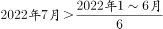
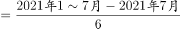

# 综合判断（数据可推性验证+当月量与月均量比较）

考点：[[20-考点/资料分析/综合/综合判断（数据可推性验证+当月量与月均量比较）|综合 / 综合判断（数据可推性验证+当月量与月均量比较）]]
材料：[[15-材料/资料分析/340953 2022年1-7月全国发电量（分品种|340953 2022年1-7月全国发电量（分品种]]

**问法模型**：‘能够从上述资料中推出的是’→逐项检验四个陈述：缺绝对量的增速型选项判'推不出'排除，可比项将'某月量与上半年月均比较'转化为'7×当月值 vs 1-7月累计值'的单步不等式判定

## 推理链
1. 第1步：提取数据——第二产业用电量：7月当月5132亿千瓦时，1-7月累计32552亿千瓦时；第一产业：7月121亿(+14.3%)，1-7月634亿(+11.1%)；A、B涉及的太阳能(+13.0%)、核电(7月-3.3%，降幅收窄5.7pp)均只给增速，无任何绝对量
2. 第2步：A项考查增长量=现期×r/(1+r)，B项需比较6月与5月发电量绝对值，二者均需绝对量数据
3. 第3步：A项无现期绝对量无法算增长量，排除；B项由'降幅收窄5.7pp'最多推出6月增速为-3.3%-5.7%=-9.0%，增速无法反推两月绝对量大小，排除
4. 第4步：C项将'7月二产用电量高于上半年月均'转化为不等式：5132×7=35924＞32552成立（直接验证：上半年总量=32552-5132=27420，月均=27420÷6=4570亿＜5132亿），C可推出
5. 第5步：D项按基期量=现期/(1+r)换算：2021年7月一产=121/(1+14.3%)≈105.9亿千瓦时，2021年1-7月一产=634/(1+11.1%)≈570.7亿千瓦时，7×105.9≈741＞570.7，即2021年7月高于2021年上半年月均，'低于'不成立，排除
6. 第6步：仅C项可由材料推出，对照选项锁定答案C

**最快解法**：⚡ 排除法+单步放缩：A、B选项主体（太阳能、核电）在材料中只有同比增速无绝对量，秒排除；C项不计算上半年总量，直接比较'7×当月值 vs 累计值'——5132×7=35924＞32552，一次乘法即锁定正确；D项最后用截位直除粗算基期（121/1.143≈106，634/1.111≈571，106×7远大于571）确认排除。

## 易错点
- ⚠ 增长率大≠增长量大：A项太阳能增速13.0%为分品种最高，但增长量=现期×r/(1+r)必须知道绝对量，分品种只给增速，凭增速判'增长量最大'必错
- ⚠ B项'降幅收窄5.7个百分点'只能反推6月增速(-9.0%)，增速变化方向不代表绝对量升降，缺两月绝对量无法比较
- ⚠ 月均比较不要先算'累计−当月'再除以6，直接用'当月×7 vs 累计'放缩更快；D项两处基期分母不同(1+14.3%与1+11.1%)不可混用，且一产7月增速(14.3%)高于累计增速(11.1%)说明7月占比同比上升，2021年7月仍高于2021年月均，易凭'增速高'直觉误选D

## 母题抽象
> 🧩 当综合判断题出现'某月量与（上）半年月均比较'特征时，将比较等价转化为'7×当月值 vs 1-7月累计值'（基期题先套现期/(1+r)再同样放缩）单步判定；凡选项涉及增长量或绝对量比较而材料只给增速的，直接判'推不出'排除。

**同类特征**：能够从上述资料中推出的是、当月量与上半年月均量比较、分品种仅给同比增速无绝对量、累计值与当月值混排、基期量=现期/(1+r)、综合判断逐项排除

## 相关题
- [[10-真题/资料分析/综合/2376552 综合判断（顺差额比较+基期顺差计算+比重比较）|2376552]]（黑龙江 2019，相关度2）
- [[10-真题/资料分析/综合/2742218 综合分析题（基期量计算＋基期占比比较＋增速计数比较＋比重趋势读图）|2742218]]（江苏 2021，相关度2）
- [[10-真题/资料分析/综合/4663224 综合判断题（混合增长率居中+基期量+多年加总+负增长计数逐项验证）|4663224]]（山东 2022，相关度2）
- [[10-真题/资料分析/综合/19283943 综合分析判断题（倍数比较+求和判断+隐含平均每场座位数反推）|19283943]]（国考 2025，相关度1）
- [[10-真题/资料分析/综合/1796162 综合判断（月均计算、平均运输距离、比重对比、增长量比较逐项验证）|1796162]]（贵州 2016，相关度1）

---

### 题干
能够从上述资料中推出的是：

### 选项
- A. 2022年7月全国太阳能发电增长量最大
- B. 2022年6月全国核电发电量比5月份高
- C. 2022年7月第二产业用电量高于上半年第二产业平均用电量　✅
- D. 2021年7月第一产业用电量低于2021年上半年第一产业平均用电量

### 官方解析

A项：定位文字材料第一段可得：材料只给出各品种发电量同比增速，无法求出增长量，故无法得出太阳能发电增长量最大，错误；

B项：定位文字材料第一段可得：2022年7月，核电同比下降3.3%，降幅比上月收窄5.7个百分点。即只能求出2022年6月全国核电发电量同比增速，无法求出2022年6月和5月的全国核电发电量，错误；

C项：定位文字材料第二段可得：2022年1～7月，第二产业用电量32552亿千瓦时；7月份，第二产业用电量5132亿千瓦时。要求，即要求7×2022年7月＞2022年1～7月，代入数据，则有5132×7＞32552，正确；

D项：定位文字材料第二段可得：2022年1～7月，第一产业用电量634亿千瓦时，同比增长11.1%；7月份，第一产业用电量121亿千瓦时，同比增长14.3%。要求，即要求7×2021年7月＜2021年1～7月。根据公式：基期量，则2021年7月第一产业用电量亿千瓦时；2021年1～7月第一产业用电量亿千瓦时，则，即2021年7月第一产业用电量高于2021年上半年第一产业平均用电量，错误。

故正确答案为C。

### 给定材料

        国家能源局发布2022年1～7月，全国规模以上工业发电4.77万亿千瓦时，同比增长1.4%，增速比上半年加快0.7个百分点。7月份，全国发电量8059亿千瓦时，同比增长4.5%，增速比上月加快3.0个百分点。分品种看，7月份火电由降转增，同比增长5.3%；由于来水偏枯，水电同比增长2.4%，增速比上月放缓26.6个百分点；风电同比增长5.7%，增速比上月放缓11.0个百分点；核电同比下降3.3%，降幅比上月收窄5.7个百分点；太阳能发电同比增长13.0%，增速比上月加快3.1个百分点。

        国家能源局发布2022年1～7月，全社会用电量累计49303亿千瓦时，同比增长3.4%。分产业看，第一产业用电量634亿千瓦时，同比增长11.1%；第二产业用电量32552亿千瓦时，同比增长1.1%；第三产业用电量8531亿千瓦时，同比增长4.6%；城乡居民生活用电量7586亿千瓦时，同比增长12.5%。7月份，全社会用电量8324亿千瓦时，同比增长6.3%。分产业看，第一产业用电量121亿千瓦时，同比增长14.3%；第二产业用电量5132亿千瓦时，同比下降0.1%；第三产业用电量1591亿千瓦时，同比增长11.5%；城乡居民生活用电量1480亿千瓦时，同比增长26.8%。

