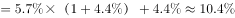

# 量价乘积（销售收入=产量×零售价）同比增长率，两因子增速合成 (1+a)=(1+b)(1+r)，等价于平均数增长率模型

考点：[[20-考点/资料分析/综合/量价乘积（销售收入=产量×零售价）同比增长率，两因子增速合成 (1+a)=(1+b)(1+r)，等价于平均数增长率模型|综合 / 量价乘积（销售收入=产量×零售价）同比增长率，两因子增速合成 (1+a)=(1+b)(1+r)，等价于平均数增长率模型]]
材料：[[15-材料/资料分析/340962 2012～2021年全国羊肉产量年度|340962 2012～2021年全国羊肉产量年度]]

**问法模型**：题干'假设以零售价全部售罄，2021年销售收入同比增长约'→先设定收入=产量×零售价（量、价分处图1与表1），再用两因子增长率合成模型 (1+a)=(1+b)(1+r) 求a。

## 推理链
1. 第1步：跨图表取数——图1得羊肉产量2021年514.1万吨、2020年492.3万吨；表1得羊肉零售价2021年81.40元/公斤、2020年77.01元/公斤（勿误取批发价73.65/69.27）
2. 第2步：单位换算与模型设定——1万吨=10^7公斤，514.1万吨≈51.4亿公斤、492.3万吨≈49.2亿公斤；题干'全部售罄'故收入=产量×零售价，比较增长率时10^7量级可约去，只算（产量×价格）之比
3. 第3步：代入计算两期收入——2021年收入≈51.4×81.4≈4185亿元，2020年收入≈49.2×77.0≈3791亿元
4. 第4步：套增长率公式——a=(4185−3791)/3791≈394/3791≈10.4%
5. 第5步：拆分法验证——产量增速b=21.8/492.3≈4.4%（即第1题答案可直接复用），零售价增速r=4.39/77.01≈5.7%，代入(1+a)=(1+b)(1+r)得a≈4.4%+5.7%+0.25%≈10.4%
6. 第6步：与选项对照——10.4%对应B，A(5.2%)、C(17.6%)、D(22.7%)均差距明显，锁定B

**最快解法**：⚡ 公式法（乘积增长率/平均数增长率）：a=b+r+b×r，其中b≈4.4%（21.8/492.3，直接复用第1小题答案）、r≈5.7%（4.39/77.01），则a≈4.4%+5.7%+0.25%≈10.4%，一步锁B；亦可两期收入各保留两位有效数字截位直除：4185/3791−1≈10.4%。

## 易错点
- ⚠ 跨图表同名指标混淆：'羊肉'产量在图1（万吨）、价格在表1（元/公斤），须两处同时取数；且表1羊肉分批发/零售两列，本题必须取零售价81.40/77.01，误用批发价73.65/69.27会算出错误增速
- ⚠ 单位换算陷阱：万吨×元/公斤需换算1万吨=1000万公斤（10^7公斤），乘积为千万元~亿元量级；求增长率时量级自动约去，直接用（产量×价格）之比即可，但若把价格误当'元/吨'会放大1000倍
- ⚠ 增长率合成不完整：只算产量增速4.4%或只算价格增速5.7%都会误选A(5.2%)；用a≈b+r≈10.1%虽接近B，但严格算法须补上交叉项b×r≈0.25%修正至10.4%

## 母题抽象
> 🧩 当题干出现'收入（量×价）的同比增长率'且量、价分处不同图表时，分别求量增速b与价增速r，套(1+a)=(1+b)(1+r)即a=b+r+b×r；选项间隔大时用a≈b+r即可定性锁定。

**同类特征**：假设……以某价格全部售罄（暗示收入=产量×价格）、跨图表取数（图1产量+表1零售价）、'2021年……同比增长约'且选项为间隔明显的百分数、万吨与元/公斤跨单位相乘（量级约去）、上一小题产量增速可直接复用、可用平均数增长率公式等价求解

## 相关题
（暂无）

---

### 题干
假设羊肉每年以零售价格全部售罄，那么，2021年羊肉销售收入同比增长约：

### 选项
- A. 5.2%
- B. 10.4%　✅
- C. 17.6%
- D. 22.7%

### 官方解析

方法一：根据题干“2021年······同比增长约”，结合选项为百分数，可判定本题为一般增长率问题。定位图表可得：2021年、2020年羊肉产量分别为514.1万吨、492.3万吨，2021年、2020年羊肉零售价格分别为81.40元/公斤、77.01元/公斤。因题目假设羊肉每年以零售价格全部售罄，故羊肉销售收入=产量×零售价格，则2021年羊肉销售收入=514.1万吨×81.40元/公斤51亿公斤×81元/公斤=4131亿元；2020年羊肉销售收入=492.3万吨×77.01元/公斤49亿公斤×77元/公斤=3773亿元。根据公式：增长率，则2021年羊肉销售收入同比增长，与B项最接近。

方法二：根据题干“2021年······同比增长约”，结合选项为百分数，且题目假设羊肉每年以零售价格全部售罄，故羊肉零售价格，可判定本题为平均数的增长率问题。定位图表可得：2021年、2020年羊肉产量分别为514.1万吨、492.3万吨，2021年、2020年羊肉零售价格分别为81.40元/公斤、77.01元/公斤。根据公式：增长率，则2021年羊肉产量同比增长率为（b）（也可根据第一小题答案直接使用），2021年羊肉零售价格同比增长率为（r）。根据平均数的增长率公式：r，设2021年羊肉销售收入同比增长率为a，代入公式得：，则a。

故正确答案为B。

### 给定材料

> [!warning] 疑点（官方解析可能有误，待人工复核）
> 官方方法一将51.41亿公斤截为51、81.40元/公斤截为81，算得2021年收入4131亿元（精确约4185亿元）、2020年3773亿元（精确约3791亿元），对应增速约9.5%而非精确值10.4%，系截位舍入偏差，结论仍最接近B，不影响答案。

<!-- CODEX-ANSWER-REVIEW:BEGIN -->
### 本次独立复核

**复核状态：** `resolved`（答案与解析已核定）

**计分答案：** B（可计分）

**复核解析：**

按销售收入=产量×零售价：2021为514.1万吨×81.40元/公斤，2020为492.3万吨×77.01元/公斤。两收入同比比值=(514.1/492.3)×(81.40/77.01)≈1.104，增幅约10.4%，选B。精算优于官方先截位成51、81及49、77后得到的约9.5%。

**相关信息：**

万吨换为亿公斤时每万吨=0.01亿公斤；同比乘积可直接相乘两个因子。

**题源依据：** [固定版本原题](https://github.com/Mentat-Uran/kaogongzhentizhengliu/blob/84ab93d4b64b61d897bece8a1c0a5bab06b4feb2/10-%E7%9C%9F%E9%A2%98/%E8%B5%84%E6%96%99%E5%88%86%E6%9E%90/%E7%BB%BC%E5%90%88/5509998%20%E9%87%8F%E4%BB%B7%E4%B9%98%E7%A7%AF%EF%BC%88%E9%94%80%E5%94%AE%E6%94%B6%E5%85%A5%3D%E4%BA%A7%E9%87%8F%C3%97%E9%9B%B6%E5%94%AE%E4%BB%B7%EF%BC%89%E5%90%8C%E6%AF%94%E5%A2%9E%E9%95%BF%E7%8E%87%EF%BC%8C%E4%B8%A4%E5%9B%A0%E5%AD%90%E5%A2%9E%E9%80%9F%E5%90%88%E6%88%90%20(1%2Ba)%3D(1%2Bb)(1%2Br)%EF%BC%8C%E7%AD%89%E4%BB%B7%E4%BA%8E%E5%B9%B3%E5%9D%87%E6%95%B0%E5%A2%9E%E9%95%BF%E7%8E%87%E6%A8%A1%E5%9E%8B.md)；固定内容 commit `84ab93d4b64b61d897bece8a1c0a5bab06b4feb2`，Markdown blob `e9dcae690211e3537f41b745df1c2a902573f7dc`。
<!-- CODEX-ANSWER-REVIEW:END -->
