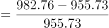
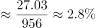

# 综合判断题（核心验证点：两期比重比较，辅以百分点基期回推与数据可得性判断）

考点：[[20-考点/资料分析/综合/综合判断题（核心验证点：两期比重比较，辅以百分点基期回推与数据可得性判断）|综合 / 综合判断题（核心验证点：两期比重比较，辅以百分点基期回推与数据可得性判断）]]
材料：[[15-材料/资料分析/340964 2020—2021年广东省财政科学技|340964 2020—2021年广东省财政科学技]]

**问法模型**：'根据资料，以下说法正确的是'综合判断题 → 逐项验证：两期比重比较结论（a与b比大小判比重升降）+百分点做减法回推基期占比+无数据项判'无法推出'

## 推理链
1. 第1步：A项验证——材料只给2021年全省财政科技支出982.76亿元、占全省一般公共预算支出5.4%（可反推2021年≈1.82万亿元），但2020年全省占比未给，无法推出2020年全省一般公共预算支出是否小于2万亿元，A错误
2. 第2步：B项验证——文字给省本级占比2021年为6.6%、同比增加0.84个百分点，故2020年占比=6.6%−0.84%=5.76%，不是7.44%（7.44%=6.6%+0.84%为误加陷阱值），B错误
3. 第3步：C项取数——部分增速a=2.6%（文字：珠三角核心区财政科技支出同比+2.6%）；整体基期与增量由表1全省行取得：955.73→982.76，增量27.03亿元
4. 第4步：C项计算——整体增速b=27.03/955.73≈2.8%（截位直除），由两期比重比较结论，a=2.6%＜b=2.8%时比重下降，故2021年珠三角核心区占全省财政科技支出比重略有下降，C正确
5. 第5步：D项数科目——表2中2021年同比正增长的科目仅6个：基础研究(124.75>116.01)、科技条件与服务(54.56>44.55)、科学技术普及(13.06>9.20)、科技交流与合作(4.48>4.25)、科技重大项目(71.21>58.20)、其他科学技术支出(468.42>406.92)
6. 第6步：D项判定——比重增加要求科目增速a＞整体增速b=2.8%，而正增长科目总共只有6个，故比重增加的科目数不超过6个，不可能是7个，D错误；综上锁定C

**最快解法**：⚡ 综合判断题抓最易验证项先做：C项用两期比重比较秒杀——a=2.6%（文字直接给）与b=27.03/955.73≈2.8%（截位直除）比较，a<b→比重降，直接锁定C；B项用6.6%−0.84%=5.76%排误，D项数表2正增长科目（6个）排误，A项凭'2020年占比缺失、无法推出'排误

## 易错点
- ⚠ 百分点方向陷阱：'同比增加0.84个百分点'回推基期占比应做减法（6.6%−0.84%=5.76%），误做加法得7.44%，恰好就是B项设置的陷阱值
- ⚠ D项判定标准陷阱：'比重有所增加'需科目增速a＞整体增速b=2.8%，而非增速为正即可；且表2正增长科目只有6个，易漏数或将负增长科目（科学技术管理事务、应用研究、技术研究与开发、社会科学）误计入
- ⚠ 数据可得性陷阱：2021年全省一般公共预算支出可由982.76/5.4%≈1.82万亿元反推，但2020年占比材料未给，A项不能用2021年数据外推2020年是否小于2万亿元，正确处理是判'无法推出'而非硬算；另注意亿元与万亿元量级换算

## 母题抽象
> 🧩 当综合判断题出现'部分占整体的比重上升/下降'类选项时，用两期比重比较：部分增速a（文字常直接给出）与整体增速b=增量/基期（截位直除）比大小，a<b比重降、a>b比重升，无需算出具体比重即可判正误；遇'同比增加X个百分点'回推基期一律做减法

**同类特征**：综合判断·说法正确的是、两期比重升降判断、同比增加X个百分点、部分增速与整体增速比较、比重增加的科目个数、无法推出/数据可得性

## 相关题
- [[10-真题/资料分析/综合/10718189 综合分析判断题（混搭占比排序、均值与中位数、名义-实际增速差、两期比重升降）|10718189]]（深圳市考 2024，相关度1）
- [[10-真题/资料分析/比重/1746802 两期比重变化比较（增速比较法，连续两年判断）|1746802]]（国考 2016，相关度1）
- [[10-真题/资料分析/比重/1797640 两期比重变化（比重差定量计算）|1797640]]（山东 2016，相关度1）
- [[10-真题/资料分析/综合/2049570 综合判断题（两期比重变化判断＋现期比值-占比比较）|2049570]]（新疆 2017，相关度1）
- [[10-真题/资料分析/比重/3523610 两期比重比较（比重升降判断+计数）|3523610]]（四川 2021，相关度1）

---

### 题干
根据资料，以下关于广东省财政支出的说法正确的是（    ）。

### 选项
- A. 2020年和2021年，全省财政一般公共预算支出均小于2万亿元
- B. 2020年，全省省本级财政科学技术支出占省本级财政一般公共预算支出的比重为7.44%
- C. 与2020年相比，2021年珠江三角洲核心区财政科学技术支出在全省财政科学技术支出中的比重略有下降　✅
- D. 与2020年相比，2021年在全省财政科学技术支出中比重有所增加的分类科目有7个

### 官方解析

A项：材料中未给出2020年全省财政一般公共预算支出的相关数据，无法推出2020年全省财政一般公共预算支出是否小于2万亿元，错误；

B项：定位文字材料可得，（2021年）省本级财政科学技术支出为102.05亿元，占省本级财政一般公共预算支出的比重为6.6%，同比增加0.84个百分点。则2020年省本级财政科学技术支出占省本级财政一般公共预算支出的比重为6.6%-0.84%=5.76%，非7.44%，错误；

C项：定位文字材料可得，（2021年）珠江三角洲核心区财政科学技术支出同比增长2.6%（a）。定位统计表1可得，2020年、2021年全省财政科学技术支出分别为955.73亿元、982.76亿元。根据公式：增长率，则2021年全省财政科学技术支出同比增速（b）。结合两期比重比较结论，当部分增长率（a）＜整体增长率（b）时，则比重下降，2.6%（a）＜2.8%（b），正确；

D项：定位统计表1、表2可得2020年、2021年全省财政科学技术支出和各分类科目财政科学技术支出。根据本题C项可确定全省财政科学技术支出同比增速（b）=2.8%。观察表2可知，2021年财政科学技术支出同比实现正增长的科目有：基础研究（124.75亿元＞116.01亿元）、科技条件与服务（54.56亿元＞44.55亿元）、科学技术普及（13.06亿元＞9.20亿元）、科技交流与合作（4.48亿元＞4.25亿元）、科技重大项目（71.21亿元＞58.20亿元）、其他科学技术支出（468.42＞406.92），即各分类科目同比增速（a）＞0的科目只有6个，由此可知同比增速超过全省财政科学技术支出增速（2.8%）的科目不超过6个。根据“两期比重比较结论”可知，当部分增长率（a）＞整体增长率（b）时，则比重上升，即在全省财政科学技术支出中比重有所增加的分类科目不超过6个，错误。

故正确答案为C。

### 给定材料

        2021年，广东省财政科学技术支出为982.76亿元，占当年全省财政一般公共预算支出的比重为5.4%。其中，省本级财政科学技术支出为102.05亿元，占省本级财政一般公共预算支出的比重为6.6%，同比增加0.84个百分点。珠江三角洲核心区财政科学技术支出845.09亿元，同比增长2.6%。

