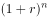
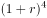
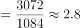
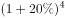
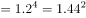
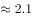
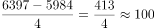

# 综合判断题（年均增长率验证+增速读图+年均增长量+无权重混合增速不可求）

考点：[[20-考点/资料分析/综合/综合判断题（年均增长率验证+增速读图+年均增长量+无权重混合增速不可求）|综合 / 综合判断题（年均增长率验证+增速读图+年均增长量+无权重混合增速不可求）]]
材料：[[15-材料/资料分析/340966 我国2018-2022年电信业务收入|340966 我国2018-2022年电信业务收入]]

**问法模型**：题干问'下列说法正确的是'→ 逐项套用对应模型证伪/证实：A用年均增长率倍数验证、B直接读增速图、C用年均增长量公式、D判断混合增速是否可求

## 推理链
1. 第1步：A项从图2读出新兴业务收入2018年=1084亿元、2022年=3072亿元，年份差n=2022-2018=4
2. 第2步：用年均增长率模型(1+r)^4=3072/1084≈2.83，取r=20%验证：1.2^4=2.0736<2.83，故r>20%，'超20%'成立，A正确
3. 第3步：B项从图1直接读增速：2018年2.9%、2019年0.5%、2020年3.9%、2021年8.1%、2022年8.0%，其中2019年0.5%<1%,'始终高于1%'不成立
4. 第4步：C项用年均增长量=(现期-基期)/n=(6397-5984)/4=413/4≈103亿元，远非'约1000亿元'，不成立
5. 第5步：D项文字只给云计算+118.2%、大数据+58%两个增速，未给各自收入（权重），无法合成混合增速，88.1%恰是(118.2%+58%)/2的简单平均陷阱，不成立
6. 第6步：四项中仅A经计算成立，对照选项锁定答案A

**最快解法**：⚡ 综合题先扫易排除项：B项看图1中2019年0.5%<1%直接排除；C项总增量仅413亿元、除以4约103亿元，与'约1000亿'量级矛盾排除；D项发现88.1%=(118.2%+58%)/2是无权重的简单平均、缺各业务收入无法合成，排除；A项用倍数验证法：3072/1084≈2.83>1.2^4=2.07，锁定A

## 易错点
- ⚠ 年份差陷阱：年均增长/年均增量的n=4（2022-2018），不是5个年份就除以5，错用n=5会把年均增长率算小
- ⚠ 混合增速陷阱：D项88.1%正是(118.2%+58%)/2的简单平均，两个部分增速合成必须知道各自基期收入作权重，材料未给则不可求，切勿因数字'恰好88.1%'误选
- ⚠ 年均增长量勿与总增量混淆：C项413亿元是2018-2022总增量，除以4才得年均约103亿元；且图2纵轴单位亿元、柱高读数勿错位（如6397勿看成6300量级外的数）

## 母题抽象
> 🧩 当题干出现'某年间年均增长超x%'特征时，用现期/基期与(1+x%)^n（n=年份差）比较的倍数验证法；'始终高于/混合增速'类说法则找反例年份或查权重是否缺失，逐项证伪后锁定正确项

**同类特征**：下列说法正确的是、年均增长超20%、同比增长率始终高于1%、年均增加约1000亿元、同比增长88.1%、跨图表综合判断

## 相关题
- [[10-真题/资料分析/综合/2195856 综合判断题·增长倍数口径下的基期反推与定性表述可推性验证|2195856]]（黑龙江 2018，相关度1）
- [[10-真题/资料分析/增长/7159 增长量计算|7159]]（北京 2009，相关度1）
- [[10-真题/资料分析/综合/10204448 综合分析-逐项判断（历史极值确认、两期比重比较、多期累计求和、基期比重）|10204448]]（广东 2024，相关度1）
- [[10-真题/资料分析/综合/1772378 综合分析判断题（多选项直接查找与数据比较）|1772378]]（深圳市考 2016，相关度1）
- [[10-真题/资料分析/综合/2033342 综合分析题（增速逐年比较＋两期比重比较＋库存流量平衡式混合判断）|2033342]]（河南 2016，相关度1）

---

### 题干
根据资料，下列说法正确的是（    ）。

### 选项
- A. 2018-2022年间，我国新兴业务收入年均增长超20%　✅
- B. 2018-2022年间，我国电信业务收入同比增长率始终高于1%
- C. 2018-2022年间，我国移动数据流量业务收入年均增加约1000亿元
- D. 与2021年相比，2022年我国云计算和大数据业务收入同比增长88.1%

### 官方解析

A项：定位图形材料2，2018年、2022年我国新兴业务收入分别为1084亿元、3072亿元。根据年均增长率公式： （n为年份差），年份差n=4，故，若r=20%，则&lt;2.8，故2018-2022年间，我国新兴业务收入年均增长超20%，正确；

B项：定位图形材料1可知2018-2022年我国电信业务收入同比增长率。其中2019年我国电信业务收入同比增长率为0.5%，小于1%，错误；

C项：定位图形材料2，2018年、2022年我国移动数据流量业务收入分别为5984亿元、6397亿元。根据公式：年均增长量，故所求=亿元，错误；

D项：定位文字材料第二段，数据中心、云计算、大数据、物联网业务比上年分别增长11.5%、118.2%、58%和24.7%。只给出各自的增长率，并未给出具体的业务收入，故无法推出，错误。

故正确答案为A。

### 给定材料

        五年来，我国积极推进网络强国和数字中国建设，着力深化数字经济与实体经济融合，为打造数字经济新优势、增强经济发展新动能提供有力支撑。2022年，我国电信业务收入累计完成1.58万亿元，比上年增长8%，较2018年增长超2800亿元。

        2022年移动数据流量业务收入6397亿元，比上年增长0.3%，在电信业务收入中占比约为40.5%。数据中心、云计算、大数据、物联网等新兴业务快速发展，对我国电信业务拉动作用持续增强。2022年新兴业务收入达3072亿元，在电信业务收入中占比由上年的16.1%提升至19.4%。其中，数据中心、云计算、大数据、物联网业务比上年分别增长11.5%、118.2%、58%和24.7%。

