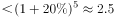
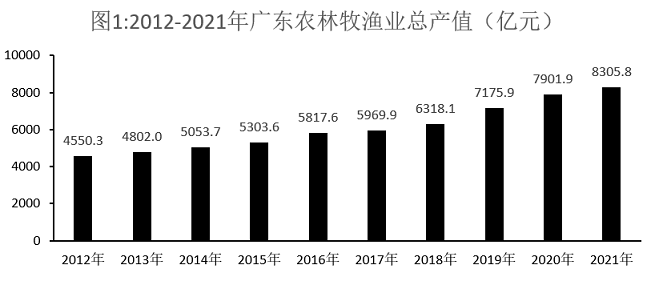

# 综合分析（年均增长率+部分=整体×比重+比重变化比较，四选项逐项验证）

考点：[[20-考点/资料分析/综合/综合分析（年均增长率+部分=整体×比重+比重变化比较，四选项逐项验证）|综合 / 综合分析（年均增长率+部分=整体×比重+比重变化比较，四选项逐项验证）]]
材料：[[15-材料/资料分析/341192 2012-2021年广东农林牧渔业总|341192 2012-2021年广东农林牧渔业总]]

**问法模型**：『下列说法正确的是』→ 对A~D逐项独立套模型验证：A用年均增长率开n次方、B/C用部分=整体×比重跨图求值、D直接比较占比，排除三项得正确项

## 推理链
1. 第1步：A项定位图1——2016年总产值5817.6亿元、2021年8305.8亿元，间隔n=2021−2016=5年
2. 第2步：年均增长率公式 r=(末年/首年)^(1/n)−1，代入得 r=(8305.8/5817.6)^(1/5)−1≈1.43^(1/5)−1≈7%+，远低于20%，A错误
3. 第3步：B项定位图1×图2——2020年专业及辅助性活动产值=7901.9×4.5%≈355.6亿元，2021年=8305.8×4.9%≈407.0亿元
4. 第4步：355.6与407.0均高于300亿元，B正确
5. 第5步：C项定位图1×图2——牧业2020年=7901.9×22.5%≈1777.9亿元，2021年=8305.8×20.6%≈1711.0亿元，同比下降约67亿元，与『均有所增加』矛盾，C错误
6. 第6步：D项直接比较图2占比——农业47.7%→47.6%、林业5.2%→6.0%、渔业20.0%→21.0%，农业比重下降，『均有所增加』不成立，D错误
7. 第7步：综上，仅B项正确，与官方答案一致

**最快解法**：⚡ 门槛比重法快速锁定B：300亿元对应2020年比重300÷7901.9≈3.8%、2021年比重300÷8305.8≈3.6%，而实际占比4.5%、4.9%均大于门槛，故两年均高于300亿元，无需精算乘积；A项用估算验证：(1.07)^5≈1.40、(1.08)^5≈1.47，1.43介于其间故r≈7%~8%，绝非20%；C/D项凭占比升降即可秒杀（牧业22.5%→20.6%降、农业47.7%→47.6%降）

## 易错点
- ⚠ A项年均增长率须开5次方（间隔n=5），若把总增幅(8305.8−5817.6)/5817.6≈42.8%或42.8%÷5≈8.6%误当年均增长率即入坑；正确值约7%多，与20%相差悬殊
- ⚠ B/C项跨图相乘时%须换算为小数（×0.045而非×45），量级差100倍，谨防355.6误成35.56或3556导致300亿门槛判断错位
- ⚠ C项『农业各类产业』含牧业：虽然总产值2021年(8305.8)>2020年(7901.9)，但牧业占比降1.9个百分点（22.5%→20.6%），整体涨不等于每个分项都涨，不能凭总量上升判定C正确
- ⚠ D项同属同一整体内部占比比较，直接读图2比重即可，农业47.7%→47.6%微降即被否定，勿与『产值是否增加』混淆

## 母题抽象
> 🧩 当题干出现『下列说法正确/错误的是』且材料为『总量数列+结构占比』双图时，先扫最易判定的选项（纯比重升降直接读图、门槛比重法验部分值），再处理需开n次方的年均增长率项，逐项排除即得答案

**同类特征**：下列说法正确的是、年均增长率约为、产值均高于、产值均有所增加、比重均有所增加、图1总量×图2占比跨图复合

## 相关题
- [[10-真题/资料分析/综合/2195856 综合判断题·增长倍数口径下的基期反推与定性表述可推性验证|2195856]]（黑龙江 2018，相关度1）
- [[10-真题/资料分析/综合/10204448 综合分析-逐项判断（历史极值确认、两期比重比较、多期累计求和、基期比重）|10204448]]（广东 2024，相关度1）
- [[10-真题/资料分析/综合/1772378 综合分析判断题（多选项直接查找与数据比较）|1772378]]（深圳市考 2016，相关度1）
- [[10-真题/资料分析/综合/2033342 综合分析题（增速逐年比较＋两期比重比较＋库存流量平衡式混合判断）|2033342]]（河南 2016，相关度1）
- [[10-真题/资料分析/综合/2060624 综合分析题（口径辨析+方向词核验+同比减少量计算的四选项正误判断）|2060624]]（深圳市考 2017，相关度1）

---

### 题干
根据资料，下列说法正确的是（    ）。

### 选项
- A. 2016-2021年间，广东农林牧渔业总产值年均增长率约为20%
- B. 2020年和2021年，广东农林牧渔专业及辅助性活动产值均高于300亿元　✅
- C. 与2020年相比，2021年广东农业各类产业的产值均有所增加
- D. 与2020年相比，2021年广东农业、林业和渔业产值在农业总产值中的比重均有所增加

### 官方解析

A项：定位图1可得，2016年与2021年广东农林牧渔业总产值分别为5817.6亿元和8305.8亿元。根据公式：，可得，错误；

B项：定位图1可得，2020年与2021年广东农林牧渔业总产值分别为7901.9亿元和8305.8亿元；定位图2可得，2020年和2021年，广东农林牧渔专业及辅助性活动产值在农林牧渔业总产值中的比重分别为4.5%和4.9%。根据公式：部分=整体×比重，则2020年广东农林牧渔专业及辅助性活动产值亿元，2021年该产值亿元，均高于300亿元，正确；

C项：定位图1可得，2020年与2021年广东农林牧渔业总产值分别为7901.9亿元和8305.8亿元；定位图2可得，2020年和2021年，广东牧业产值在农林牧渔业总产值中的比重分别为22.5%和20.6%。根据公式：部分=整体×比重，则2020年广东牧业产值亿元；2021年该产值亿元，即与2020年相比，2021年该产值有所减少，错误；

D项：定位图2可得，2020年广东农业、林业和渔业产值在农林牧渔业总产值中的比重分别为47.7%、5.2%和20.0%；2021年这三类产业产值在农林牧渔业总产值中的比重分别为47.6%、6.0%和21.0%。比较可知，与2020年相比，2021年广东农业产值在农业总产值中的比重有所减少，错误。

故正确答案为B。

### 给定材料

