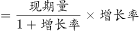
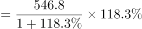
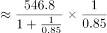
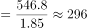
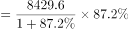
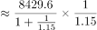
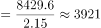
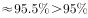

# 综合判断题（月均增长量+季度加总比较+增长量贡献比较+现期比重）

考点：[[20-考点/资料分析/综合/综合判断题（月均增长量+季度加总比较+增长量贡献比较+现期比重）|综合 / 综合判断题（月均增长量+季度加总比较+增长量贡献比较+现期比重）]]
材料：[[15-材料/资料分析/341286 2018~2020年中国动力电池装车|341286 2018~2020年中国动力电池装车]]

**问法模型**：题干出现'据所给资料推断，下列表述正确的是'的综合判断问法 → 对A~D逐项套用独立小模型验证：月均增长量=（末月-基期月）÷月数、季度值=三个月加总、贡献比较用增长量=现期×r/(1+r)、比重=部分÷整体，锁定唯一正确项

## 推理链
1. 第1步：A项——2020年下半年为7月1日~12月31日，现期取12月装车量12.95GWh，基期取6月末（即6月）4.7GWh，月均增长=(12.95-4.7)/6≈1.4GWh，与'约1.3GWh'不符，A错误
2. 第2步：B项——2019年二季度=5.41+5.68+6.62=17.71GWh，三季度=4.7+3.46+3.95=12.11GWh，三季度低于二季度，'2018~2020各年都逐季度递增'被推翻，B错误
3. 第3步：C项——12月插混乘用车同比增量=546.8×118.3%/(1+118.3%)≈296MWh，纯电动乘用车增量=8429.6×87.2%/(1+87.2%)≈3927MWh，插混增量远小于纯电动乘用车，同比递增主因不是插混乘用车，C错误
4. 第4步：D项——12月纯电动装车量=纯电动乘用车8429.6+纯电动客车3066.3+纯电动专用车873.4=12369.3MWh
5. 第5步：D项判定——占比=12369.3/12952.4≈95.5%>95%，D正确，故选D

**最快解法**：⚡ 综合判断优先验证数据最集中、计算最轻的D项：纯电动三类加总12369.3MWh，与总量的95%基准比较（12952.4×95%≈12309.8MWh），12369.3>12309.8即占比超95%，基准比较法（免除法）直接锁定D；再快速排除：A用(12.95-4.7)/6≈1.4GWh≠1.3，B用2019年Q3(12.11)<Q2(17.71)反例，C用增量296 vs 3927MWh悬殊对比

## 易错点
- ⚠ A项基期错位：'下半年月平均增长'的基期是6月值4.7GWh（7月初即6月末），误用7月值5.02GWh或对6个月环比增量另行平均都会算错；正确为(12.95-4.7)/6≈1.4GWh而非1.3GWh
- ⚠ C项以增速代替增量：插混乘用车同比增速118.3%全场最高，但基数仅546.8MWh，贡献=现期×r/(1+r)≈296MWh，远小于纯电动乘用车的≈3927MWh，'增速高≠贡献大'
- ⚠ D项'纯电动车'须乘用车+客车+专用车三类合计，漏加客车306.3或专用车873.4会误判不超95%；且表1全程单位MWh，勿与图1的GWh（千倍量级）混淆

## 母题抽象
> 🧩 当题干出现'据所给资料推断，下列表述正确的是'时，逐项匹配独立小模型：月均增长量=（末期-基期）÷月数且基期取上一期末、季度值=三个月相加找反例、贡献比较用增长量=现期×r/(1+r)、比重=部分÷整体，优先做计算量最小、结论唯一的选项验证以快速锁定答案

**同类特征**：据所给资料推断，下列表述正确的是、月平均增长（月均增长量）、逐季度递增、同比递增主要归功于（增量贡献比较）、占比超95%（纯电动三类合计/当月总量）

## 相关题
（暂无）

---

### 题干
据所给资料推断，下列表述正确的是（    ）。

### 选项
- A. 2020年下半年，我国动力电池装车量月平均增长约1.3GWh
- B. 2018～2020年各年中，我国动力电池的装车量都是逐季度递增
- C. 2020年12月我国动力电池装车量同比递增主要归功于插混乘用车
- D. 2020年12月我国动力电池装车量中纯电动车电池装车量占比超95%　✅

### 官方解析

A项：定位图形材料可得2020年6-12月我国动力电池装车量。根据公式：增长量=现期量-基期量，由于2020年下半年为7月1日-12月31日，则现期为12月末，基期为7月初（即6月末）。则2020年下半年，我国动力电池装车量月均增长量GWh，错误；

B项：定位图形材料可得2018~2020年我国动力电池月度装车量。则2019年二季度我国动力电池装车量=5.41+5.68+6.62=17.71GWh，三季度我国动力电池装车量=4.7+3.46+3.95=12.11GWh，比较可知，我国动力电池的装车量并非逐季度递增，错误；

C项：定位表格材料可得，2020年12月我国插混乘用车动力电池装车量为546.8MWh，同比增长118.3%；纯电动乘用车动力电池装车量为8429.6MWh，同比增长87.2%。根据公式：增长量，则2020年12月插混乘用车动力电池装车量同比增量MWh，纯电动乘用车同比增量MWh，前者低于后者，则2020年12月我国动力电池装车量同比递增并非主要归功于插混乘用车，错误；

D项：定位表格材料可得，2020年12月我国动力电池装车量为12952.4MWh，其中，纯电动乘用车动力电池装车量为8429.6MWh，纯电动客车动力电池装车量为3066.3MWh，纯电动专用车动力电池装车量为873.4MWh。根据公式：比重，则2020年12月我国动力电池装车量中纯电动车电池装车量占比，正确。

故正确答案为D。

注：A项，在题干无明确说明的情况下一般问与“月”相关默认为“环比”；与“年”相关默认为“同比”。

### 给定材料

        2020年1~12月，中国新能源汽车市场共计72家动力电池企业实现装车配套，其中排名前3家、前5家、前10家的企业动力电池装车量分别占总装车量的71.3%、82.1%和91.8%。

