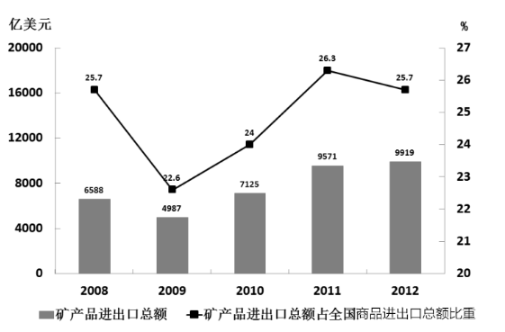

# 条件计数之差（倍数判定+比重变化）

考点：[[20-考点/资料分析/综合/条件计数之差（倍数判定+比重变化）|综合 / 条件计数之差（倍数判定+比重变化）]]

**问法模型**：题干问'满足条件①的年份个数与满足条件②的年份个数相差几个'→ 把两个条件分别逐年判定、计数后相减的模型

## 推理链
1. 第1步：将题干拆成两个计数条件：①石油消费量＞石油产量×2；②矿产品进出口总额占商品进出口总额比重较上年下降
2. 第2步：条件①逐年读图1：2008年消费量未超过产量的2倍（排除），2009、2010、2011、2012年均超过，共4个年份
3. 第3步：条件②读图2比重折线：仅2009、2012两年比重较上年下降，共2个年份
4. 第4步：个数之差=4−2=2，对照选项选C

**最快解法**：⚡ 边界排除法+读线法：条件①只需重点验证2008年（读图未达2倍即排除），其余4年直接计入得4；条件②直接看图2占比折线向下拐点，仅2009、2012两年得2；4−2=2秒选C，全程无需精确计算

## 易错点
- ⚠ '超过2倍'易误判为'超过产量'或'达到2倍'，把2008年边界年误计入条件①
- ⚠ 比重下降必须看占商品进出口总额比重的同比变化，易误用矿产品进出口总额本身的增减来判定（其总额逐年增长）
- ⚠ 求'相差几个'时易顺手把两组个数相加（4+2=6）或数漏年份误选D（3）

## 母题抽象
> 🧩 当题干出现'满足条件A的年份个数与满足条件B的年份个数相差'特征时，先把题干拆为两个可逐年判定的计数条件（常见为倍数关系+比重升降），分别列出年份清单、计数相减，最后对照选项验证

**同类特征**：2008—2012年间逐年判定、超过……2倍的年份个数、比重下降的年份个数、相差几个、图1与图2双图联查、答案为个数之差

## 相关题
（暂无）

---

### 题干
2008—2012年间，全国石油消费量超过全国石油产量2倍的年份的个数与矿产品进出口总额占全国商品进出口总额比重下降的年份的个数相差几个：

### 选项
- A. 0
- B. 1
- C. 2　✅
- D. 3

### 官方解析

由图表1计算得出，2008—2012年间全国石油消费量超过全国石油产量2倍的年份有：2009、2010、2011、2012四年；矿产品进出口总额占全国商品进出口总额比重下降的年份有：2009、2012两年；故二者年份个数之差为：。

故正确答案为C。

### 给定材料

图1 2008—2012年全国一次能源、石油生产量与消费量的情况

图2 2008—2012年全国矿产品进出口情况

