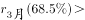
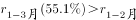

# 综合判断题（混合增长率居中＋基期量计算＋平均数比较＋累计减当月的简单加减）

考点：[[20-考点/资料分析/综合/综合判断题（混合增长率居中＋基期量计算＋平均数比较＋累计减当月的简单加减）|综合 / 综合判断题（混合增长率居中＋基期量计算＋平均数比较＋累计减当月的简单加减）]]
材料：[[15-材料/资料分析/360774 全国规模以上工业企业工业-服务机器人|360774 全国规模以上工业企业工业-服务机器人]]

**问法模型**：'能够从上述资料中推出的是'→逐项验证四个选项：A用基期量=现期/(1+增长率)并换算单位，B用混合增长率'居中'口诀比较3月与1~2月增速，C用均值=全年累计/4，D用'全年累计−12月当月'倒推1~11月

## 推理链
1. 第1步：A项定位第2段：2023年3月出口0.7亿美元、同比+110.3%，基期量=0.7/(1+110.3%)≈0.33亿美元≈3300万美元>3000万美元，'不到3000万美元'不成立，A错误
2. 第2步：B项定位第2段：2023年3月进口2.4亿美元、同比+68.5%；1~3月累计进口6.9亿美元、同比+55.1%；1~3月累计是3月与1~2月两部分的混合，整体增速55.1%必居两分量增速之间
3. 第3步：因3月增速68.5%>55.1%，故1~2月增速必<55.1%，即68.5%>1~2月增速，3月增速快于1~2月，B成立
4. 第4步：C项：2022年服务机器人全年累计645.8万套，各季度均值=645.8/4≈161.45万套，2023年一季度145万套<161.45万套，'高于'不成立，C错误
5. 第5步：D项：2022年1~11月工业+服务机器人产量之和=(44.3+645.8)−(4+49.1)=690.1−53.1=637万套<650万套，'超过650万套'不成立，D错误
6. 第6步：综上仅B能从资料推出，与官方答案一致

**最快解法**：⚡ B项用'混合居中'口诀秒杀：3月增速68.5%＞1~3月累计增速55.1%⇒1~2月增速<55.1%⇒3月快于1~2月，无需算具体增速；其余项粗估排除：A项0.7/2.1≈0.33亿美元（3300万+万美元）>0.3亿；C项645.8/4≈161>145；D项690.1−53.1=637<650

## 易错点
- ⚠ 当月值与累计值混排易取错行：A项求2022年3月基期须用3月当月出口0.7亿美元，误用1~3月累计1.9亿美元即错
- ⚠ 单位换算：基期量约0.33亿美元≈3300万美元，漏掉'1亿美元=10^4万美元'的换算会误判A'不到3000万美元'成立
- ⚠ 混合增速居中方向与口径拼接：1~3月累计为整体、3月与1~2月为部分，方向搞反会误判B；另C项'上年各季度均值'=645.8/4而非与645.8直接比较，D项倒推1~11月时工业、服务两项均须扣减12月当月值，漏减一项即错

## 母题抽象
> 🧩 当题干出现'能够从上述资料中推出的是'且选项混有增速比较、基期量、均值、时段倒推时，先用口诀（混合居中）或粗估秒判最简选项定答案，再用'累计−当月'等间接拼接验证其余项

**同类特征**：能够从上述资料中推出的是、同比增速快于（混合增长率比较）、不到3000万美元（基期量＋亿美元转万美元）、上年各季度均值（全年累计/4）、1~11月（全年累计−12月当月倒推）、当月值与累计值混排材料

## 相关题
- [[10-真题/资料分析/综合/19283943 综合分析判断题（倍数比较+求和判断+隐含平均每场座位数反推）|19283943]]（国考 2025，相关度1）
- [[10-真题/资料分析/综合/1796162 综合判断（月均计算、平均运输距离、比重对比、增长量比较逐项验证）|1796162]]（贵州 2016，相关度1）
- [[10-真题/资料分析/综合/2133504 综合判断题（现期比重+现期平均数多项验证，一对三错）|2133504]]（国考 2018，相关度1）
- [[10-真题/资料分析/综合/2444706 综合判断题（增长量+比重+倍数逐项验证）|2444706]]（四川 2019，相关度1）
- [[10-真题/资料分析/综合/2571728 综合分析逐项判断（等差递推求和＋单位换算＋比值估算）|2571728]]（山东 2020，相关度1）

---

### 题干
能够从上述资料中推出的是：

### 选项
- A. 2022年3月，我国机器人设备出口金额不到3000万美元
- B. 2023年3月，我国机器人设备进口金额同比增速快于1~2月同比增速　✅
- C. 2023年一季度，全国规模以上工业企业的服务机器人完成产量高于上年各季度均值
- D. 2022年1~11月，全国规模以上工业企业的工业和服务机器人完成产量之和超过650万套

### 官方解析

A项：定位文字材料第二段可知，2023年3月，我国机器人设备出口金额0.7亿美元，较上年增长110.3%。根据公式：基期量，可得所求万美元万美元，错误；

B项：定位文字材料第二段可知，2023年3月，我国机器人设备进口金额2.4亿美元，较上年增长68.5%；2023年1~3月我国机器人设备累计进口金额6.9亿美元，较上年增长55.1%。根据混合增长率口诀“混合居中”可知，，即2023年3月，我国机器人设备进口金额同比增速快于1~2月同比增速，正确；

C项：定位文字材料第一段可知，2023年1~3月全国规模以上工业企业的服务机器人累计完成产量145万套；定位文字材料第三段可知，2022年1~12月全国规模以上工业企业的服务机器人累计完成产量645.8万套。则2022年各季度均值万套。故2023年一季度产量（145万套）低于2022年各季度均值（万套），错误；

D项：定位文字材料第三段可知，2022年12月，全国规模以上工业企业的工业机器人完成产量4万套，服务机器人完成产量49.1万套。2022年1~12月全国规模以上工业企业的工业机器人累计完成产量44.3万套，服务机器人累计完成产量645.8万套。则2022年1~11月工业和服务机器人完成产量之和=2022年1~12月产量之和-2022年12月产量之和=（44.3+645.8）-（4+49.1）=645.8+（44.3-49.1）-4＜645.8万套＜650万套，错误。

故正确答案为B。

### 给定材料

        2023年3月，全国规模以上工业企业的工业机器人完成产量4.4万套，服务机器人完成产量70万套。2023年1~3月全国规模以上工业企业的工业机器人累计完成产量10.4万套，服务机器人累计完成产量145万套。

        2023年3月，我国机器人设备出口金额0.7亿美元，较上年增长110.3%，进口金额2.4亿美元，较上年增长68.5%。2023年1~3月我国机器人设备累计出口金额1.9亿美元，较上年增长62.1%，累计进口金额6.9亿美元，较上年增长55.1%。

        2022年12月，全国规模以上工业企业的工业机器人完成产量4万套，服务机器人完成产量49.1万套。2022年1~12月全国规模以上工业企业的工业机器人累计完成产量44.3万套，服务机器人累计完成产量645.8万套。

        2022年12月，我国工业机器人设备出口金额0.5亿美元，进口金额1.8亿美元。2022年1~12月我国工业机器人设备累计出口金额6.1亿美元，累计进口金额20亿美元。

