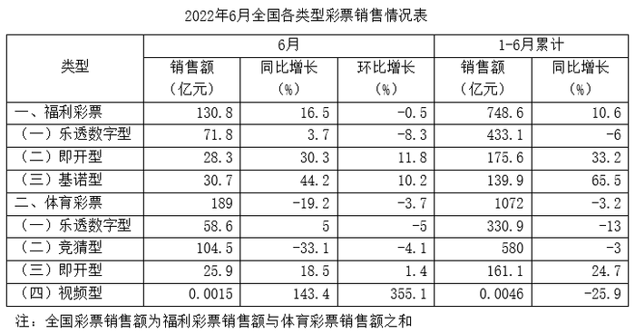

# 综合分析判断（增长量计算＋基期比重＋月均比较＋增长量倍数）

考点：[[20-考点/资料分析/综合/综合分析判断（增长量计算＋基期比重＋月均比较＋增长量倍数）|综合 / 综合分析判断（增长量计算＋基期比重＋月均比较＋增长量倍数）]]
材料：[[15-材料/资料分析/6345032 2022年6月当月及1-6月累计，全|6345032 2022年6月当月及1-6月累计，全]]

**问法模型**：『能够从上述资料中推出的是』四选一综合判断问法→对每个选项分别套用对应模型逐项验证：增长量=现期×r/(1+r)（含亿元→万元换算）、基期比重=基期体彩/(基期福利+基期体彩)、月均=(累计-6月)÷5与6月值比较、增长量倍数比较

## 推理链
1. 第1步：A项从表格取视频型体育彩票1-6月累计销售额0.0046亿元（=46万元）、同比-25.9%，属负增长求增长量
2. 第2步：套增长量公式：增长量=现期×r/(1+r)=46×(-0.259)/(1-0.259)≈-16.1万元，即同比减少约16.1万元，超过15万元，A正确
3. 第3步：B项按表下注释全国=福利+体彩，反推2021年上半年基期：福利=748.6/1.106≈676.9亿元，体彩=1072/0.968≈1107.4亿元
4. 第4步：基期比重=1107.4/(676.9+1107.4)=1107.4/1784.3≈62.1%<70%，B错误
5. 第5步：C项月均=(1-6月累计-6月值)÷5，即开型=(161.1-25.9)÷5=27.04亿元>6月25.9亿元，即开型6月未超过月均，『均超过』被一项否定，C错误（乐透54.46<58.6、竞猜95.1<104.5、视频0.00062<0.0015均满足）
6. 第6步：D项即开型6月增量=28.3×0.303/1.303≈6.6亿元，基诺型=30.7×0.442/1.442≈9.4亿元，倍数=9.4/6.6≈1.43<1.5，D错误
7. 第7步：仅A项成立，对照选项锁定答案A

**最快解法**：⚡ 综合题先攻数字最小、含单位换算的A项：百化分速算——25.9%≈25%=1/4，负增长时减少量=现期÷(n-1)=46÷3≈15.3万元，且25.9%>25%实际减少更多，必超15万元，直接锁定A；关键换算：0.0046亿元=46万元

## 易错点
- ⚠ 单位换算陷阱：0.0046亿元=46万元，不换算成万元就无法与选项『15万元』比较，最易在A项误判
- ⚠ D项公式陷阱：增长量须乘r/(1+r)，若误用现期×增速（28.3×30.3%≈8.57、30.7×44.2%≈13.57）得倍数13.57/8.57≈1.58>1.5，会错判D正确
- ⚠ 负增长方向与基期：同比-25.9%、-3.2%为负，基期=现期÷(1-|r|)分母小于1、基期大于现期；增长量为负表示减少，方向搞反则A、B全错
- ⚠ C项月均口径：须用(累计-6月)÷5（等价于累计÷6）与6月比较，不能误用环比/同比列数据；且『均超过』只要即开型一项不满足即整项错误

## 母题抽象
> 🧩 当题干出现『能够从上述资料中推出的是』的综合判断特征时，优先验证含极小数值＋单位换算的增长量选项（负增长用减少量=现期÷(n-1)百化分速算），其余按基期比重→月均比较→增长量倍数顺序排除；凡比较增长量或其倍数，必用r/(1+r)修正而非直接乘增速

**同类特征**：能够从上述资料中推出的是、四选一综合判断、同比增长-25.9%（负增长）、亿元与万元单位换算、上半年每月平均销售额、同比增量倍数比较

## 相关题
- [[10-真题/资料分析/综合/1746812 综合判断题（逐项验证：比重计算、双指标排序比较、同比方向判断）|1746812]]（国考 2016，相关度2）
- [[10-真题/资料分析/综合/10942304 综合判断（增长量计算+单位换算；两期比重比较；下降速度比较）|10942304]]（山东 2024，相关度2）
- [[10-真题/资料分析/综合/12536418 综合判断题（基期量计算+增长量计算+差额变化比较+两期比重比较混合考查）|12536418]]（四川 2024，相关度2）
- [[10-真题/资料分析/综合/15833800 综合判断（年均平均数+同比增量递增+最值查找+增长率多模型混合验证）|15833800]]（贵州 2026，相关度2）
- [[10-真题/资料分析/综合/2187843 综合判断题（混合增长率居中原理+现期比重+总量减部分差值）|2187843]]（山东 2018，相关度2）

---

### 题干
能够从上述资料中推出的是：

### 选项
- A. 2022年上半年，视频型体育彩票销售额同比减少超过15万元　✅
- B. 2021年上半年，全国体育彩票销售额占全国彩票销售额的70%以上
- C. 四类体育彩票2022年6月的销售额均超过上半年每月的平均销售额
- D. 2022年6月，福利彩票中基诺型销售额同比增量是即开型的1.5倍以上

### 官方解析
A项：定位表格材料可得，2022年1-6月累计视频型体育彩票销售额0.0046亿元，同比增长-25.9%。根据公式：增长量，可得2022年上半年，视频型体育彩票销售额同比增量万元，即同比减少超过15万元，正确；
B项：定位表格材料可得，2022年1-6月累计全国福利彩票销售额748.6亿元，同比增长10.6%；体育彩票销售额1072亿元，同比增长-3.2%。根据公式：基期量，可得2021年上半年，全国福利彩票销售额为亿元，体育彩票销售额为亿元。根据公式：比重，则2021年上半年，全国体育彩票销售额占全国彩票销售额的比重，错误；
C项：定位表格材料可得，2022年6月及1-6月累计全国体育彩票中，乐透数字型销售额分别为58.6亿元、330.9亿元；竞猜型销售额分别为104.5亿元、580亿元；即开型销售额分别为25.9亿元、161.1亿元；视频型销售额分别为0.0015亿元、0.0046亿元。则四类体育彩票2022年上半年每月的平均销售额分别为：乐透数字型，亿元&lt;6月销售额58.6亿元；竞猜型，亿元&lt;6月销售额104.5亿元；即开型，亿元&gt;6月销售额25.9亿元；视频型，亿元&lt;6月销售额0.0015亿元。综上，四类体育彩票中，即开型2022年6月的销售额未超过上半年每月的平均销售额，错误；
D项：定位表格材料可得，2022年6月全国福利彩票中，即开型销售额28.3亿元，同比增长30.3%；基诺型销售额30.7亿元，同比增长44.2%。根据公式：增长量，可得2022年6月，即开型福利彩票销售额同比增量亿元，基诺型福利彩票销售额同比增量亿元，则福利彩票中基诺型销售额同比增量是即开型的倍，错误。
故正确答案为A。

### 给定材料

