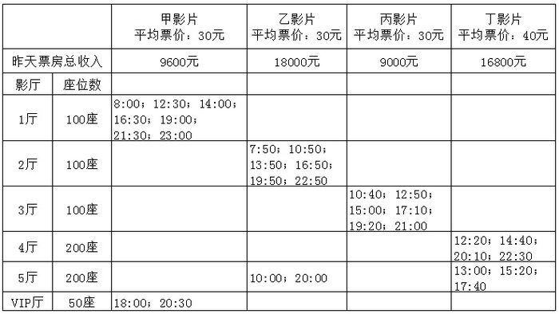

# 材料 · 某影院6个影厅（1-5厅+VIP厅）最近一周的每日排片安排（甲、乙、丙、丁四部影

> 关联 3 道小题

**时间口径**：双重时间口径并存：排片时刻表为'最近一周'的每日安排（每天重复同一排片）；'昨天票房总收入'为昨天单日的现期汇总值（单日合计，非一周累计）。无基期年、无预测年份、无多期数据，全部数据只对应一天。

**单位与换算**：金额单位为元（票房9600/18000/9000/16800元，平均票价甲乙丙均30元、丁40元）；场次单位为场；座位/人次单位为座/人次。核心换算：①观影人次=票房收入÷平均票价（甲=9600÷30=320，乙=18000÷30=600，丙=9000÷30=300，丁=16800÷40=420人次），票价不同是最大换算陷阱；②排片率、上座率均为百分比比值，无单位；③上座率分母b=Σ(各厅场次×该厅座位数)，座位数有50/100/200三档，量级不同不可统一相乘。

## 结构拆解
- 第1张表（唯一图表，行列交叉表）：列维度为四部影片（甲/乙/丙/丁），表头标注平均票价（甲、乙、丙各30元，丁40元），首行数据为'昨天票房总收入'：甲9600元、乙18000元、丙9000元、丁16800元。行维度为6个影厅及座位数：1厅100座、2厅100座、3厅100座、4厅200座、5厅200座、VIP厅50座。表体为各影片在各厅的当日放映时刻：甲在1厅7场（8:00、12:30、14:00、16:30、19:00、21:30、23:00）+VIP厅2场（18:00、20:30）共9场；乙在2厅6场（7:50、10:50、13:50、16:50、19:50、22:50）+5厅2场（10:00、20:00）共8场；丙在3厅6场（10:40、12:50、15:00、17:10、19:20、21:00）共6场；丁在4厅4场（12:20、14:40、20:10、22:30）+5厅3场（13:00、15:20、17:40）共7场。全院合计30场。表中未直接给出总场次、排片率、观影人次、上座率，全部需考生自行推导。

## 阅读陷阱
- ⚠ 同名影片跨厅排片：甲分散在1厅+VIP厅，乙分散在2厅+5厅，丁分散在4厅+5厅，总场次必须跨行合并统计，只看单行/单列会漏场。
- ⚠ 各厅座位数不等（VIP厅50座、1-3厅100座、4-5厅200座），上座率分母b须逐厅按'场次×该厅座位数'求和，不能用统一座位数×总场次。
- ⚠ 丁影片平均票价40元与其余三部30元不同，用票房换算观影人次时若统一按30元计算，丁的人次会算错（应为16800÷40=420而非560）。
- ⚠ 票房是'昨天'单日数据，排片表是'最近一周'的每日安排，两套时间口径混排；计算昨天上座率只能用昨天票房，不得按一周天数放大。
- ⚠ 5厅同一行内排了乙（10:00、20:00）和丁（13:00、15:20、17:40）两部影片，读表时易把乙的场次误记到丁名下或反之。
- ⚠ 题干公式以留白形式呈现（'排片率就是___''上座率就是___'），需按常规定义自行补全：排片率=该影片放映场次÷全院总场次；上座率=观影人次÷该影片全部场次座位总数。

## 小题群关系
三题共用同一张排片表，属'一表多挖'模式。题1为占比模型：先数出各影片场次（甲9、乙8、丙6、丁7，合计30场），排片率=影片场次÷30，甲（9/30=30%）最高。题2为两步换算比率模型：分子a=票房÷平均票价，分母b=Σ(场次×所在厅座位数)（甲800座、乙1000座、丙600座、丁1400座），得上座率乙60%＞丙50%＞甲40%＞丁30%——其中分母b的场次计数直接复用题1统计结果，属连环复用。题3为纯时间推理题：按'18:30下班+半小时晚餐+半小时路程=19:30到影院，须提前10分钟入场即开场不早于19:40'的约束筛选时刻表，最早满足的是乙影片19:50场（到影院后尚余20分钟），不再涉及比值计算，但复用表中的时刻列。三题层层递进：数场次→算人次与座位→用时刻做决策。

## 关联真题
- [[10-真题/资料分析/比重/1756326 比重比较（排片率=该影片场次÷全院总场次，分母相同比分子）|1756326]] 国考 2016 — 比重比较（排片率=该影片场次÷全院总场次，分母相同比分子）
- [[10-真题/资料分析/比重/1756328 两步换算求上座率（票房÷票价求人次，Σ场次×各厅座位数求分母）并排序比较|1756328]] 国考 2016 — 两步换算求上座率（票房÷票价求人次，Σ场次×各厅座位数求分母）并排序比较
- [[10-真题/资料分析/其他/1756330 时间推算与时刻筛选（排片表决策型）|1756330]] 国考 2016 — 时间推算与时刻筛选（排片表决策型）

---

### 材料原文

某影院有6个影厅，最近一周的排片情况和昨天的票房收入见下表：

