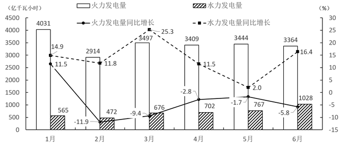

# 材料 · 我国发电量情况：2013—2014年分季度的发电总量、水力与火力发电量（统计表）

> 关联 5 道小题

**时间口径**：两套时间口径并存：表为2013年第一季度至2014年第四季度共8个季度的当季值（非累计值）；图为2015年1—6月各月当期值及当月同比增速（增速的基期是2014年同月，但材料未给出月度基期数据）。材料本身不含预测年份，第4题属假设性外推（2015年7—11月）

**单位与换算**：全部数量指标单位统一为亿千瓦小时（表头标注），图纵轴同为亿千瓦小时，右轴为增速%，无需单位换算；但柱状数值为千位级绝对量（如4031），折线旁标签为百分比（如25.3），二者不可混加；季度值=该季度三个月当月值之和，不能按累计口径理解

## 结构拆解
- 统计表《2013年第一季度至2014年第四季度我国发电量情况》：2个年份×4个季度，四列指标——时间、发电总量、水力发电量、火力发电量。发电总量2013年Q1—Q4为11823、12519、14347、13763，2014年为12719、13444、14592、13883；水力2013年为1306、1985、2552、2047，2014年为1453、2265、3442、2284；火力2013年为10006、9949、11161、11037，2014年为10782、10582、10877、10677
- 统计图（2015年1—6月）：白柱=火力发电量（1—6月：4031、2914、3497、3409、3444、3364），阴影柱=水力发电量（565、472、676、702、767、1028），读左轴0—4500亿千瓦小时；实线（圆点）=火力发电量同比增长（11.5%、-11.9%、-9.4%、-2.8%、-1.7%、-5.8%），虚线（方块）=水力发电量同比增长（14.9%、11.8%、25.3%、11.5%、2.0%、16.4%），读右轴-15%—30%

## 阅读陷阱
- ⚠ 双轴图陷阱：柱子读左轴（发电量）、折线读右轴（增速%），数值标签在柱与线间交叉排布，易把25.3、16.4等增速误读成发电量
- ⚠ 折线归属易混：实线圆点是火力增速、虚线方块是水电增速，1月两线数值接近（14.9与11.5），看错图例整题皆错
- ⚠ 跨图表拼接：表中只有季度值，2015年第二季度火力发电量须用图中4+5+6月相加，再与表中2014年Q2火力（10582）比较；表的季度数据是当季值而非累计值
- ⚠ 基期数据不全：图中2015年各月增速对应的2014年同月基期值材料未给出（表中仅有季度合计），判断某月发电量是否'少于上年同期'只能依据增速正负号，不能硬算基期
- ⚠ 外推步长陷阱：第4题'2月—6月平均增速'对应4个增长步长（1028/472开4次方），而由6月外推至11月是5个步长，间隔月数数错结果即错

## 小题群关系
四题覆盖资料分析四类核心模型：第1题为读图定性题，依火力增速折线判负增长月份（2—6月为负，即5个月）；第2题为表格基期比较题，用表中2014/2013年同季度发电总量作同比（第四季度增速最低）；第3题为跨图表连环计算题，图中4、5、6月火力之和对比表中2014年Q2火力10582求差额（少约365亿千瓦小时）；第4题为图内连环外推题，由2—6月水电量求月均增长率（约21.5%）再外推5个月至11月。四题间数据不直接复用，但第3、4题均需先在图内算出中间量（季度加总/平均增速）后再进行下一步计算

## 关联真题
- [[10-真题/资料分析/增长/1789628 同比增长率比较|1789628]] 江苏 2016 — 同比增长率比较
- [[10-真题/资料分析/增长/1789630 同比减少量计算＋跨图表数据拼合|1789630]] 江苏 2016 — 同比减少量计算＋跨图表数据拼合
- [[10-真题/资料分析/增长/1789634 月均增长率反解与外推求现期（年均增长率模型）|1789634]] 江苏 2016 — 月均增长率反解与外推求现期（年均增长率模型）
- [[10-真题/资料分析/综合/1789640 综合判断选非题（比重门槛比较＋增速方向判断＋环比增减计数）|1789640]] 江苏 2016 — 综合判断选非题（比重门槛比较＋增速方向判断＋环比增减计数）
- [[10-真题/资料分析/增长/1789652 增长率正负判定（负增长月份计数，同比增减定性）|1789652]] 江苏 2016 — 增长率正负判定（负增长月份计数，同比增减定性）

---

### 材料原文

        2015年1—6月我国火力、水力发电量及其增长情况
