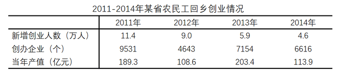

# 材料 · 2015年某省农民工在本市（区、县）自主创业意愿调查（3000个有效样本的障碍分

> 关联 5 道小题

**时间口径**：图1、图2为2015年当年调查的现期截面数据（百分比结构，无时间序列）；表格为2011—2014年逐年数据，其中'新增创业人数''创办企业''当年产值'均为各年当期发生量，非累计值；无预测年份。调查现期（2015年）与表格末期（2014年）相差一年，第2题'上年'即2013年

**单位与换算**：图1、图2单位为%；表格单位：新增创业人数为万人、创办企业为个、当年产值为亿元。量级陷阱：万人换算为人需×10000（11.4万人=114000人），求'平均每家企业创业者数'约为个位数到十几人量级，勿多乘一个零；求'平均每家企业产值'为亿元÷个，结果约十几万至几十万元/家；样本人数计算需百分比×3000（如8.5%×3000=255人）

## 结构拆解
- 图1（横向条形图）：2015年调查中农民工认为在本市（区、县）自主创业的最大障碍，共8项：缺乏合适创业项目43.3%、获得创业贷款难40.5%、缺乏创业经验人脉关系39.7%、能力难以承受风险31.9%、难以找到创业基地24.1%、家人朋友不支持5.1%、没有什么障碍1.3%、其他5.2%，按占比从高到低排列
- 图2（3D饼图）：2015年调查中农民工在本市（区、县）自主创业意愿情况，共6类：已经开始自主营业26.2%、完全没有兴趣意愿25.9%、有一点兴趣意愿13.1%、有一定的兴趣意愿16.6%、兴趣意愿较大9.7%、兴趣意愿很强8.5%，合计100%
- 表格：2011—2014年某省农民工回乡创业情况，3个指标×4个年份：新增创业人数2011年11.4、2012年9.0、2013年5.9、2014年4.6（万人）；创办企业2011年9531、2012年4643、2013年7154、2014年6616（个）；当年产值2011年189.3、2012年108.6、2013年203.4、2014年113.9（亿元）

## 阅读陷阱
- ⚠ 图1为多选题：各选项占比合计约191.1%（43.3+40.5+39.7+31.9+24.1+5.1+1.3+5.2），不能按100%的结构比重理解，也不能用占比直接乘3000当作唯一选择人数
- ⚠ 图2为3D饼图且扇区与图例需逐一对色：白色26.2%对应'已经开始自主营业'（是行为而非意愿等级），网点25.9%对应'完全没有兴趣意愿'，黑色9.7%对应'兴趣意愿较大'，斜点8.5%对应'兴趣意愿很强'，最高占比两项极易被误认为意愿最强
- ⚠ 图2中求'有创业意愿'人群时须排除'已经开始自主营业'26.2%，有意愿合计=13.1%+16.6%+9.7%+8.5%=47.9%；'兴趣意愿很强'仅8.5%，易与相邻扇区数值（9.7%、25.9%）看串行
- ⚠ 表格三项指标均为当年新增/当期值，'新增创业人数'是流量不是存量，不能跨年相加当作创业总人数；'创办企业'数最小的2012年（4643个）对应产值也最低（108.6亿元），数值大小趋势不同步，查数时易错位
- ⚠ 跨图表口径不同：图1、图2是2015年3000人意愿调查样本，表格是2011—2014年全省实际回乡创业数据，二者对象与年份均不同，不可直接拼接计算
- ⚠ 第2题需对比2014年（113.9亿元/6616个≈17.2万元/家）与2013年（203.4亿元/7154个≈28.4万元/家），'上年'数据须回取2013列，易误用2011年基期

## 小题群关系
本组题围绕四类模型：①比重×样本量——第1题用图2求'兴趣意愿很强'人数（8.5%×3000≈255人）；②平均数两期比较——第2题用表格'当年产值÷创办企业'比较2014与2013年每家企业平均产值（约17.2万元 vs 28.4万元，判断下降）；③平均数时间趋势——第3题用表格'新增创业人数×10000÷创办企业'逐年计算每家企业平均创业者数（2011约12.0人、2012约19.4人、2013约8.2人、2014约7.0人，先升后降），需连续四年同类计算但各年独立，不连环复用上一题结果；④定性推断——第4题需结合图1障碍分布（缺项目、贷款难、缺经验人脉居前）与图2意愿结构选举措；第5题为综合推断题，需跨图1、图2、表格逐项验证。第1、2、3题各锁定不同图表，题与题之间无数值传递，但共享'平均数=总量÷份数'这一核心模型。

## 关联真题
- [[10-真题/资料分析/综合/2030164 定性推断——调查障碍占比排序与对策选项匹配|2030164]] 四川 2016 — 定性推断——调查障碍占比排序与对策选项匹配
- [[10-真题/资料分析/比重/2030154 现期比重求部分量（占比×样本总量）|2030154]] 四川 2016 — 现期比重求部分量（占比×样本总量）
- [[10-真题/资料分析/平均数/2030158 平均数增长率（两期平均数升降比较）|2030158]] 四川 2016 — 平均数增长率（两期平均数升降比较）
- [[10-真题/资料分析/平均数/2030160 平均数求解与多年趋势比较（平均每家企业创业者数）|2030160]] 四川 2016 — 平均数求解与多年趋势比较（平均每家企业创业者数）
- [[10-真题/资料分析/综合/2030170 综合推断（占比×样本量 + 平均数计算与两期倍数比较）|2030170]] 四川 2016 — 综合推断（占比×样本量 + 平均数计算与两期倍数比较）

---

### 材料原文

        2015年，某省对农民工在本市（区、县）创业的意愿进行了调查，共完成有效样本3000个，调查结果如下：

