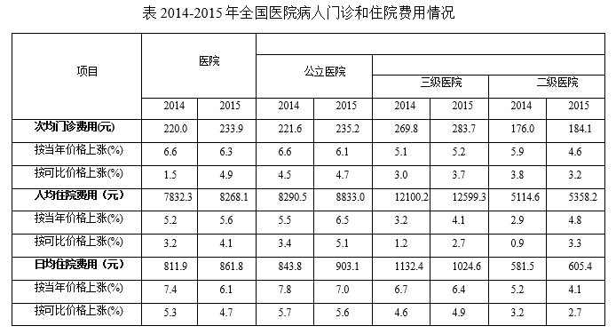

# 材料 · 2014—2015年全国医院病人门诊和住院费用情况：按医院整体、公立医院、三级医

> 关联 4 道小题

**时间口径**：现期2015年、基期2014年两个年度的当期（年度）费用均值，无预测年份、无累计值；每个指标配两行同比涨幅（'按当年价格上涨%'与'按可比价格上涨%'两套口径）；2013年数据未直接给出，需用2014年数值结合涨幅倒推（第1题考点）。

**单位与换算**：三项费用指标单位均为'元'（数值如220.0、12599.3），涨幅单位为'%'；无亿元/万吨类大额单位，量级陷阱主要是数值位数多易看错小数位；隐藏换算关系：人均住院费用(元)÷日均住院费用(元)≈出院病人人均住院天数（天），如表中2015年二级医院5358.2÷605.4≈8.9天。

## 结构拆解
- 唯一统计表《2014—2015年全国医院病人门诊和住院费用情况》：列结构为四个口径分组——医院、公立医院、三级医院、二级医院，每组各含2014、2015两列，共8列数据；数据年份仅2014—2015两年。
- 行结构①：次均门诊费用(元)——医院220.0→233.9，公立医院221.6→235.2，三级医院269.8→283.7，二级医院176.0→184.1；其下两行涨幅：按当年价格上涨%（6.6/6.3；6.6/6.1；5.1/5.2；5.9/4.6）、按可比价格上涨%（1.5/4.9；4.5/4.7；3.0/3.7；3.8/3.2）。
- 行结构②：人均住院费用(元)——医院7832.3→8268.1，公立医院8290.5→8833.0，三级医院12100.2→12599.3，二级医院5114.6→5358.2；其下按当年价格上涨%（5.2/5.6；5.5/6.5；3.2/4.1；2.9/4.8）、按可比价格上涨%（3.2/4.1；3.4/5.1；1.2/2.7；0.9/3.3）。
- 行结构③：日均住院费用(元)——医院811.9→861.8，公立医院843.8→903.1，三级医院1132.4→1024.6，二级医院581.5→605.4；其下按当年价格上涨%（7.4/6.1；7.8/7.0；6.7/6.4；5.2/4.1）、按可比价格上涨%（5.3/4.7；5.7/5.6；4.6/4.9；3.2/2.7）。
- 表下注释：①费用均值按当年价格计算；②界定了次均门诊费用（门诊病人次均医药费用）、人均住院费用（出院病人住院期间人均医药费用）、日均住院费用（出院病人住院期间日均医药费用）三个指标的口径。

## 阅读陷阱
- ⚠ 同名涨幅双口径：每个指标下都有'按当年价格上涨%'和'按可比价格上涨%'两行，前者含物价变动因素，后者剔除价格因素，两者之差≈价格（通胀）因素，第3题直接考此概念辨析，极易混淆串行。
- ⚠ 列口径与题干措辞对应：表中'三级医院''二级医院'两列即题干所称'公立三级医院''公立二级医院'；'医院'列为全口径、'公立医院'列为其子集，四列数值互不相同，切勿串列取数。
- ⚠ 三个绝对数指标名近似：'次均门诊费用''人均住院费用''日均住院费用'易混；表中未直接给出住院天数，第4题需跨行拼接（人均住院费用÷日均住院费用）才可求出。
- ⚠ 表格只有2014、2015两年数据，第1题问2014年比2013年多多少，必须用2014年数值与当年价格涨幅6.6%做基期倒推，不能直接读表得答案。
- ⚠ 涨幅行给出的是增长率而非增量，'比某年多多少'类问题需另行计算增长量=现期×r/(1+r)，直接用现期×r会出错。
- ⚠ 三级医院日均住院费用2015年(1024.6)低于2014年(1132.4)而对应涨幅为正，取数时须仔细核对行与列的交叉对应，防止串行误读；涉及该格计算时以图中数值为准并谨慎复核。

## 小题群关系
四题共用同一张表，围绕'基期倒推增长量、现期差值比较、双口径涨幅概念辨析、平均数拼接'四个模型展开：第1题为基期增长量（用2014年次均门诊费用220.0元及当年价格涨幅6.6%倒推2013年，增量≈220.0×6.6%/106.6%≈13.6元）；第2题为现期差值比较（2015年三级医院人均住院费用12599.3元−二级医院5358.2元≈7241.1元）；第3题为概念辨析题，基本不需计算，考'当年价格涨幅与可比价格涨幅之差来源于价格（物价/通胀）变动因素'；第4题为平均数拼接（5358.2÷605.4≈8.9天）。四题之间无连环复用（上一题结果不被下一题引用），但定位不同'行×列×年份'交叉单元格的速度决定做题效率。

## 关联真题
- [[10-真题/资料分析/平均数/2043708 现期平均数拼接（人均住院费用÷日均住院费用=人均住院天数）|2043708]] 江苏 2017 — 现期平均数拼接（人均住院费用÷日均住院费用=人均住院天数）
- [[10-真题/资料分析/增长/2043702 基期增长量计算（已知现期与增长率求增长量）|2043702]] 江苏 2017 — 基期增长量计算（已知现期与增长率求增长量）
- [[10-真题/资料分析/倍数/2043704 现期倍数（'多几倍'=是几倍−1）|2043704]] 江苏 2017 — 现期倍数（'多几倍'=是几倍−1）
- [[10-真题/资料分析/其他/2043706 统计口径概念辨析（当年价格与可比价格涨幅差异来源）|2043706]] 江苏 2017 — 统计口径概念辨析（当年价格与可比价格涨幅差异来源）

---

### 材料原文

注：①费用均值按当年价格计算；②次均门诊费用指门诊病人次均医药费用，人均住院费用指出院病人住院期间人均医药费用，日均住院费用指出院病人住院期间日均医药费用。
