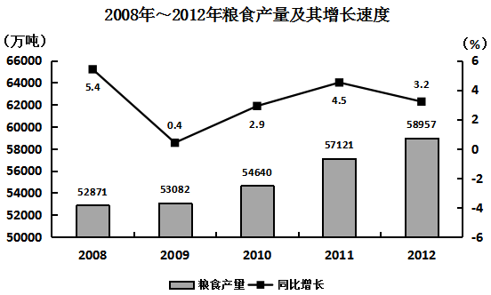

# 材料 · 2012年我国农业种植面积与主要农产品产量情况（粮食/棉花/油料/糖料/烟茶/肉

> 关联 5 道小题

**时间口径**：现期年为2012年；文字材料给2012年现期值与同比增速（隐含2011年基期量，需自行倒推）；统计图给出2008~2012共5年当期产量及逐年同比增速（由此可再倒推2007年基期量）；全部为当期（年度）产量，非累计值，无预测年份

**单位与换算**：面积用万公顷（粮食11127、棉花470、油料1398、糖料203、新增灌溉172、节水灌溉235）；产量用万吨（粮食58957、棉花684、油料3476、糖料13493、烤烟320、茶叶180、肉类8384、禽蛋2861、牛奶3744、水产品5906）；木材例外用万立方米（8088）；增速用%。量级注意：万公顷与万吨混合求单产得吨/公顷（57121万吨/约11058万公顷≈5.17吨/公顷）；基期量=现期/(1+增速)，增量=现期-现期/(1+增速)

## 结构拆解
- 文字第1段：2012年种植面积——粮食11127万公顷（比上年+69）、棉花470（-34）、油料1398（+12，原文写作'油科'）、糖料203（+9），均为现期面积与面积增减量
- 文字第2段：2012年产量——粮食58957万吨（+1836万吨、+3.2%）、棉花684（+3.8%）、油料3476（+5.1%）、糖料13493（+7.8%）、烤烟320（+11.5%）、茶叶180（+11.2%），模式为'现期值+同比增速'，基期量需倒推
- 文字第3段：畜产品与其他——肉类8384万吨（+5.4%）、禽蛋2861（+1.8%）、牛奶3744（+2.3%）、水产品5906（+5.4%）、木材8088万立方米（-0.7%，负增长）、新增有效灌溉面积172万公顷、新增节水灌溉面积235万公顷
- 统计图：2008~2012年粮食产量及其增长速度，双轴图——柱状为粮食产量（左轴，万吨，50000~66000）：2008年52871、2009年53082、2010年54640、2011年57121、2012年58957；折线为同比增长（右轴，%）：5.4、0.4、2.9、4.5、3.2；图例：柱=粮食产量、方块折线=同比增长

## 阅读陷阱
- ⚠ 统计图为双轴：柱对应左轴（万吨）是产量，折线对应右轴（%）是增速，切勿把折线数值当产量、或把柱值直接乘以折线数值
- ⚠ 粮食数据文字与图可互相校验：58957（2012）与3.2%在两处一致；2011年产量既可读图57121，也可用58957-1836得到，注意互验后再使用
- ⚠ 求2007年粮食产量只能由图中2008年数据倒推：52871/(1+5.4%)，材料没有直接给出2007年数值
- ⚠ 单产=产量/种植面积，但2011年面积材料未直接给出，需用2012年面积11127减增量69倒推为11058万公顷，跨图+跨段拼数据
- ⚠ 比较'2012年比2011年增加最多'不能直接比增速或现期值，必须先逐项算增量（现期-现期/(1+g)），粮食增量1836万吨通常远超其他品类
- ⚠ 棉花种植面积减少34万公顷但产量增产3.8%，面积变化方向与产量变化方向可以相反，勿凭面积升降推产量
- ⚠ 木材单位是万立方米（且为下降0.7%），与其余'万吨'类指标口径不同，不可混算
- ⚠ 原文存在笔误：'油科'应为'油料'、'产效灌溉'应为'有效灌溉'，勿当成新指标；兄弟题第5题III表述被截断（'2012年各种农作物的产量比…'），条件不完整
- ⚠ 判断'2008~2012逐年增加'看图中增速是否全为正（5.4、0.4、2.9、4.5、3.2均为正即可得证）；'年均增量'用（58957-52871)/4≈1521.5万吨，与'不到1000万吨'对照即知真伪

## 小题群关系
这组题围绕'基期量倒推+增量计算+单产模型'展开：第1题用图中2008年量52871/(1+5.4%)倒推2007年约50160万吨；第2题是'单产=产量/面积'的跨图表拼接题（图中2011年57121万吨÷文字倒推的2011年面积11058万公顷）；第4题是增量比较题，需对棉花/油料/糖料/烤烟/茶叶用'现期-现期/(1+g)'算增量再与粮食1836万吨比较；第3、5题为综合判断题。连环复用明显：2011年粮食产量57121万吨（图给，亦等于58957-1836）同时服务第2题与第5题；2008年量52871同时服务第1题与第5题II的年均增量计算；2012年文字现期值与增速被第3、4、5题共同复用。

## 关联真题
- [[10-真题/资料分析/增长/2047654 基期量计算（由现期量与同比增速倒推上一年）|2047654]] 福建 2019 — 基期量计算（由现期量与同比增速倒推上一年）
- [[10-真题/资料分析/平均数/2047656 单位面积产量（单产）计算，跨图表拼接+面积基期倒推|2047656]] 福建 2019 — 单位面积产量（单产）计算，跨图表拼接+面积基期倒推
- [[10-真题/资料分析/综合/2047658 数据可得性判断（基期量可求性验证）|2047658]] 福建 2019 — 数据可得性判断（基期量可求性验证）
- [[10-真题/资料分析/增长/2047660 增长量比较|2047660]] 福建 2019 — 增长量比较
- [[10-真题/资料分析/综合/2047662 多命题综合判断（正误计数）——含基期量倒推、年均增量比较、趋势判断|2047662]] 福建 2019 — 多命题综合判断（正误计数）——含基期量倒推、年均增量比较、趋势判断

---

### 材料原文

        2012年我国粮食种植面积11127万公顷，比上年增加69万公顷；棉花种植面积470万公顷，减少34万公顷，油科种植面积1398万公顷，增加12万公顷；糖料种植面积203万公顷，增加9万公顷。

        全年粮食产量58957万吨，比上年增加1836万吨，增产3.2%。全年棉花产量684万吨，比上年增产3.8%，油料产量3476万吨，比上年增产5.1%，糖料产量13493万吨，比上年增产7.8%，烤烟产量320万吨，比上年增产11.5%；茶叶产量180万吨，比上年增产11.2%。

        全年肉类产量8384万吨，比上年增产5.4%；禽蛋产量2861万吨，比上年增产1.8%，牛奶产量3744万吨，比上年增产2.3%；水产品产量5906万吨，比上年增产5.4%；全年木材产量8088万立方米，比上年下降0.7%；全年新增产效灌溉面积172万公顷，新增节水灌溉面积235万公顷。

