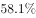
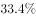
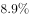
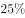
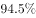
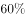
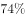
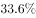
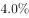

# 材料 · 某年度某机构关于中国宠物主人消费行为及倾向的问卷调查（10680份有效问卷）：涵

> 关联 5 道小题

**时间口径**：单一时点的截面调查数据（"某年度"一次性调查），无基期/现期之分，不含预测年份；所有数据均为该次问卷的当期统计占比，非累计值，也无时间序列

**单位与换算**：样本基数统一为10680份有效问卷；比重以百分数与文字比例混用："四成"=40%、"三成"=30%、"近一半"≈50%、"不足X%"为上限约数、"接近X%"为约数；人数类计算=10680×对应比重；需区分"人数"与"人次"（购买物品、购买渠道均可多选重复计数）；特别注意：本材料文本中绝大多数百分数数值处均为空格缺省，具体量级必须以完整原卷数值为准，不得凭经验补数

## 结构拆解
- 单一文字型材料（0张统计图/表）：某机构宠物主人消费行为调查结果，样本10680份有效问卷，依次给出7组指标——①养宠者结构：女性占比、"80-90后"占比（数值均空缺）；②宠物角色认知：将宠物定义为"孩子""亲人""朋友""宠物"的四类占比（数值均空缺）；③月开销分布：100元以内、101至500元、501至1000元、1000元以上四档占比（数值均空缺）；④购买物品：宠物食物居首，其次为药品、保健品、日用品、玩具、服饰五项"均接近"同一比重（数值空缺）；⑤外出安置：四成"委托亲朋照顾"、三成"一起带走"、委托寄养"不到"某值；⑥训练状况：自主训练或放任生长的占比（数值空缺）、近一半人希望爱宠得到专业训练；⑦购买渠道：综合电商平台占比、线下综合商店或专卖店占比、宠物类垂直电商平台占比（均空缺，且垂直电商复购率更高）、对购物类O2O服务有选择意向者"不足"某值

## 阅读陷阱
- ⚠ 最大陷阱：关键百分数在文本中全部为空格缺省（女性占比、四档开销、各购买渠道占比等），凭现有文本无法直接计算，切勿凭记忆或常识补数，须以完整原卷数值为准
- ⚠ "成"与百分数混用：四成=40%、三成=30%；"不足""接近""不到""近一半"均为约数或界限值而非精确值，据此计算的比值、人数只能得约数或区间
- ⚠ 月开销四档（100元以内/101-500/501-1000/1000以上）互斥且仅覆盖"有花费"人群，"没有花费"人数=10680×(1−四档占比之和)，易误把某单一档占比当作全体或漏掉求补
- ⚠ 购买物品与购买渠道均为可多选项目，各项占比之和远超100%，计算总规模时是"人次"而非"人数"，勿将各项占比相加后当作人数或当成100%
- ⚠ 宠物角色认知四类与月开销四档这类分组题应先确认互斥性（占比和≈100%）再决定用求和还是求补，两种模型不可混用
- ⚠ 所有小题共用同一基数10680份有效问卷，注意题干问的是"人数""人次"还是"比重"，量级与单位易错

## 小题群关系
五题共用同一基数10680与同一组调查占比，核心计算模型为"部分量=10680×比重"及"比重互补（1−已知比重）"。题1：男性占比=1−女性占比（互补模型）；题2："没有花费"人数=10680×(1−月开销四档占比之和)（求和后求补）；题3：综合电商平台人数与O2O人数之比=两比重相除，因O2O为"不足"型模糊值，比值结果为约数/范围；题4：以药品、保健品、日用品、玩具、服饰五项"均接近"同一比重的约数估算，总人次≈10680×该比重×5（多选题的人次叠加模型）；题5为综合判断题，需回用全文多处占比逐项核对正误。各题之间数据不连环复用（前一题结果不被后一题直接引用），但共享同一份占比体系与同一基数，题2、题3、题4的答案性质均为基于约数的估算值

## 关联真题
- [[10-真题/资料分析/比重/2051086 现期比重求部分量——互斥分组求和后取补（无花费人数=基数×(1−四档占比之和)）|2051086]] 河南 2017 — 现期比重求部分量——互斥分组求和后取补（无花费人数=基数×(1−四档占比之和)）
- [[10-真题/资料分析/倍数/2051088 同基数两类人数之比（分母为'不足'型模糊值的放缩定界）|2051088]] 河南 2017 — 同基数两类人数之比（分母为'不足'型模糊值的放缩定界）
- [[10-真题/资料分析/比重/2051084 比重互补（现期比重之1−已知比重求剩余部分）|2051084]] 河南 2017 — 比重互补（现期比重之1−已知比重求剩余部分）
- [[10-真题/资料分析/比重/2051090 现期部分量计算（多选项'人次'占比叠加求和）|2051090]] 河南 2017 — 现期部分量计算（多选项'人次'占比叠加求和）
- [[10-真题/资料分析/综合/2051092 综合判断题（选非）——文字型调查材料多指标正误核对|2051092]] 河南 2017 — 综合判断题（选非）——文字型调查材料多指标正误核对

---

### 材料原文

        某年度某机构关于中国宠物主人消费行为及倾向调查回收的10680份有效问卷显示：女性养宠者占，宠物主人为“80-90后”占。将宠物定义为“孩子”“亲人”“朋友”和“宠物”的分别为、、和。的人月开销在100元以内，的人开销在101至500元之间，而花费在501至1000元之间的达到，月消费1000元以上的人群达到。在购买物品方面，购买宠物食物的人数达到有效问卷总人数的，其次为药品、保健品，以及日用品、玩具、服饰五项，均接近。宠物主人外出时，四成“委托亲朋照顾”，三成“一起带走”，委托寄养还不到。在训练方面，的宠物处于自主训练或放任生长的状态，但近一半人希望爱宠得到专业训练。在购买渠道方面，的被访问者选择综合电商平台，选择线下综合商店或专卖店者为，选择宠物类垂直电商平台的占，但其复购率更高。值得注意的是，目前宠物主人对购物类O2O服务有选择意向的不足。
