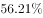

# 材料 · 2012-2016年S省城镇化水平：年末常住人口与城镇常住人口规模、城镇化率及其

> 关联 5 道小题

**时间口径**：现期为2016年末，基期涉及2012年末和2015年末；图表覆盖2012-2016共5个年度，无预测年份；人口数据均为年末时点数（存量），城镇化率为年度比率，非累计值；文字以2016年为陈述主体，通过'比2015年提高1.18个百分点''比2012年提高4.95个百分点'回推基期

**单位与换算**：人口单位为万人；城镇化率为%；率的变化、全国差距、年均提高幅度均用'个百分点'；市数量用'个'。换算陷阱：①百分点≠百分比，'提高1.18/4.95个百分点'是率相减，'年均增长率1.56、1.62、1.53'实为年均提高百分点而非百分比增速；②城镇化率原文被挖空，须用2069.63/3681.61≈56.2%还原；③图为双轴：柱对应左轴(48%-58%)，'差'折线对应右轴(0-1.4百分点)，量级不可混读

## 结构拆解
- 第1段（人口与城镇化率）：2016年末S省常住人口3681.61万人，城镇常住人口2069.63万人（较2015年末增加53.26万人）；城镇化率数值被挖空（可还原为2069.63/3681.61≈56.2%），居全国第16位，比2015年提高1.18个百分点，比2012年提高4.95个百分点，高于同期全国平均增幅0.17个百分点（可推全国平均增幅=4.95-0.17=4.78个百分点）；与全国差距由2012年的1.31个百分点缩至2016年的1.14个百分点
- 第2段（市域格局）：全省11个市中'城镇人口超过___'（阈值数值缺失）的市由2012年的5个增加为2016年的8个；城镇化水平较低的E、F、G三市年均增长（实为年均提高）1.56、1.62、1.53个百分点，区域差距缩小
- 第1图（2012-2016年S省与全国城镇化率对比，柱线双轴组合图）：横轴2012-2016年；S省城镇化率（白柱，左轴%）：2012≈51.3%、2013≈52.5%、2014≈53.7%、2015≈55.0%、2016≈56.2%；全国城镇化率（斜纹柱，左轴%）：2012≈52.6%、2013≈53.7%、2014≈54.8%、2015≈56.0%左右、2016≈57.4%；差=全国-S省（菱形折线，右轴百分点）：2012≈1.31、2013≈1.2、2014≈1.0（最低点）、2015≈1.05左右、2016≈1.14

## 阅读陷阱
- ⚠ 文字中'城镇化率达___'与'城镇人口超过___的市'两处数值缺失，城镇化率必须由城镇人口÷常住人口自行计算还原，市数阈值只能用个数(5→8)做题
- ⚠ 双轴图陷阱：柱读左轴%、'差'折线读右轴百分点，两轴量纲不同，易把折线当百分比或按左轴读数
- ⚠ '差'=全国−S省，判断差距最小的年份要看折线最低点（约2014年），不能靠两根柱子目测高低
- ⚠ '较2015年末增加53.26万人'是增长量，求2015年城镇人口需做减法；'提高1.18/4.95个百分点'是率差运算，均不能按百分比增长率处理
- ⚠ 全国各年城镇化率未在文字中完整给出，须用'S省率+差'或读图拼合，跨文字与图才能拼出完整数据
- ⚠ '高于全国平均增幅0.17个百分点'需间接推算全国平均增幅=4.95-0.17=4.78个百分点
- ⚠ E/F/G市'年均增长率1.56、1.62、1.53'单位实为个百分点（年均提高幅度），易误当百分比增速

## 小题群关系
整组题围绕'现期—基期链式推算+百分点运算'模型：Q1用'现期−增长量'求基期城镇人口（2069.63-53.26=2016.37万）；Q2用'2016年率−4.95个百分点'或读图求2012年城镇化率（≈51.3%/51.26%）；Q3读图'差'折线或逐年做'全国−S省'找差距最小年份（约2014年）；Q4为简单个数增长(8-5)/5=60%；Q5为综合判断题，其分句（1）2015年城镇化率复用Q1+Q2的中间量，（2）全国平均增幅复用'4.95-0.17=4.78个百分点'的推算，存在明显连环复用——前四题的中间结果被第5题的判定直接引用，做题时应保留各题中间量

## 关联真题
- [[10-真题/资料分析/比重/2144691 基期比重（率）计算——现期率减提高百分点还原基期城镇化率|2144691]] 新疆 2017 — 基期比重（率）计算——现期率减提高百分点还原基期城镇化率
- [[10-真题/资料分析/其他/2144696 双轴图差值（百分点）折线读取与多年份最小值比较|2144696]] 新疆 2017 — 双轴图差值（百分点）折线读取与多年份最小值比较
- [[10-真题/资料分析/综合/2144707 综合判断（说法正误计数）：基期城镇化率推算＋增幅之差推算＋年均增幅比较|2144707]] 新疆 2017 — 综合判断（说法正误计数）：基期城镇化率推算＋增幅之差推算＋年均增幅比较
- [[10-真题/资料分析/增长/2144681 基期量计算（已知现期量与增长量，基期=现期−增长量）|2144681]] 新疆 2017 — 基期量计算（已知现期量与增长量，基期=现期−增长量）
- [[10-真题/资料分析/增长/2144703 一般增长率计算（个数型增长，基期为'个'数）|2144703]] 新疆 2017 — 一般增长率计算（个数型增长，基期为'个'数）

---

### 材料原文

        2012-2016年，S省城镇化水平快速提高。2016年末，S省常住人口3681.61万人，其中居住在城镇区域的常住人口2069.63万人，较2015年末增加53.26万人；城镇化率达，居全国第16位，比2015年提高1.18个百分点。

        与2012年相比，城镇化率提高了4.95个百分点，高于这一时期全国平均增幅0.17个百分点。与全国城镇化平均水平的差距由2012年的1.31个百分点缩小为1.14个百分点。

2016年，全省11个市中城镇人口超过的市由2012年的5个增加为8个。城镇化水平较低的E市、F市、G市均实现了较快的增长，年均增长率分别达到1.56、1.62和1.53个百分点，区域间城镇化水平差距进一步缩小，全省城镇化保持了较快的增长势头。
