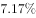
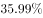
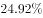
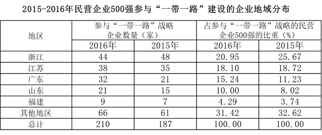

# 材料 · 2016年中国民营企业500强的出口总额、海外投资及参与'一带一路'建设情况（出

> 关联 1 道小题

**时间口径**：现期为2016年（榜单发布于2017年8月）；对比基期主要为2015年，兄弟小题涉及2014年；图1覆盖2011—2016年逐年当期值（非累计）；文字中'未来三年有投资意向287家'属意向性表述，无具体预测年份数值

**单位与换算**：出口总额、投资总额单位为亿美元（注意是'亿美元'而非'亿元'）；企业数量单位为家；投资项目单位为项；比重与增速为%。易错点：图中2016年出口额记为1495.4（一位小数），与文字1495.4亿美元一致；表中最小比重4.29%易在减法比较中被忽略量级

## 结构拆解
- 文字段①：2016年出口与海外投资总况——出口总额1495.4亿美元（占我国出口总额比重、增幅在文中留空），较2015年增加395.79亿美元；海外投资项目1659项，投资总额515.32亿美元；海外投资企业数由2015年201家增加113家（即2016年314家）
- 文字段②：'一带一路'参与情况——2016年210家企业参与，其中144家位于浙江、江苏、广东、山东、福建等东部沿海（2016年表中五省之和44+38+32+21+9=144，图文互证）；制造业121家、建筑业25家；另有287家企业未来三年有投资意向，比2015年增加28家、提高5.6个百分点
- 图1（柱线双轴图）：2011—2016年民营企业500强出口总额及增速——出口总额（亿美元）：879.11、728.91、884.14、1433.24、1099.61、1495.4；增速（%）：20.3、-17.09、21.3、63.24、-23.81、35.99
- 图2（统计表）：2015—2016年参与'一带一路'建设企业地域分布——列示浙江、江苏、广东、山东、福建、其他地区的企业数量（家）及占参与'一带一路'企业的比重（%），2016年总计210家/100%，2015年总计187家/100%

## 阅读陷阱
- ⚠ 文字段多处百分比留空（占我国出口总额比重、出口增幅、投资项目增长率），需由图表数据或基本公式推算补齐，不可凭空填数；可用图1验证：1495.4-1099.61=395.79亿美元
- ⚠ 图1为柱线双轴混排：柱=出口总额（亿美元），线=增速（%），2012年-17.09%和2015年-23.81%为负增长，对应总额下降年份，读线时勿误读为总额
- ⚠ 同名相近指标口径不同：'出口总额1495.4亿美元'与'海外投资总额515.32亿美元'不可互换；'参与一带一路210家'（存量现状）与'未来三年有投资意向287家'（意向）是两个不同口径
- ⚠ 图2中比重是'占参与一带一路战略的民营企业500强'的内部占比（总计100%），不是占500强整体（500家）的比重；表中每年各有'数量'与'比重'两组2016/2015列，年份列极易看串
- ⚠ 跨文字与表格拼数：文字'144家位于东部沿海五省'需与表中五省2016年数量之和核对；海外投资企业数314家需由201家+113家自行加总
- ⚠ 兄弟小题为2016年与2014年比较，属跳过2015年的隔年比较，基期是1433.24而非1099.61，若误用2015年为基期会掉坑

## 小题群关系
本组题围绕图1柱线图的多期比较与增速计算模型展开。已列出的核心小题'2016年与2014年相比出口总额呈现出的变化'是典型的隔年（跨两年）比较：可用1495.4对1433.24直接求增量和增幅（约62.16亿美元、约+4.3%），也可用2015年-23.81%与2016年35.99%两期增速混合验证（(1-23.81%)×(1+35.99%)≈1.043），两种路径互为验算。就现有题干看，各题分别取材于图1、图2与文字段，数据相对独立，暂无上一题结果被下一题直接复用的连环结构，但文字段'增加395.79亿美元'与图1数据完全咬合，图文互证是本材料命题的重要设计

## 关联真题
- [[10-真题/资料分析/增长/2188101 增长量比较（同比增量与同比增速的多期两两比较）|2188101]] 吉林 2018 — 增长量比较（同比增量与同比增速的多期两两比较）

---

### 材料原文

<b>根据下面资料回答96-100题。</b>

        2017年8月24日，全国工商联发布《2017中国民营企业500强》榜单。2016年，民营企业500强出口总额出现大幅回升，达到1495.4亿美元，占我国出口总额的，较2015年增加395.79亿美元，增幅为，海外投资项目达到1659项，增长；投资总额达515.32亿美元；进行海外投资的企业数量也比2015年的201家增加了113家。

        据统计，民营企业500强中，共有210家企业参与“一带一路”建设。从地区分布看，有144家企业分别位于浙江、江苏、广东、山东和福建等东部沿海经济发达地区。从行业分布看，有121家企业为制造业企业，有25家建筑业企业。另外，有287家民营企业在未来三年对于“一带一路”有投资意向，比2015年增加28家，比2015年提高5.6个百分点。

