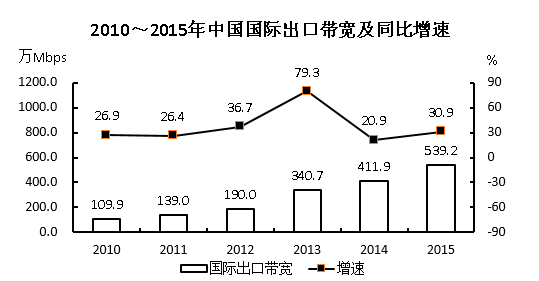

# 材料 · 2010～2015年中国国际出口带宽总量及同比增速变化（柱线图），并附2015年

> 关联 5 道小题

**时间口径**：现期年为2015年；图1给出2010～2015共6年的当期年度值（非累计值）及其同比增速；2010年的增速26.9%以2009年为基期，但2009年带宽值图中未直接给出，需用基期公式反推；无预测年份

**单位与换算**：图1左轴为万Mbps（带宽柱值），右轴为%（增速折线）；表1为Mbps。换算关系：1万Mbps=10000 Mbps，539.2万Mbps=5392000 Mbps，与表1合计5392116 Mbps基本对应（微小差异系四舍五入）。量级陷阱：若把图1的539.2直接与表内Mbps数值混算，会差1万倍；计算运营商占比应在表内统一用Mbps

## 结构拆解
- 图1（柱线组合双轴图）：标题'2010～2015年中国国际出口带宽及同比增速'。柱（左轴，万Mbps）为国际出口带宽：2010年109.9、2011年139.0、2012年190.0、2013年340.7、2014年411.9、2015年539.2；折线（右轴，%）为同比增速：26.9、26.4、36.7、79.3、20.9、30.9。数据跨度2010～2015年
- 表1：标题'2015年主要运营商骨干网络国际出口带宽'，单位Mbps。指标为运营商及其国际出口带宽：中国电信3223629、中国联通1414868、中国移动645073、中国教育和科研网61440、中国科技网47104、中国国际经济贸易互联网2、合计5392116。仅2015年一年数据

## 阅读陷阱
- ⚠ 双轴图混读：柱是带宽（左轴万Mbps）、线是增速（右轴%），勿把柱值当增速或把线值当带宽
- ⚠ 单位量级跨图不一致：图为'万Mbps'，表为'Mbps'，相差1万倍；图1的539.2万Mbps≈表1合计5392116 Mbps，可作互验桥梁
- ⚠ 2010年柱值109.9万Mbps是现期量，其基期2009年的带宽未在图中出现，求2009年须用109.9÷(1+26.9%)≈86.6万Mbps
- ⚠ 增速最高≠增量最大：增速最高的2013年（79.3%）增量为340.7-190.0=150.7万Mbps；增速最低的2014年（20.9%）增量为411.9-340.7=71.2万Mbps，求增量需从图中跨年份读数做差
- ⚠ 表1中'中国国际经济贸易互联网'仅2 Mbps，数量级极小但计入合计；合计5392116与图1的539.2万略有出入，属四舍五入，非数据矛盾
- ⚠ 移动占比约为645073÷5392116≈12%，判断比例图形时应与约12%的扇形对应，勿误用图1的539.2作分母与表内Mbps分子混算

## 小题群关系
这组题围绕'增速—增量—基期量—比重'四大基础模型展开。题1考增速数据比较（直接读折线，注意题干中'高于'后的比较对象被截断，须以完整原题的比较基准为准，不能凭空设定）；题2考基期量计算（2010年值109.9万Mbps与增速26.9%反推2009年，可用百化分26.9%≈1/3.7速算）；题3考比重判断（表内中国移动645073÷合计5392116≈12%，仅用表1）；题4考增量比较（增速最高年份2013与最低年份2014的增量做差，150.7对71.2，差约79.5万Mbps）。各题无上一题结果被下一题直接使用的连环复用，但共享同一图表数据：题1、题2、题4用图1，题3用表1；题3与图1的2015年柱值通过'539.2万Mbps≈表合计'形成跨图核验关系

## 关联真题
- [[10-真题/资料分析/增长/2188587 增速读数比较（逐年与阈值比较计数）|2188587]] 四川 2018 — 增速读数比较（逐年与阈值比较计数）
- [[10-真题/资料分析/增长/2188591 增长量计算与比较（增速最高年与最低年的增量做差）|2188591]] 四川 2018 — 增长量计算与比较（增速最高年与最低年的增量做差）
- [[10-真题/资料分析/增长/2188588 基期量计算（已知现期量与同比增长率反推基期）|2188588]] 四川 2018 — 基期量计算（已知现期量与同比增长率反推基期）
- [[10-真题/资料分析/比重/2188589 现期比重计算+扇形图占比识别|2188589]] 四川 2018 — 现期比重计算+扇形图占比识别
- [[10-真题/资料分析/综合/2188592 综合判断题（年均增长量计算为主，兼查增长倍数、增速趋势、逐年增量比较）|2188592]] 四川 2018 — 综合判断题（年均增长量计算为主，兼查增长倍数、增速趋势、逐年增量比较）

---

### 材料原文

<b>根据以下资料，回答96～100题。</b>

