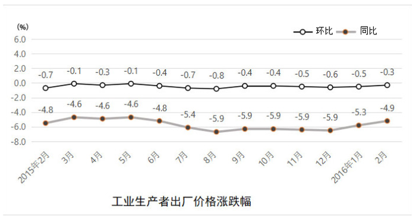
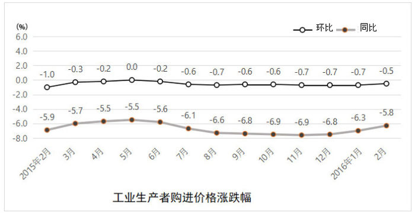
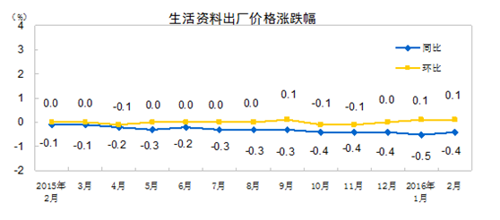
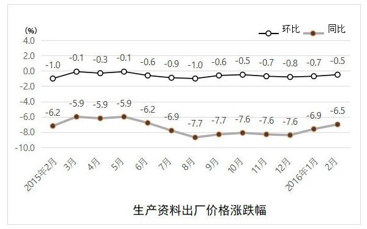

# 材料 · 国家统计局发布的2016年2月全国工业生产者价格（PPI）变动情况：出厂价格与购

> 关联 5 道小题

**时间口径**：现期为2016年2月，无预测年份数据（第2题的2016年3月为题干假设性外推）；四张图均为2015年2月至2016年2月的月度当期涨跌幅（环比、同比双序列），非累计值；正文另提及'1-2月平均'口径但本版文字中具体数值缺失

**单位与换算**：全部单位为%（涨跌幅），图纵轴为%；正文'影响总水平下降约4.8/0.1个百分点'及'翘尾-4.1、新涨价-0.8'均以'个百分点'计量，与%不直接混算；负值表示下降，求极差=最大值-最小值（同为负数时如-4.6-(-5.9)=1.3），求占比需取绝对值（如0.8/4.9）；数据量级均为个位数%，无大数换算陷阱，陷阱在符号与口径

## 结构拆解
- 正文文字段：①总述2016年2月出厂价格、购进价格的环比与同比涨跌幅及'1-2月平均'同比；②同比变动部分——生产资料（含采掘/原材料/加工工业）影响总水平约4.8个百分点，生活资料（含食品/衣着/一般日用品/耐用品）影响约0.1个百分点；③分解2月同比降幅：翘尾因素约-4.1个百分点、新涨价因素约-0.8个百分点；④购进价格分类中列出黑色金属材料类、燃料动力类、有色金属材料及电线类、化工原料类四类同比。注意：本版文字中各具体百分数均为空格缺失，分类数值须依赖图表读取
- 图1'工业生产者出厂价格涨跌幅'：总指数折线图，环比、同比双序列，2015年2月—2016年2月共13个月，每点标注数值；环比-0.7→-0.1→…→2016年2月-0.3，同比-4.8起、最低-5.9（2015年8月—12月持平）、2016年2月-4.9
- 图2'工业生产者购进价格涨跌幅'：环比、同比双折线，同期13个月；环比-1.0起步、2015年5月为0.0、其余在-0.2~-0.7间、2016年2月-0.5；同比-5.9起、最低-6.9（2015年10-11月）、2016年2月-5.8
- 图3'生活资料出厂价格涨跌幅'：同比（蓝）、环比（黄）双折线，同期13个月；环比在0附近波动（-0.1~+0.1，2016年1-2月为+0.1），同比-0.1持续走低至2016年1月-0.5、2016年2月-0.4
- 图4'生产资料出厂价格涨跌幅'：环比、同比双折线，同期13个月；环比-1.0起步、多数在-0.1~-1.0间、2016年2月-0.5；同比-6.2起、最低-7.7（2015年8月）、2016年2月-6.5

## 阅读陷阱
- ⚠ 本版正文所有具体百分数为空格缺失，不得凭空补数，分类与总体数值一律从四张图中读取
- ⚠ 图3图例顺序为'同比/环比'（黄线在上方、蓝线在下方），与图1、2、4的'环比/同比'顺序相反，极易把生活资料的环比、同比两条线读反
- ⚠ 同名不同口径：'工业生产者出厂价格'（图1，总指数）≠'生产资料出厂价格'（图4）≠'生活资料出厂价格'（图3）；题目问'出厂价格'必须用图1，问分类必须用对应图，总指数是生产资料与生活资料的加权结果而非三者任一
- ⚠ '影响全国总水平下降约4.8/0.1个百分点'是该类价格的拉动（贡献）量，不是其自身涨跌幅，勿与分类同比数值混同
- ⚠ 翘尾-4.1与新涨价-0.8为'个百分点'，二者之和-4.9恰等于当月同比降幅，构成'整体=部分之和'的验证关系；算占比时分子分母均取绝对值
- ⚠ 极差与平均均针对同比/环比整条13个月序列计算，序列最大、最小值多为负数，'谁大谁小'要按数轴判断（-5.5>-6.9），避免直接用绝对值相减
- ⚠ 跨图拼数：第5题需同时取图1、图4、图3中2016年2月的环比三个点才能判断加权关系

## 小题群关系
5题共同围绕'涨跌幅时间序列'的计算模型：①算术平均（13个月生活资料环比求均值）；②差值外推预测（用2015年2→3月生产资料同比变化量+0.3个百分点叠加2016年2月的-6.5%，得2016年3月预测值约-6.2%）；③极差（图1同比最大-4.6、最小-5.9得极差约1.3，图2同比-5.5与-6.9得极差约1.4）；④部分占总体比例（新涨价0.8/总降幅4.9≈16%）；⑤总指数与分类指数的加权从属关系（-0.3介于生产资料-0.5与生活资料+0.1之间）。题与题之间无答案量值连环复用，属'同材料同图不同点'的平行取数：题1独用图3环比列，题2独用图4同比列的跨年两点，题3用图1+图2同比列，题4用正文翘尾/新涨价（并与图1的-4.9呼应），题5同取图1/图3/图4的2016年2月环比点——其中题2与题5虽同用图4，但取不同列或不同月，不构成上一题结果被下一题使用的链条

## 关联真题
- [[10-真题/资料分析/平均数/2262865 算术平均数（13个月涨跌幅序列求均值，正负抵消）|2262865]] 选调 2016 — 算术平均数（13个月涨跌幅序列求均值，正负抵消）
- [[10-真题/资料分析/其他/2262880 极差计算（涨跌幅时间序列：最大值−最小值）|2262880]] 选调 2016 — 极差计算（涨跌幅时间序列：最大值−最小值）
- [[10-真题/资料分析/增长/2262870 同比变化量外推预测（差值叠加）|2262870]] 选调 2016 — 同比变化量外推预测（差值叠加）
- [[10-真题/资料分析/比重/2262886 现期比重计算——因素分解中部分占整体比例（负值取绝对值）|2262886]] 选调 2016 — 现期比重计算——因素分解中部分占整体比例（负值取绝对值）
- [[10-真题/资料分析/综合/2262887 总指数与分类指数涨跌方向关系定性判断（正相关-负相关）|2262887]] 选调 2016 — 总指数与分类指数涨跌方向关系定性判断（正相关-负相关）

---

### 材料原文

        根据国家统计局最新发布的数据，2016年2月份，全国工业生产者出厂价格环比下降，同比下降。工业生产者购进价格环比下降，同比下降。1-2月平均，工业生产者出厂价格同比下降，工业生产者购进价格同比下降。

 

1.工业生产者价格同比变动情况 

        工业生产者出厂价格中，生产资料价格同比下降，影响全国工业生产者出厂价格总水平下降约4.8个百分点。其中，采掘工业价格下降，原材料工业价格下降，加工工业价格下降。生活资料价格同比下降，影响全国工业生产者出厂价格总水平下降约0.1个百分点。其中，食品价格上涨，衣着价格上涨，一般日用品价格下降，耐用消费品价格下降。

        据测算，在2月份-的全国工业生产者出厂价格总水平同比降幅中，去年价格变动的翘尾因素约为-4.1个百分点，新涨价因素约为-0.8个百分点。

        工业生产者购进价格中，黑色金属材料类价格同比下降，燃料动力类价格下降，有色金属材料及电线类价格下降，化工原料类价格下降。

2.工业生产者价格环比变动情况

        工业生产者出厂价格中，生产资料价格环比下降，影响全国工业生产者出厂价格总水平下降约0.3个百分点。其中，采掘工业价格下降，原材料工业价格下降，加工工业价格下降。生活资料价格环比上涨。其中，食品价格上涨，衣着价格持平，一般日用品价格上涨，耐用消费品价格下降。

        工业生产者购进价格中，燃料动力类价格环比下降，黑色金属材料类价格下降，有色金属材料及电线类价格上涨，农副产品类价格上涨。
