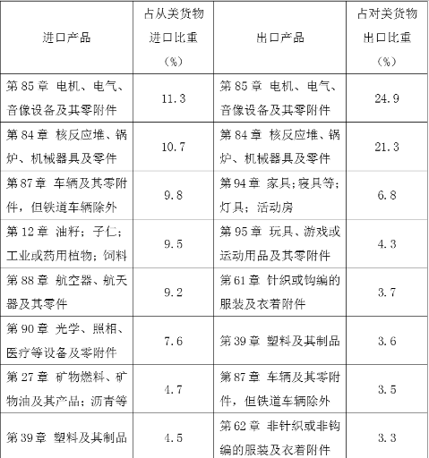
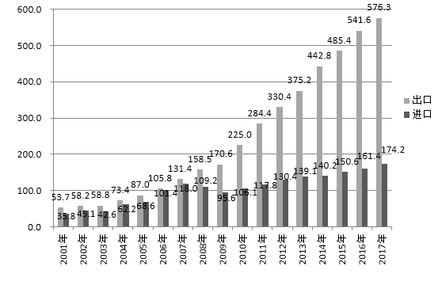
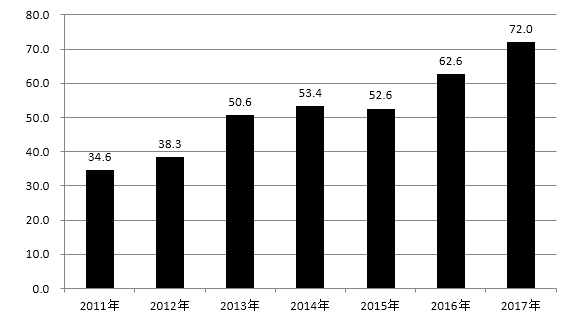

# 材料 · 2017年中美贸易结构档案：货物进出口商品（HS2位码）、服务贸易进出口、知识产

> 关联 0 道小题

**时间口径**：标题显示的明确年份为2017年（资料1、资料4）；资料2、资料3仅标注单位为亿美元、未在文字标题中给出年份范围，时间结构需以图片内容为准，文字层面不可读；无法从文字判断是否含预测年份或累计值

**单位与换算**：资料2、资料3标题明确单位为亿美元；资料1、资料4的单位（如亿美元、商品分类口径、税率%）仅在图片中呈现，文字不可读；涉及亿美元与其他单位（如万亿元人民币、%）混用时需注意量级换算，但具体陷阱项无法从文字确认

## 结构拆解
- 资料1：图片材料，标题为'2017年中国对美国主要进、出口商品（HS2位码）'，按HS2位码分类列出中国对美主要进出口商品；图片尺寸约479×512px，具体商品类别、指标列与数据不可读
- 资料2：图片材料，标题为'美国对中国服务贸易进出口（亿美元）'，涉及美国对中国服务贸易的进出口金额；图片尺寸约553×355px，具体年份、指标分解与数值不可读
- 资料3：图片材料，标题为'中国对美国支付知识产权使用费（亿美元）'，涉及中国对美知识产权使用费支付金额；图片尺寸约583×330px，具体年份序列与数值不可读
- 资料4：图片材料，标题为'2017年中美部分关税税率对比'，对比中美部分商品的关税税率；图片尺寸约580×306px，具体商品项、税率数值不可读

## 阅读陷阱
- ⚠ 材料主体为图片，文字数据不可读，所有数值判断只能依赖图片原图，标注时严禁凭空补数
- ⚠ 资料1为货物贸易、资料2为服务贸易，二者贸易口径不同，计算'中美贸易差额'时极易将货物与服务口径混用
- ⚠ 资料2标题的进出口主体是'美国对中国'，与资料1'中国对美国'方向相反，同名金额（进出口）所指方向相反，需警惕主语方向陷阱
- ⚠ 资料1的HS2位码是商品分类编码而非数值，读图时勿将编码误当作数据列
- ⚠ 资料3'中国对美支付知识产权使用费'是单向支付流，与服务贸易进出口、货物贸易数据分属不同维度，跨资料拼接需核对口径与年份
- ⚠ 资料2、资料3的年份范围仅由图片内部呈现，文字层面无法确认与2017年是否同口径

## 小题群关系
兄弟小题题干列表为空（标注任务说明'共0题'），无法从题干判断小题群的计算模型与连环复用关系；从材料主题推断，后续第46至50题可能围绕中美货物/服务贸易差额、结构占比、知识产权使用费变化及关税税率对比等模型命题，且资料1-4口径各异，存在跨资料综合判断题的可能，但此为基于标题主题的推断，需待题干提供后核实

## 关联真题

---

### 材料原文

请阅读以下资料，回答第46至50题。

资料1：2017年中国对美国主要进、出口商品（HS2位码）

资料2：美国对中国服务贸易进出口（亿美元）

资料3：中国对美国支付知识产权使用费（亿美元）

资料4：2017年中美部分关税税率对比

