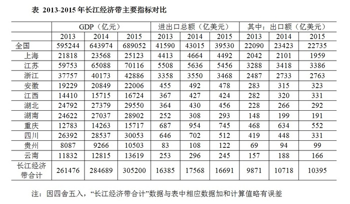

# 材料 · 2013-2015年长江经济带（11省市，另附全国参照行）的GDP、进出口总额及

> 关联 1 道小题

**时间口径**：连续三个年度的当期值（2013/2014/2015），无累计值、无预测年份；现期为2015年，同比基期为2014年，2013年数据可作两年对比备用

**单位与换算**：GDP单位为亿元（人民币），进出口总额与出口额单位为亿美元；表中两套量纲并存，涉及GDP与贸易额混合计算时注意亿元与亿美元的量级差异，无需百分比/千分数换算

## 结构拆解
- 唯一一张统计表：《2013-2015年长江经济带主要指标对比》。行维度为：全国（参照行）+ 长江经济带11省市（上海、江苏、浙江、安徽、江西、湖北、湖南、重庆、四川、贵州、云南）+ 长江经济带合计；列维度为三组指标各分2013、2014、2015三年：GDP（亿元）、进出口总额（亿美元）、其中：出口额（亿美元）。数据覆盖2013-2015三个年度。表下注：因四舍五入，长江经济带合计数据与各省数据加和略有误差

## 阅读陷阱
- ⚠ 同一张表内两套单位并存（GDP为亿元、进出口/出口为亿美元），勿把GDP与贸易额直接加减或求比例
- ⚠ 进出口总额与出口额是包含关系（'其中：出口额'），出口仅是总额一部分，两列不可互相替代；且部分省份总额与出口同向降（如四川2015进出口512<702、出口331<448），部分省份总额降但需另核出口
- ⚠ '长江经济带合计'因四舍五入与各省加总略有误差，做验证或比重时不能直接用分项加和替代合计行
- ⚠ 全国行与长江经济带行并存，取数时勿把全国数据误当区域数据；题目若限定中部省份，只使用安徽、江西、湖北、湖南四行
- ⚠ 2015年出口同比增速中湖南为负增长（199→191），易在排序中被当成正增长；安徽增速（315→323）仅约2.5%，与江西（320→331）约3.4%很接近，口算易错位

## 小题群关系
本材料仅1道小题，核心模型为'同比增速=现期/基期-1'：取安徽、江西、湖北、湖南四省2014年与2015年出口额（安徽315→323、江西320→331、湖北266→292、湖南199→191），分别计算2015年出口同比增速后从低到高排序。无跨题连环复用；排序结论为湖南（约-4.0%）<安徽（约+2.5%）<江西（约+3.4%）<湖北（约+9.8%），关键考点是识别湖南的负增长及安徽与江西的增速差较小

## 关联真题
- [[10-真题/资料分析/增长/2295581 同比增速计算与大小排序|2295581]] 上海 2019 — 同比增速计算与大小排序

---

### 材料原文

