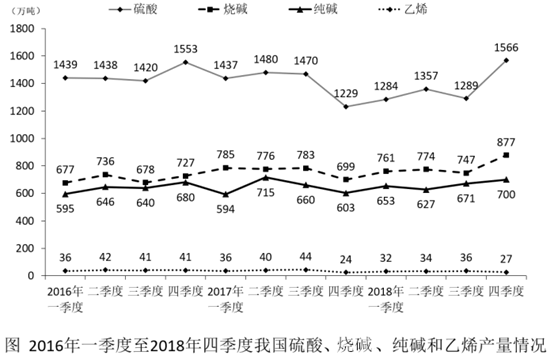

# 材料 · 2016年一季度至2018年四季度我国硫酸、烧碱、纯碱、乙烯四种化工产品的季度产

> 关联 4 道小题

**时间口径**：图表为2016年一季度至2018年四季度共12个季度的当季产量（非累计值）；文字给出2018年全年产量（等于图中2018年四个季度之和，如硫酸1284+1357+1289+1566=5496万吨，与文字吻合）；现期为2018年、同比基期为2017年，无预测年份

**单位与换算**：全文统一为'万吨'，图纵轴与文字单位一致，无需换算；主要陷阱是量级：乙烯仅24—44万吨（两位数），硫酸达1229—1566万吨（四位数），烧碱677—877万吨、纯碱594—715万吨，比较增长量/增速时注意数量级差异，勿错位

## 结构拆解
- 文字段：给出2018年全年四种产品产量——硫酸5496万吨、烧碱3159万吨、纯碱2651万吨、乙烯129万吨；这四个全年值恰等于图中2018年四个季度之和，是文字与图之间的数据拼合点
- 折线图1张（图题：2016年一季度至2018年四季度我国硫酸、烧碱、纯碱和乙烯产量情况）：横轴为2016年一季度至2018年四季度共12个季度，纵轴单位万吨（0—1800），四条折线均逐点标注数值——硫酸（1439/1438/1420/1553/1437/1480/1470/1229/1284/1357/1289/1566）、烧碱（677/736/678/727/785/776/783/699/761/774/747/877）、纯碱（595/646/640/680/594/715/660/603/653/627/671/700）、乙烯（36/42/41/41/36/40/44/24/32/34/36/27）；全图峰值是2018Q4硫酸1566，谷值是2017Q4硫酸1229

## 阅读陷阱
- ⚠ 文字给'全年'、图给'当季'：求2018年比上年增加多少，必须先用图把2017年四个季度加总（由图可算得：硫酸5616、烧碱3043、纯碱2572、乙烯144万吨），再与文字2018年全年比较；拿2018年全年直接减图中某季度是典型错误
- ⚠ 四条线数值沿横轴纵向堆叠、标注密集，易把一条线上的数读成另一条线的；乙烯量级（24—44）与硫酸（1229—1566）相差约40倍，比较'增加最多'时可先按量级排除乙烯
- ⚠ 烧碱与纯碱两线同处600—900区间、局部贴近，逐点读数须认准图例线型（菱形硫酸/方块烧碱/三角纯碱/点线乙烯）
- ⚠ 季平均增量的间隔数陷阱：2016年二季度到2018年四季度共11个季度值，间隔只有10个，平均增量=（877-736）÷10，误用11或12会错
- ⚠ 同比必须同季度对同季度：2018Q4的基期是2017Q4（硫酸1229为全图低谷），误取相邻的2018Q3（1289）作基期会算错；2017Q4低谷配2018Q4峰值使硫酸同比增速被基数效应明显放大

## 小题群关系
四个小题共用同一张季度折线图+文字段，是典型的'文字全年+图季度'复合单材料题组。核心模型：题1为全年增长量比较——文字2018全年对比图中2017年四季度之和（由图可得各产品增减：硫酸约-120、烧碱约+116、纯碱约+79、乙烯约-15万吨，正增长中烧碱最大）；题2为折线直接读数的差值比较（硫酸与烧碱各季度差值在约523—826万吨间找最小）；题3为平均增量模型（877-736）÷10，考点在间隔计数；题4为同比增速大小比较（2018Q4对2017Q4：硫酸337/1229≈27%＞烧碱178/699≈25%＞纯碱97/603≈16%）。四题各自独立取数，无上一题答案被下一题直接代入的强连环，但共享两个前置取数规则：'季度加总成全年'（题1）和'同季度对同季度同比'（题4）

## 关联真题
- [[10-真题/资料分析/增长/2367897 增长量比较（全年口径：文字现期 vs 图加总基期）|2367897]] 江苏 2019 — 增长量比较（全年口径：文字现期 vs 图加总基期）
- [[10-真题/资料分析/其他/2367898 折线图直接读数之差值比较（两线'最接近'判定）|2367898]] 江苏 2019 — 折线图直接读数之差值比较（两线'最接近'判定）
- [[10-真题/资料分析/增长/2367899 季均（年均）增长量计算|2367899]] 江苏 2019 — 季均（年均）增长量计算
- [[10-真题/资料分析/增长/2367902 同比增长率大小比较（同季度对同季度）|2367902]] 江苏 2019 — 同比增长率大小比较（同季度对同季度）

---

### 材料原文

        2018年我国硫酸、烧碱、纯碱和乙烯产量分别为5496万吨、3159万吨、2651万吨和129万吨。2016年一季度至2018年四季度我国硫酸、烧碱、纯碱和乙烯产量见下图。

