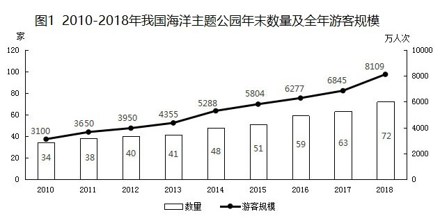
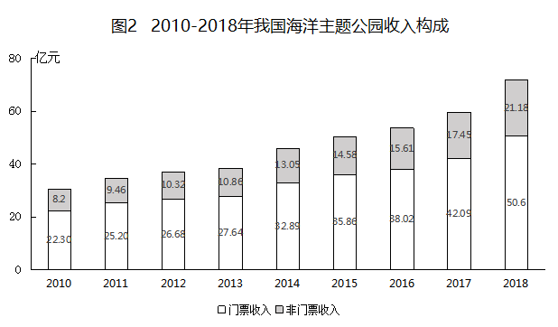

# 材料 · 2010-2018年我国海洋主题公园的年末数量、全年游客规模及门票/非门票收入构

> 关联 5 道小题

**时间口径**：现期年为2018年，最早基期年为2010年，共9个年度，无预测年份；公园数量为各年'年末'时点数，游客规模与收入为当年全年当期值，材料中无跨年累计口径

**单位与换算**：图1左轴单位'家'（公园数量）、右轴单位'万人次'（全年游客规模）；图2单位'亿元'（门票收入、非门票收入）。核心换算陷阱：求人均收入时需将'亿元÷万人次'化为'元/人'，即X亿元÷Y万人次=(X×10^8)÷(Y×10^4)=(X/Y)×10^4元，如2016年38.02亿元/6277万人次≈60.6元/人，量级（10^8与10^4）处理极易出错

## 结构拆解
- 图1（双轴柱线组合图）：2010-2018年我国海洋主题公园年末数量（柱，读左轴，单位家）：34、38、40、41、48、51、59、63、72；全年游客规模（折线，读右轴，单位万人次）：3100、3650、3950、4355、5288、5804、6277、6845、8109，数据覆盖2010-2018连续9年
- 图2（堆叠柱状图）：2010-2018年我国海洋主题公园收入构成（单位亿元），门票收入（下层）：22.30、25.20、26.68、27.64、32.85、35.86、38.02、42.09、50.6；非门票收入（上层）：8.2、9.46、10.32、10.86、13.05、14.58、15.61、17.45、21.18，两段之和为当年总收入，数据覆盖2010-2018连续9年

## 阅读陷阱
- ⚠ 图1为双轴图：柱体读左轴'家'、折线读右轴'万人次'，量纲不同，误读轴会导致把家数当游客规模（或反之）
- ⚠ 公园数量是'年末'时点数：2011年初在营数量即2010年末的34家；计算新增开园家数须用2018年末72家减2010年末34家得38家，不能错用其他年份柱值
- ⚠ 游客规模（万人次）与收入（亿元）分处两图且量纲悬殊，第4题类人均计算需完成亿元→元、万人次→人的双重换算，10^8/10^4量级易错
- ⚠ 图2为堆叠柱，门票与非门票收入须分层读数，不能只读柱顶总高度；2018年门票收入50.6仅一位小数、与他年两位小数精度不一致，读数勿错位
- ⚠ 两图口径不同：数量为时点值，游客与收入为全年当期值，求'每家平均'时分子分母须同为年度口径

## 小题群关系
5题围绕两大模型：'平均数=总量÷份数'与'同比增长率'。第1题为两期平均数比较（游客规模÷公园家数，2018年8109/72对2010年3100/34）；第2题为平均间隔模型（2011年初至2018年末共8年÷新增38家≈0.21年/家，关键在正确使用年末数作差）；第3题需逐年算非门票收入同比增速并与基准比较（注意该题题干中基准数值显示不完整，实际计算须以完整原题基准为准）；第4题为典型跨图拼接题，须同时用图2的2016年门票38.02亿元、非门票15.61亿元与图1的2016年游客规模6277万人次，求两种人均收入的差。各题间无'上题答案被下题直接复用'的连环计算，但共用同一数据底座，且第1、2、4题均落到'总量÷份数'的平均思想；第5题为综合判断题，需逐项回归上述两图数据验算

## 关联真题
- [[10-真题/资料分析/平均数/2448389 平均数增长量（两期平均数作差比较）|2448389]] 国考 2020 — 平均数增长量（两期平均数作差比较）
- [[10-真题/资料分析/平均数/2448392 现期平均数——平均间隔（总时间÷新增份数）|2448392]] 国考 2020 — 现期平均数——平均间隔（总时间÷新增份数）
- [[10-真题/资料分析/增长/2448403 同比增长率计算与固定阈值比较（计数型）|2448403]] 国考 2020 — 同比增长率计算与固定阈值比较（计数型）
- [[10-真题/资料分析/平均数/2448407 现期平均数差值（人均收入比较，跨图拼接+单位量级换算）|2448407]] 国考 2020 — 现期平均数差值（人均收入比较，跨图拼接+单位量级换算）
- [[10-真题/资料分析/综合/2448411 综合判断题（两期平均数比较+区间累计求和+同比增量比较+增长量验算）|2448411]] 国考 2020 — 综合判断题（两期平均数比较+区间累计求和+同比增量比较+增长量验算）

---

### 材料原文

