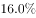
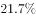

# 材料 · 2016年“一带一路”沿线64国的GDP、人口、对外贸易总量及占全球比重概况，并

> 关联 5 道小题

**时间口径**：文字段与统计表均为现期2016年当年（当期值，非累计）；折线图为2011-2016年共6个年度的“当期份额”序列（各年占全球贸易比重，非累计）；无预测年份，2016年既是文字/表格的现期、也是折线序列的末端年

**单位与换算**：三套单位并存：文字段为万亿美元（GDP）、亿人（人口）、亿美元（贸易总额71885.5）；统计表为万人（人口）、亿美元（GDP/进口额/出口额）；折线图为百分比%。量级陷阱：万亿美元→亿美元×10000（12.0万亿美元=120000亿美元）；亿人→万人×10000（32.1亿人=321000万人，表中总计63852.5万人≈6.39亿人）。人均GDP计算时若用“亿美元÷万人”须×10^4还原为美元/人

## 结构拆解
- 文字段：2016年“一带一路”沿线64国三项总量——GDP约12.0万亿美元、人口约32.1亿人、对外贸易总额约71885.5亿美元；后接三处“占全球GDP/全球人口/全球贸易总额的比重”，该三处比重数值在所给材料文字中为空缺（其中贸易占全球份额可由折线图2016年数据21.7%补得，GDP占比与人口占比在本材料中不可直接读取）
- 统计表（图1）“2016年东南亚‘一带一路’沿线国家情况”：列4项指标——人口（万人）、GDP（亿美元）、进口额（亿美元）、出口额（亿美元）；行结构为“总计”+11国（新加坡、泰国、越南、马来西亚、印度尼西亚、菲律宾、缅甸、柬埔寨、文莱、老挝、东帝汶）；总计：人口63852.5万人、GDP 25802.2亿美元、进口额11267.2亿美元、出口额11798.5亿美元；进口额列排在出口额列之前
- 折线图（图2）“2011-2016年‘一带一路’沿线国家对外贸易占全球份额”：2011年23.3%、2012年24.0%、2013年24.0%、2014年23.9%、2015年22.1%、2016年21.7%，先升后降，2012-2013持平于峰值24.0%，2015年降幅最大，纵轴起点为21.5%（非0起点）

## 阅读陷阱
- ⚠ 文字段三处全球占比数值空缺，仅贸易份额可从折线图（2016年21.7%）跨材料拼出，GDP占比、人口占比无法从所给材料获得，涉及“反推全球GDP/全球人口”的计算需依赖完整原文
- ⚠ 单位跨表不一致：文字“亿人”vs表格“万人”差1万倍，表格总计人口63852.5万人=约6.39亿人，求“东南亚占沿线64国人口比重”必须跨文字+表格换算后相除
- ⚠ 表格“总计”是东南亚11国合计，不等于文字中的沿线64国（东南亚GDP 25802.2亿美元仅占12.0万亿美元的一部分），两者范围不同不能混用
- ⚠ 进口额与出口额列序与常见“先出后进”习惯相反，判断贸易逆差须逐国比较“进口额>出口额”，仅看金额大小或列名看反即出错
- ⚠ 折线图给的是“占全球份额”而非贸易额绝对值，份额下降不等于贸易额下降；纵轴21.5%起、非0起点，视觉上放大了2015年的跌幅
- ⚠ “人均GDP”类计算涉及两层平均数：国别人均=GDP÷人口（同用表格两列），沿线/全球人均涉及万亿美元与亿人的量级匹配，分子分母单位须先统一

## 小题群关系
整组题围绕“比重—平均数—倍数”三大模型展开：题1是跨表比重（表格总计人口63852.5万人÷文字32.1亿人）；题2是平均数倍数（沿线人均GDP=12.0万亿美元÷32.1亿人，与全球人均GDP比较，全球口径需由文字占比反推，依赖材料中空缺的占比数据）；题3是表格逐行计数比较（进口额>出口额的国别个数）；题4是两步串联模型——先用表格GDP÷人口逐国算人均找最低国，再求该国（进口+出口）占东南亚总计的比重，与题3共享“逐行比较”的数据但不传递答案；题5是综合判断题，①直接复用折线图逐年份额比较（2012与2013持平24.0%是判断①的关键），②需用表格东南亚GDP与全球GDP（由文字占比反推）求比重。题1、2共用文字总量数据，题3、4共用表格分国数据，题5①复用折线图，题间为同源数据不同切面的复用关系，无上一题答案被下一题直接引用的强连环

## 关联真题
- [[10-真题/资料分析/比重/2453176 现期比重计算（跨文字与表格取数，含单位换算）|2453176]] 北京 2020 — 现期比重计算（跨文字与表格取数，含单位换算）
- [[10-真题/资料分析/倍数/2453183 现期倍数——两个人均（平均数）作商，化为比重相除|2453183]] 北京 2020 — 现期倍数——两个人均（平均数）作商，化为比重相除
- [[10-真题/资料分析/比重/2453191 现期比重计算（前置人均GDP平均数逐行比较定位主体，两步串联）|2453191]] 北京 2020 — 现期比重计算（前置人均GDP平均数逐行比较定位主体，两步串联）
- [[10-真题/资料分析/其他/2453185 进口额与出口额逐行比较计数（贸易逆差判定）|2453185]] 北京 2020 — 进口额与出口额逐行比较计数（贸易逆差判定）
- [[10-真题/资料分析/综合/2453192 综合判断题（逐条验证可推出条数：折线图逐年比较+比重反推+表格排序计数）|2453192]] 北京 2020 — 综合判断题（逐条验证可推出条数：折线图逐年比较+比重反推+表格排序计数）

---

### 材料原文

        2016年“一带一路”沿线64个国家GDP之和约为12.0万亿美元，占全球GDP的；人口总数约为32.1亿人，占全球人口的；对外贸易总额约为71885.5亿美元，占全球贸易总额的。

