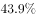

# 材料 · 2019年我国服务进出口（上半年与全年两个截面）总额、出口、进口运行情况，以及其

> 关联 5 道小题

**时间口径**：纯现期年材料，现期为2019年，含'2019年上半年'与'2019年全年'两个时间截面；同比基期为2018年对应期间（2018年上半年、2018年全年）；无预测年份；各金额均为期间发生额，其中'全年'数据相当于'上半年+下半年'的合计口径，下半年数据材料未直接给出，需作差求出

**单位与换算**：金额单位均为亿元人民币；增速与占比单位为%（注意：本文本中所有增速和占比数值均为空缺，仅金额完整）；'比重比2018年全年高出0.5个百分点'是百分点差而非百分比增速；题3要求以'万亿元'作答，需亿元÷10000换算量级；材料为纯文字型（0图0表），不存在图例单位不一致问题

## 结构拆解
- 第1段（2019年上半年服务进出口总况）：服务进出口总额26124.6亿元、出口9333.7亿元、进口16790.8亿元，三者各自同比增速数值在文本中空缺；另给出'服务进出口总额占对外贸易总额的比重'（数值空缺）及该比重比2018年全年高0.5个百分点
- 第2段（2019年全年服务进出口总况）：进出口总额54152.9亿元、出口19564.0亿元、进口34588.9亿元，同比增速数值空缺；与第1段构成'上半年/全年'可作差结构（全年-上半年=下半年：总额28028.3亿元、出口10230.3亿元、进口17798.1亿元）
- 第3段（2019年上半年知识密集型服务）：进出口额8923.9亿元（=出口4674.1+进口4249.8，勾稽相符）、出口额4674.1亿元、进口额4249.8亿元及同比增速（空缺）；分领域列出知识产权使用费出口、电信计算机和信息服务出口与进口、其他商业服务出口、金融服务出口与进口的同比增速（数值均空缺）
- 第4段（2019年全年知识密集型服务）：进出口额18777.7亿元（=出口9916.8+进口8860.9，勾稽相符）、出口额9916.8亿元、进口额8860.9亿元及同比增速（空缺）；分领域列出个人文化娱乐服务、电信计算机和信息服务、金融服务进出口总额的同比增速（数值空缺）；与第3段为'上半年/全年'平行结构

## 阅读陷阱
- ⚠ 全年与上半年数据混排：'2019年下半年'各量材料中不直接出现，必须用全年减上半年作差，易误用全年数据直接当作下半年答题
- ⚠ 尾数校验：2019年上半年出口+进口=26124.5亿元，与材料给出的总额26124.6亿元差0.1亿元（四舍五入尾差），'用总额作差'与'出口、进口分别作差'结果会差0.1，精算型选项需注意
- ⚠ 本文本中所有同比增速与占比数值均为空缺，涉及基期值、环比、基期比重的题目（题2、题3）在原卷中必须回材料补读这些百分数，按空缺无法代入计算
- ⚠ '比2018年全年高出0.5个百分点'指2019年上半年比重与2018年全年比重的差，需先反推2018年全年占比，且是百分点差不是百分比变化
- ⚠ 口径层次：'对外贸易总额'是服务进出口的更大分母，求2018年对外贸易总额需先求2018年服务进出口基期值、再除以2018年占比，跨两步口径且需亿元转万亿元
- ⚠ 两套平行段落层级不同：知识密集型出口额（9916.8亿元）与服务出口总额（19564.0亿元）是两个层级，作比重时分母易配错；分领域增速上半年列4个领域、全年列3个领域，领域不完全对应，查数易看串行

## 小题群关系
四题围绕'两期作差+基期反推+比重'三类模型：题1用'全年-上半年'作差求2019年下半年出口（19564.0-9333.7）与进口（34588.9-16790.8），判断顺差/逆差，连环复用第1、2段金额；题2为同比转环比模型，需用同比增速反推2018年上半年与2018年全年知识密集型进出口额（依赖文本中缺失的增速），作差得2018年下半年，再与8923.9亿元比较，与题1共享'全年-上半年'作差思想；题3为'基期值÷比重'模型：54152.9÷(1+全年同比增速)得2018年服务进出口额，再除以(2019上半年占比-0.5个百分点)得2018年对外贸易总额并换算为万亿元（依赖文本中缺失的增速与占比两处数值）；题4相对独立，现期比重=9916.8÷19564.0，仅用2019全年两个出口额，不依赖缺失数值。四题数据不直接互相复用，但题1、题2共用作差模型，题2、题3共用基期反推模型

## 关联真题
- [[10-真题/资料分析/其他/2719407 两期作差求下半年进出口额+顺逆差判断与差额档位|2719407]] 国考 2021 — 两期作差求下半年进出口额+顺逆差判断与差额档位
- [[10-真题/资料分析/增长/2719411 环比增长率计算（同比转环比：基期反推+全年减上半年作差）|2719411]] 国考 2021 — 环比增长率计算（同比转环比：基期反推+全年减上半年作差）
- [[10-真题/资料分析/比重/2719412 基期比重反推整体（基期整体=现期部分÷(1+同比增速)÷基期比重）|2719412]] 国考 2021 — 基期比重反推整体（基期整体=现期部分÷(1+同比增速)÷基期比重）
- [[10-真题/资料分析/比重/2719413 两期比重比较（比重升降判断），结合混合增长率'居中不正中'反推下半年增速|2719413]] 国考 2021 — 两期比重比较（比重升降判断），结合混合增长率'居中不正中'反推下半年增速
- [[10-真题/资料分析/综合/2719414 综合判断题（两期作差＋混合增长率＋两期比重比较＋逆差计算）|2719414]] 国考 2021 — 综合判断题（两期作差＋混合增长率＋两期比重比较＋逆差计算）

---

### 材料原文

        2019年上半年，我国服务进出口总额达到26124.6亿元，同比增长。其中，出口总额9333.7亿元，同比增长；进口总额16790.8亿元，同比下降。服务进出口总额占对外贸易总额的比重达到，比2018年全年高出0.5个百分点。

        2019年全年，我国服务进出口总额54152.9亿元，同比增长。其中，出口总额19564.0亿元，同比增长；进口总额34588.9亿元，同比减少。

        2019年上半年，我国知识密集型服务进出口额8923.9亿元，同比增长，其中，知识密集型服务出口额4674.1亿元，同比增长；进口额4249.8亿元，同比增长。从具体领域看，知识产权使用费出口同比增长；电信、计算机和信息服务出口同比增长，进口同比增长；其他商业服务（含技术、专业和管理咨询服务、研发成果转让费及委托研发等）出口同比增长；金融服务出口同比增长，进口同比增长。

        2019年全年，我国知识密集型服务进出口额18777.7亿元，同比增长，其中，知识密集型服务出口额9916.8亿元，同比增长；进口额8860.9亿元，同比增长。从具体领域看，个人文化娱乐服务，电信、计算机和信息服务，金融服务进出口总额分别同比增长、、。
