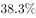
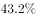

# 材料 · 2020年1-2月我国对外投资合作情况：非金融类直接投资、对外承包工程、对外劳务

> 关联 5 道小题

**时间口径**：现期为2020年1-2月（两月累计值），基期为2019年1-2月（同比口径），无预测年份；对外劳务合作中'2月末在外77.8万人'为时点数（存量），'派出3.9万人'为1-2月期间流量，二者口径不同

**单位与换算**：单位混用：总体投资、承包工程数据为亿元人民币；'一带一路'相关金额为亿美元；劳务人员为万人；项目数、企业数、国家数为个/家/国。关键换算：题4给出汇率7元人民币=1美元，需将2150.3亿元人民币与5000万美元（=3.5亿元人民币）等项目门槛、115个项目数统一币种；注意'万'量级（3.9万人、27.2亿美元）

## 结构拆解
- 第1段（总体情况）：2020年1-2月非金融类直接投资1078.6亿元人民币（涉及147国、1733家境外企业，同比增长率数值缺失）；对外承包工程完成营业额1080亿元人民币（同比下降率缺失）、新签合同额2150.3亿元人民币（同比增长率缺失）；派出劳务人员3.9万人（同比减少2.9万人，即基期约6.8万人）、2月末在外77.8万人
- 第2段（特点一·一带一路）：2020年1-2月对沿线48国新增投资合计27.2亿美元（同比增长率缺失）；在沿线59国新签对外承包工程合同额153.6亿美元（同比增长率缺失）、完成营业额91.4亿美元。注意48国与59国口径不同
- 第3段（特点二·投资结构）：2020年1-2月对外投资主要流向租赁和商务服务业、批发和零售业、制造业、采矿业四大领域，其占非金融类直接投资的比重数值在文中缺失；租赁和商务服务业投资额同比增长率数值缺失，仅文字说明其为增速最高领域
- 第4段（特点三·大项目）：2020年1-2月对外承包工程新签合同额5000万美元以上项目115个，较去年同期增加29个（即2019年同期约86个）；占新签合同总额的比重数值缺失

## 阅读陷阱
- ⚠ 人民币与美元两套币种并存：总体与承包工程用亿元人民币，'一带一路'用亿美元，跨段比较、求比重或求平均必须先统一币种（题4需按7:1换算）
- ⚠ 材料中所有增长率、四大行业占比、大项目占新签合同总额比重等百分数在给定文本中均缺失（挖空状态），解题需依托选项信息或卷面补全数据，不得凭空臆造数值
- ⚠ 分母主体易错：题1平均数分母是1733家境外企业，题4平均数分母是115个大项目；'48国有新增投资'与'59国新签合同'国家数口径不同，不可混用
- ⚠ 劳务人员两类数：3.9万人是1-2月累计派出（流量，且以'同比减少2.9万人'给出绝对差而非增长率），77.8万人是2月末在外存量（时点数），性质完全不同
- ⚠ 累计与月均：1080亿元、2150.3亿元均为1-2月两月累计值，题2求2019年月均需先还原基期值再除以2，漏除2是常见错误
- ⚠ 同比变化表达方式不一：有的给增长率（数值缺失），有的给绝对增减量（如减少2.9万人、增加29个项目），还原基期时方法不同

## 小题群关系
四题围绕资料分析核心计算模型展开：题1为现期平均数模型（1078.6亿元÷1733家）；题2为基期量+月均+差值比较模型（需由现期1080亿元、2150.3亿元结合同比变化还原2019年1-2月值再各除以2比较）；题3为两期比重变化模型（需租赁商务服务业占比及其增速与总体1078.6亿元的增速）；题4为平均数+比重+汇率换算综合模型（占比×2150.3亿元÷115个项目，再按7:1换算成美元定位区间）。四题间无严格连环复用（前一题答案未直接进入后题计算），但数据复用明显：1078.6亿元被题1、题3共用，2150.3亿元被题2、题4共用；材料本身增长率与占比数值缺失，各题实际作答均需依赖被挖空数值的卷面补全或选项反推

## 关联真题
- [[10-真题/资料分析/平均数/2719461 现期平均数计算（总量÷份数）|2719461]] 国考 2021 — 现期平均数计算（总量÷份数）
- [[10-真题/资料分析/平均数/2719462 基期平均数（月均）作差比较|2719462]] 国考 2021 — 基期平均数（月均）作差比较
- [[10-真题/资料分析/比重/2719463 两期比重差（比重比上年同期上升-下降几个百分点）计算|2719463]] 国考 2021 — 两期比重差（比重比上年同期上升-下降几个百分点）计算
- [[10-真题/资料分析/平均数/2719464 现期平均数计算（总额×金额占比÷项目个数，结合人民币-美元汇率换算）|2719464]] 国考 2021 — 现期平均数计算（总额×金额占比÷项目个数，结合人民币-美元汇率换算）
- [[10-真题/资料分析/综合/2719465 综合判断题（基期量比较+基期平均数+现期平均数+增长量计算，排除法验证四选项）|2719465]] 国考 2021 — 综合判断题（基期量比较+基期平均数+现期平均数+增长量计算，排除法验证四选项）

---

### 材料原文

        2020年1-2月，我国境内投资者共对全球147个国家和地区的1733家境外企业进行了非金融类直接投资，累计实现投资1078.6亿元人民币，同比增长。对外承包工程完成营业额1080亿元人民币，同比下降，新签合同额2150.3亿元人民币，同比增长。对外劳务合作派出各类劳务人员3.9万人，同比减少2.9万人，2月末在外各类劳务人员77.8万人。

        2020年1-2月，我国对外投资合作主要呈现以下特点：

        一是对“一带一路”投资合作增幅较大。2020年1-2月，我国企业对“一带一路”沿线的48个国家有新增投资，合计27.2亿美元，同比增长。在“一带一路”沿线的59个国家新签对外承包工程合同额153.6亿美元，同比增长，完成营业额91.4亿美元。

        二是对外投资结构持续多元。2020年1-2月，对外投资主要流向租赁和商务服务业、批发和零售业、制造业和采矿业等传统投资领域，占对境外企业非金融类直接投资的比重分别为、、和。其中流向租赁和商务服务业的投资额同比增长，成为增速最高的领域。

        三是对外承包工程新签大项目增多。2020年1-2月，对外承包工程新签合同额在5000万美元以上的项目有115个，较去年同期增加29个，占新签合同总额的。
