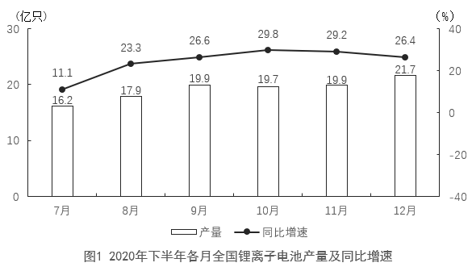
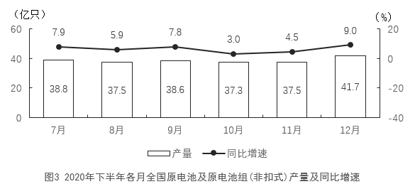

# 材料 · 2020年全国电池制造业三种主要产品（锂离子电池、铅酸蓄电池、原电池及原电池组非

> 关联 5 道小题

**时间口径**：现期为2020年，无预测年份；文字段为2020年1-6月（上半年累计值），图1-图3为2020年7-12月（当月值+同比增速）；所有基期（2019年）数据均未直接给出，需用同比增速反推；全年数据=文字上半年+图下半年各月求和

**单位与换算**：锂离子电池、原电池及原电池组（非扣式）单位为亿只；铅酸蓄电池单位为万千伏安时（文字与图2一致）；增速单位为%。核心换算陷阱：万千伏安时→亿千伏安时要除以10000（9635.6万千伏安时≈0.96亿千伏安时，第1题问'亿千伏安时'必须换算）；月均再除以6，量级落在0.15亿千伏安时附近

## 结构拆解
- 文字段：2020年1-6月全国电池制造业主要产品产量及同比增速，共3个指标：锂离子电池71.5亿只（同比+1.3%）、铅酸蓄电池9635.6万千伏安时（同比+6.1%）、原电池及原电池组（非扣式）178.2亿只（同比-0.7%），均为上半年累计值
- 图1：2020年下半年（7-12月）各月全国锂离子电池产量（亿只，柱）及同比增速（%，折线）：7月16.2/11.1%，8月17.9/23.3%，9月19.9/26.6%，10月19.7/29.8%，11月19.9/29.2%，12月21.7/26.4%
- 图2：2020年下半年（7-12月）各月全国铅酸蓄电池产量（万千伏安时，柱）及同比增速（%，折线）：7月2141.4/26.2%，8月2078.2/19.3%，9月2260.2/25.2%，10月2124.2/19.3%，11月2120.3/11.7%，12月2490.1/20.9%
- 图3：2020年下半年（7-12月）各月全国原电池及原电池组（非扣式）产量（亿只，柱）及同比增速（%，折线）：7月38.8/7.9%，8月37.5/5.9%，9月38.6/7.8%，10月37.3/3.0%，11月37.5/4.5%，12月41.7/9.0%

## 阅读陷阱
- ⚠ 口径拼接陷阱：文字段是上半年（1-6月累计）、图是下半年（7-12月当月），要求'全年'或'下半年占全年比重'必须跨文字+图分月加总（如图3下半年合计231.4亿只，再与文字178.2亿只拼全年）
- ⚠ 单位陷阱：铅酸蓄电池是万千伏安时且与另两种产品'亿只'不同；第1题问'亿千伏安时'，直接按万千伏安时作答会错一个数量级
- ⚠ 双轴图陷阱：三张图均为左轴产量（柱）+右轴同比增速（折线），两轴量纲不同，第4题只能读折线数值，勿把柱高当增速
- ⚠ 基期反推陷阱：2019年数据一律不给，需用'现期÷(1+增速)'反推（如第1题2019上半年铅酸蓄电池=9635.6÷1.061，再÷6得月均）
- ⚠ 增长量与增速混淆陷阱：第2题问'增长了多少亿只'是增长量（四季度61.3-三季度54.0=7.3亿只），不是增速；季度需自行按7-9月、10-12月划分加总
- ⚠ 月均陷阱：第1题'月均产量'需先算基期总量再除以6个月，不能直接用2020年当期数据或除以其他月数

## 小题群关系
这组题覆盖四大基本模型且一题一模型：第1题基期量+月均模型（现期/（1+增速）÷6+单位换算），第2题增长量模型（季度加总相减），第3题比重模型（下半年合计/全年合计，需文字+图3跨材料拼数据），第4题增速大小比较模型（逐月对读图1与图2折线，共6组比较，其中7月锂电11.1%<铅酸26.2%不满足，其余5个月满足，答案为5个）。四题分别锁定不同产品（铅酸/锂电/原电池/锂电vs铅酸），题与题之间没有结果连环复用，但第1、3题共享'文字上半年+图下半年'的跨材料拼接逻辑，第2、4题依赖图1分月数据，属于同图不同问

## 关联真题
- [[10-真题/资料分析/增长/4639657 同比增速大小比较（逐月配对计数）|4639657]] 国考 2022 — 同比增速大小比较（逐月配对计数）
- [[10-真题/资料分析/平均数/4639650 基期平均数（基期月均产量）+单位换算|4639650]] 国考 2022 — 基期平均数（基期月均产量）+单位换算
- [[10-真题/资料分析/增长/4639653 增长量计算（季度加总后相减）|4639653]] 国考 2022 — 增长量计算（季度加总后相减）
- [[10-真题/资料分析/比重/4639655 现期比重计算（部分时段占全年比重，跨文字+图拼接全年总量）|4639655]] 国考 2022 — 现期比重计算（部分时段占全年比重，跨文字+图拼接全年总量）
- [[10-真题/资料分析/综合/4639661 综合判断题（混合模型：增长量计算＋分月极值定位＋累计量超限验证＋环比增速比较）|4639661]] 国考 2022 — 综合判断题（混合模型：增长量计算＋分月极值定位＋累计量超限验证＋环比增速比较）

---

### 材料原文

        2020年1-6月，全国电池制造业主要产品中，锂离子电池产量71.5亿只，同比增长1.3%；铅酸蓄电池产量9635.6万千伏安时，同比增长6.1%；原电池及原电池组（非扣式）产量178.2亿只，同比下降0.7%。

