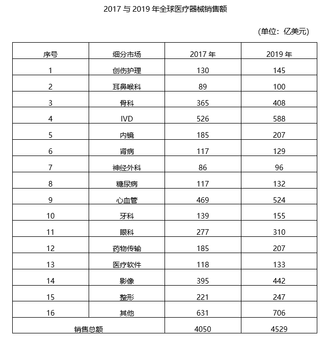

# 材料 · 2017年与2019年全球医疗器械销售额：按16个细分市场（15个具体市场+其他

> 关联 5 道小题

**时间口径**：仅两个截面年份：2017年和2019年，均为当期值（非累计），无2018年数据、无预测年份；2017为前一截面、2019为后一截面，2017→2019的增幅为两年总增幅而非年均增幅；涉及2016年（第1题'同比'）时表中无数据，需通过题干给的同比条件反推

**单位与换算**：全表统一为'亿美元'，无单位混用和量级换算陷阱；占比类计算分母统一用底部'销售总额'行（2017年4050、2019年4529），分子为各细分市场额；注意总额数值较大（4000+量级），基期换算时保留有效位数

## 结构拆解
- 唯一一张统计表：标题'2017与2019年全球医疗器械销售额'，表外右上角标注'（单位：亿美元）'；列为'序号—细分市场—2017年—2019年'四列；行为16个细分市场：①创伤护理(130/145) ②耳鼻喉科(89/100) ③骨科(365/408) ④IVD(526/588) ⑤内镜(185/207) ⑥肾病(117/129) ⑦神经外科(86/96) ⑧糖尿病(117/132) ⑨心血管(469/524) ⑩牙科(139/155) ⑪眼科(277/310) ⑫药物传输(185/207) ⑬医疗软件(118/133) ⑭影像(395/442) ⑮整形(221/247) ⑯其他(631/706)；表格底部单列'销售总额'行：2017年4050、2019年4529（=15个具体市场+其他之和，两列均验证闭合）

## 阅读陷阱
- ⚠ '其他'类（631/706）本身是16个细分市场之一且数值最大，但第2、3、4题均要求'除其他类外'——排除其他类做筛选排序，而计算占比时分母仍是含其他的销售总额4050/4529
- ⚠ 表中只有2017和2019两列，无2018年；第1题给的是'2017年同比提高4.6%'等同比条件，2016年数据必须用基期公式从题干条件反推，切勿在表中找2016或误把2017当基期直接读数
- ⚠ 底部'销售总额'行（4050/4529）是合计行不是第17个细分市场，做'超过5%的细分市场计数'或'前五排序'时极易误把它算进去
- ⚠ 数值重复项易混淆：肾病与糖尿病2017年同为117，内镜与药物传输两年数值完全相同（185/207），比较增幅或排名时注意区分；神经外科(86/96)与耳鼻喉科(89/100)数值接近易看串行
- ⚠ 增幅=（2019年−2017年）/2017年，是两年累计增幅，题干若问'年均'需另行开方，不能直接除以2充当年均
- ⚠ 2017年占比5%对应约202.5亿美元、2019年对应约226.5亿美元，判断'超过5%'需逐项与阈值比较，勿凭感觉估

## 小题群关系
五道题共用一张表，核心模型是'比重+增长'双线：第1题为基期反推模型（现期值÷(1+同比增速)，再叠加'占比同比提高3个百分点'还原2016年IVD销售额），是唯一需要表外数据的题；第2题为2017年现期比重比较（占比>5%计数，排除其他类）；第3题为2019年排序加总+比重模型（前五细分市场合计÷4529）；第4题为2017→2019增长率比较模型（两期间总增幅，找增幅最小项）；第5题为综合分析判断题，通常混合比重、增长量、增长率多口径验证。题与题之间无连环复用（第1题推出的2016年数据不被后续题使用），但第2、3、4题共享同一操作流程：先剔除'其他'类→再按数值筛选/排序→最后对分母用含其他的销售总额，备考时可将三题合并为一次'排序+比重'处理

## 关联真题
- [[10-真题/资料分析/比重/4651816 现期比重与固定阈值比较（占比超5%计数）|4651816]] 深圳市考 2022 — 现期比重与固定阈值比较（占比超5%计数）
- [[10-真题/资料分析/比重/4651813 基期部分量计算（基期整体反推＋占比百分点变化还原）|4651813]] 深圳市考 2022 — 基期部分量计算（基期整体反推＋占比百分点变化还原）
- [[10-真题/资料分析/比重/4651818 现期比重计算（排序取前N求和型）|4651818]] 深圳市考 2022 — 现期比重计算（排序取前N求和型）
- [[10-真题/资料分析/增长/4651819 增长率比较（2017→2019两年累计增幅最小项）|4651819]] 深圳市考 2022 — 增长率比较（2017→2019两年累计增幅最小项）
- [[10-真题/资料分析/综合/4651821 综合分析判断题（年均增长率测算+比重差+比重升降+增长量计数四口径混合验证）|4651821]] 深圳市考 2022 — 综合分析判断题（年均增长率测算+比重差+比重升降+增长量计数四口径混合验证）

---

### 材料原文

