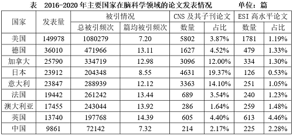

# 材料 · 1971—2020年全球脑科学领域论文发表量按五年区间的累计统计，以及2016—

> 关联 3 道小题

**时间口径**：现期为2020年，无预测年份；柱状图按'五年一个区间'给出10个区间的累计发文量（1971~1975至2016~2020），是区间累计值而非单年值；表格仅覆盖2016—2020年这最后一个五年区间的国家层面数据

**单位与换算**：全文统一单位为'篇'，无亿元/万吨类换算；柱状图数值在数万至45万篇量级（最大451472篇），作差比较时注意六位数减法精度；占比列为百分数（CNS占比、ESI占比），篇均被引频次为'次/篇'的比值，三者口径不同不可直接相加比较

## 结构拆解
- 图：1971—2020年全球脑科学领域发表论文的数量（单位：篇），按五年一组共10根柱：1971~1975年62610、1976~1980年77265、1981~1985年91503、1986~1990年114479、1991~1995年166143、1996~2000年198820、2001~2005年226891、2006~2010年290249、2011~2015年378830、2016~2020年451472
- 表：2016—2020年主要国家在脑科学领域的论文发表情况（单位：篇），列9个国家（美国、德国、加拿大、日本、意大利、法国、澳大利亚、英国、中国），指标为发表量、总被引频次、篇均被引频次，以及CNS及其子刊论文数量与占比、ESI高水平论文数量与占比，例如美国发表量149978、总被引1080279、篇均7.20、CNS论文5802（3.87%）、ESI论文1781（1.19%）；中国发表量9861、总被引72142、篇均7.32、CNS论文214（2.17%）、ESI论文225（2.28%）

## 阅读陷阱
- ⚠ 柱状图每根柱代表'五年累计'发文量而非单年值，题干问的'同比增长量'实为相邻两个五年区间数值之差，一个区间只产出一个增量数据
- ⚠ 1976~1980的增长量必须以1971~1975（62610）为基期，若误把1976~1980当作第一段会漏算或错算
- ⚠ 图与表时间范围不同：图覆盖1971—2020年全球总量，表仅2016—2020年国家数据，两者是'全球—国家'的包含关系（如2016~2020全球451472篇对应美国149978篇、中国9861篇），不可混用口径
- ⚠ 表格中同时存在两个'占比'列（CNS及其子刊论文占比、ESI高水平论文占比），基数均为该国发表量，读错列会张冠李戴；篇均被引频次为复合指标（总被引÷发表量），不能与数量类指标比大小

## 小题群关系
本组仅1题，核心模型是'增长量=现期值−基期值'的多次作差比较：需从柱状图依次取相邻两个五年区间的数值相减（1976~1980至2016~2020共9个增量）并比较最大者，本质是多位数减法的比较类计算题；表格（2016—2020年国家数据）在本题中暂不使用，疑为材料内其他未列出小题服务；本题内部不存在上一题结果被下一题复用的连环关系，但若后续有小题用到'最多增量所在区间'，可能需回用本题结论

## 关联真题
- [[10-真题/资料分析/增长/4651934 增长量比较|4651934]] 上海 2022 — 增长量比较
- [[10-真题/资料分析/增长/4651953 同比增长率计算与比较（五年区间增长率、图形匹配）|4651953]] 上海 2022 — 同比增长率计算与比较（五年区间增长率、图形匹配）
- [[10-真题/资料分析/增长/4651954 现期量预测（现期追赶问题）|4651954]] 上海 2022 — 现期量预测（现期追赶问题）

---

### 材料原文

