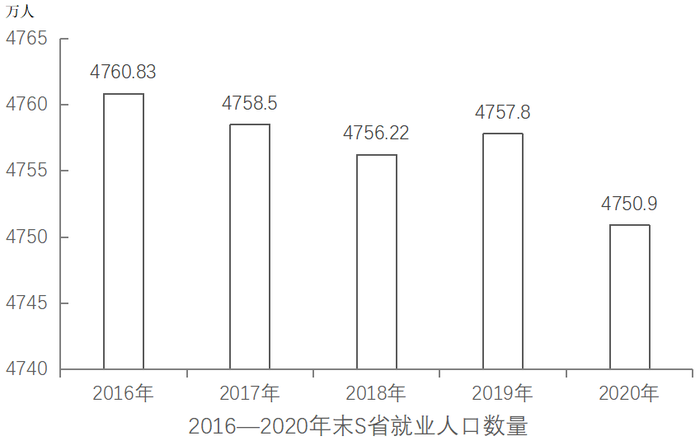

# 材料 · 2016—2020年末S省就业人口总量变化及2020年末就业人口占常住人口比重、

> 关联 5 道小题

**时间口径**：现期为2020年末，同比基期为2019年末；柱状图给出2016—2020连续5个'年末'时点存量（非累计值）；不含预测年份；文字中的比重变化均为2020年末相对2019年末

**单位与换算**：人口数量单位为'万人'，占比单位为'%'，占比变化用'个百分点'表述；三次产业就业人口之和(764.89+2033.39+1952.62=4750.9)恰等于就业人口总数，可作验算；'个百分点'不能直接当'%'用于增速计算；常住人口总数材料未直接给出，需用4750.9÷59.01%换算（约8050万）

## 结构拆解
- 文字第1句：2020年末就业人口4750.9万人，占常住人口总数59.01%，该比重比2019年末下降0.24个百分点（隐含2019年末占比59.25%），需与柱状图2019年数据联动才能求基期常住人口
- 文字第2句：2020年末三次产业就业人口：第一产业764.89万人、第二产业2033.39万人、第三产业1952.62万人；与2019年末相比，一产、二产就业比重分别下降0.7个、0.1个百分点，三产上升0.8个百分点（注意是'比重'的变化而非'数量'的增减）
- 柱状图《2016—2020年末S省就业人口数量》（单位：万人）：2016年4760.83、2017年4758.5、2018年4756.22、2019年4757.8、2020年4750.9，其中2019年4757.8是各题同比/基期计算的关键基期总量

## 阅读陷阱
- ⚠ 柱状图纵轴从4740起步、非零起点，柱高落差被视觉放大，实际五年最大降幅仅约10万人（约0.2%），勿据柱高误判'大幅下降'
- ⚠ '比重下降0.7个百分点'不等于'数量下降'：求2019年一产人数须先算2020年一产占比(764.89/4750.9≈16.1%)，再加0.7个百分点还原基期占比，再乘基期总量4757.8（约799万人），数量实为同比下降
- ⚠ 未就业常住人口未直接给出，须用'常住人口总数(4750.9/59.01%)−就业人口4750.9'或'常住人口×(1−59.01%)'跨数据推算
- ⚠ 两套不同分母的比重易混：占'常住人口'的比重(59.01%)与三次产业占'就业人口'的比重，分母完全不同，不可互换使用

## 小题群关系
四题统一围绕'比重＋基期量'模型：题1考基期比重求基期总量（2019年末常住人口＝4757.8÷(59.01%+0.24%)≈8030万）；题2考现期比重作差（(2033.39−1952.62)/4750.9≈1.7个百分点）；题3考由比重变化反推基期量再求同比（一产同比下降约4.3%）；题4考现期倍数（未就业常住人口＝4750.9/59.01%×40.99%≈3300万，与三产1952.62相比约1.69倍）。连环复用明显：题1依赖文字与柱状图拼接，题3复用柱状图2019年就业总量4757.8；题4的常住人口算法与题1同源；题2、题3均需先自行算出2020年各产业现期占比

## 关联真题
- [[10-真题/资料分析/比重/4652182 现期比重作差（两个部分占总体比重的差值比较）|4652182]] 北京 2022 — 现期比重作差（两个部分占总体比重的差值比较）
- [[10-真题/资料分析/比重/4652179 基期比重求基期总量（整体=部分÷比重，比重需先还原到基期）|4652179]] 北京 2022 — 基期比重求基期总量（整体=部分÷比重，比重需先还原到基期）
- [[10-真题/资料分析/增长/4652186 增长量计算（由比重变化反推基期部分量再作差）|4652186]] 北京 2022 — 增长量计算（由比重变化反推基期部分量再作差）
- [[10-真题/资料分析/倍数/4652190 现期倍数（比重的逆运用：整体=部分÷比重后作差再作除）|4652190]] 北京 2022 — 现期倍数（比重的逆运用：整体=部分÷比重后作差再作除）
- [[10-真题/资料分析/综合/4652192 综合判断题（两期比重变化定性结论＋同比增量-增长率逐项验证）|4652192]] 北京 2022 — 综合判断题（两期比重变化定性结论＋同比增量-增长率逐项验证）

---

### 材料原文

        2020年末S省就业人口4750.9万人，占常住人口总数的59.01%，与2019年末相比，就业人口占常住人口总数的比重下降0.24个百分点。

        2020年末S省第一产业、第二产业和第三产业的就业人口数量分别为764.89万人、2033.39万人、1952.62万人，与2019年末相比，第一、第二产业就业人口比重分别下降0.7个、0.1个百分点，第三产业就业人口比重上升0.8个百分点。

