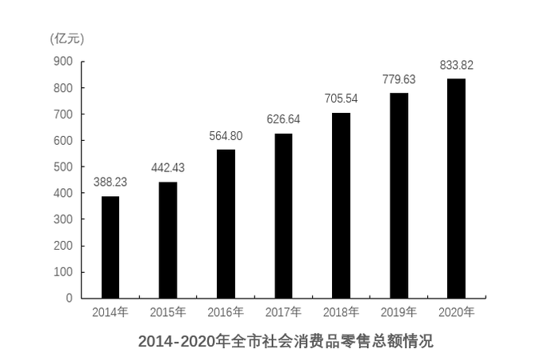
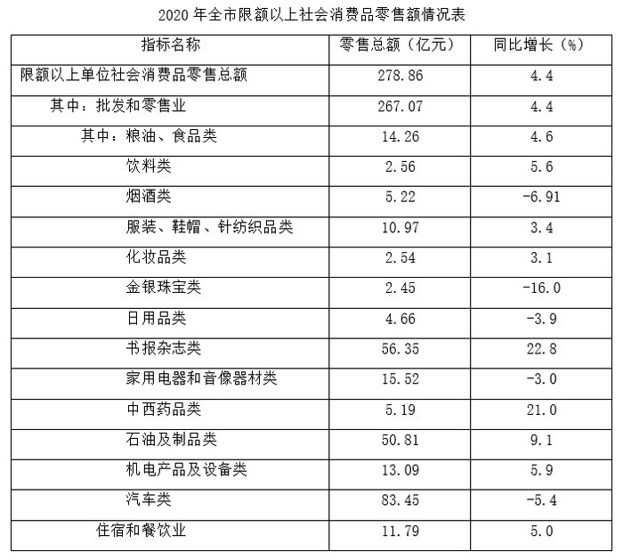

# 材料 · 某市2014-2020年社会消费品零售总额规模及2020年的结构拆分（消费形态、

> 关联 5 道小题

**时间口径**：现期为2020年，各处同比增速均以2019年为基期（需自行推基期量，材料不给2019年分项值）；柱状图给出2014-2020共7个年度当期值；无预测年份；全部为年度当期零售额，非月度累计

**单位与换算**：金额单位均为亿元，增速单位为%；柱状图纵轴标'（亿元）'、刻度间隔100；无需单位换算，但量级跨度大（限额以上最小类目约2.45亿元 vs 全市833.82亿元），比较增量时注意保持同一量纲；注意表格中烟酒类增速-6.91%为负增长

## 结构拆解
- 文字段：2020年全市社零总额833.82亿元（同比+7.0%），按消费形态拆为批发和零售业713.67亿元（+6.1%）＋住宿和餐饮业120.15亿元（+12.3%），按经营所在地拆为城镇653.54亿元（+7.2%）＋乡镇180.28亿元（+5.9%），两套拆分各自加总均等于833.82亿元，各分项增速对应2019年基期
- 柱状图《2014-2020年全市社会消费品零售总额情况》：逐年总量，2014年388.23、2015年442.43、2016年564.80、2017年626.64、2018年705.54、2019年779.63、2020年833.82（亿元），2020年数值与文字段口径一致、可互相校验
- 统计表《2020年全市限额以上社会消费品零售额情况表》：限额以上单位社零总额278.86亿元（+4.4%），其中批发和零售业267.07亿元（+4.4%）、住宿和餐饮业11.79亿元（+5.0%）；批发和零售业下再细分14个商品类别（粮油食品14.26/+4.6%、饮料2.56/+5.6%、烟酒5.22/-6.91%、服装鞋帽针纺织10.97/+3.4%、化妆品2.54/+3.1%、金银珠宝2.45/-16.0%、日用品4.66/-3.9%、书报杂志56.35/+22.8%、家电音像15.52/-3.0%、中西药品5.19/+21.0%、石油及制品50.81/+9.1%、机电产品13.09/+5.9%、汽车83.45/-5.4%），两级'其中'嵌套结构

## 阅读陷阱
- ⚠ 同名指标两套口径：'批发和零售业'在文字段是全市口径713.67亿元，在表格是限额以上口径267.07亿元，且限额以上总额278.86亿元远小于全市833.82亿元，绝不可跨口径混用（题1用全市、题4用限额以上）
- ⚠ 题3问'乡村'而材料写'乡镇'，为同一口径，需识别同义表述；2019年城镇/乡镇值材料未直接给出，必须用653.54/(1+7.2%)和180.28/(1+5.9%)自行换算
- ⚠ 表格为两级'其中'嵌套：商品类别只属于限额以上批发和零售业（267.07亿元）之下，不可与全市713.67亿元或总额278.86亿元直接加总比对
- ⚠ 表格多个类别为负增长（烟酒-6.91%、金银珠宝-16.0%、日用品-3.9%、家电-3.0%、汽车-5.4%），其同比增量为负，找'增量最多'时可直接排除；汽车类83.45亿元现期最大但负增长，是典型的'看总量不看增速'陷阱
- ⚠ 题2的'同比增量'必须由柱状图相邻两年相减（如2016年增量=564.80-442.43≈122.37亿元），不能误用图中总量本身画趋势，也不能用'增速'冒充'增量'
- ⚠ 题1比重变化需比较分子增速6.1%与分母增速7.0%，方向易判断但需防与题4的'增量'计算公式（现期×r/(1+r)）混淆

## 小题群关系
四题围绕'增长+比重+倍数'三大基础模型组合：题1考基期比重/比重变化（两期比重差=现期比重×(分子增速-分母增速)/(1+分子增速)，用文字段713.67/6.1%与833.82/7.0%）；题2考增长量计算与排序（柱状图相邻年相减，2015-2018四个增量）；题3考基期倍数（城镇基期÷乡镇基期）；题4考增长量比较（多个类目套用现期×r/(1+r)，需先剔除负增长类目，重点比对书报杂志56.35×22.8%、石油及制品50.81×9.1%等大基数高增速项）。四题相互独立、无上一题结果被下一题复用的连环结构，但共用同一份文字增速和图表数据，且题1与题4同考'增量'概念、分属不同口径，需严格区分数据来源：文字段+柱状图服务题1-3，表格服务题4

## 关联真题
- [[10-真题/资料分析/比重/4663219 两期比重差（比重变化方向与幅度）|4663219]] 山东 2022 — 两期比重差（比重变化方向与幅度）
- [[10-真题/资料分析/增长/4663220 增长量计算与排序（相邻两年相减+折线趋势判断）|4663220]] 山东 2022 — 增长量计算与排序（相邻两年相减+折线趋势判断）
- [[10-真题/资料分析/倍数/4663221 基期倍数计算|4663221]] 山东 2022 — 基期倍数计算
- [[10-真题/资料分析/增长/4663222 增长量比较|4663222]] 山东 2022 — 增长量比较
- [[10-真题/资料分析/综合/4663224 综合判断题（混合增长率居中+基期量+多年加总+负增长计数逐项验证）|4663224]] 山东 2022 — 综合判断题（混合增长率居中+基期量+多年加总+负增长计数逐项验证）

---

### 材料原文

        2020年某市实现社会消费品零售总额833.82亿元，同比增长7.0%。按消费形态分，批发和零售业实现713.67亿元，同比增长6.1%；住宿和餐饮业实现120.15亿元，同比增长12.3%。按经营所在地分，城镇实现653.54亿元，同比增长7.2%；乡镇实现180.28亿元，同比增长5.9%。

