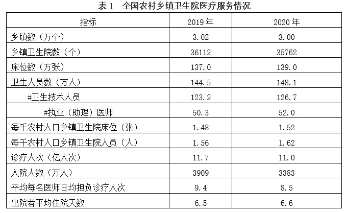
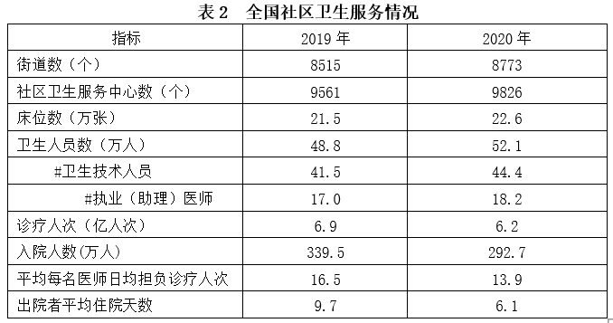

# 材料 · 2020年全国基层医疗卫生服务情况：农村乡镇卫生院（表1）与社区卫生服务（表2）

> 关联 5 道小题

**时间口径**：现期年2020年，基期年2019年；两张表均为年度当期值（非累计），无预测年份；文字段提供2020年现期量及同比增量（乡镇卫生院卫生人员+3.6万人、社区卫生人员+3.3万人）

**单位与换算**：乡镇数用'万个'（3.00万个=30000个），乡镇卫生院数用'个'；床位数'万张'，人员数'万人'，诊疗人次'亿人次'，入院人数'万人'。核心换算陷阱：题2中'诊疗人次(亿人次)÷执业(助理)医师(万人)'需做1亿=10^4万的量级换算；'每千农村人口乡镇卫生院床位(张)/人员(人)'是相对强度指标，不能当绝对总量用；'日均担负诊疗人次'为日均值，推'全年'需乘天数或改用总量÷医师数；'出院者平均住院天数'单位为天

## 结构拆解
- 文字段：交代背景并给出2020年两个现期总量及同比增量——乡镇卫生院卫生人员148.1万人(+3.6万)、社区卫生人员52.1万人(+3.3万)，与表1、表2的卫生人员数行互相印证
- 表1《全国农村乡镇卫生院医疗服务情况》：2019/2020两列，指标含乡镇数(3.02→3.00万个)、乡镇卫生院数(36112→35762个)、床位数(137.0→139.0万张)、卫生人员数(144.5→148.1万人)、其中卫生技术人员(123.2→126.7万人)、其中执业(助理)医师(50.3→52.0万人)、每千农村人口床位(1.48→1.52张)、每千农村人口人员(1.56→1.62人)、诊疗人次(11.7→11.0亿人次)、入院人数(3909→3383万人)、平均每名医师日均担负诊疗人次(9.4→8.5)、出院者平均住院天数(6.5→6.6天)
- 表2《全国社区卫生服务情况》：2019/2020两列，指标含街道数(8515→8773个)、社区卫生服务中心数(9561→9826个)、床位数(21.5→22.6万张)、卫生人员数(48.8→52.1万人)、其中卫生技术人员(41.5→44.4万人)、其中执业(助理)医师(17.0→18.2万人)、诊疗人次(6.9→6.2亿人次)、入院人数(339.5→292.7万人)、平均每名医师日均担负诊疗人次(16.5→13.9)、出院者平均住院天数(9.7→6.1天)

## 阅读陷阱
- ⚠ 带#的指标是'其中项'：卫生人员数⊃卫生技术人员⊃执业(助理)医师，第4题求医师占比分母应取卫生人员数148.1（或按题意取卫技人员），不能混用层级
- ⚠ 表1'乡镇数(万个)'与'乡镇卫生院数(个)'是两个不同口径：35762家卫生院分布在3.00万个乡镇中，第3题'平均每个乡镇床位数'分母应为乡镇数3.00万个而非卫生院数，选错分母结果差异巨大
- ⚠ 题2问'全年'诊疗人次，表中只有总量(亿人次)、医师数(万人)和'日均'口径，需跨表取数并完成亿↘万换算，直接拿'日均13.9-8.5'不做天数换算会掉坑
- ⚠ 文字段的增长量(+3.6万)对应增速计算时基期是表中144.5，误用现期148.1作分母是典型错误
- ⚠ 每千农村人口床位/人员是强度相对数，与绝对量床位(万张)、人员(万人)并存，综合分析题常用其设置偷换口径选项
- ⚠ 两表均有'诊疗人次、入院人数、日均诊疗、住院天数'同名指标，但分属乡镇卫生院与社区两套体系，数值不可互相替代，跨表拼数据(题2、题3)时须对应取列

## 小题群关系
五道题围绕'两表一文字'的基层卫生服务体系展开，核心模型为：①题1给现期+增长量求同比增长率(3.6/144.5≈2.5%)；②题2跨表平均数模型——社区与乡镇的'诊疗人次÷执业(助理)医师数'全年口径对比再作差；③题3跨表倍数模型——乡镇床位/乡镇数 对比 街道床位/街道数(139.0万/3.00万 ÷ 22.6万/8773≈1.8倍)；④题4比重模型——其中项医师52.0占卫生人员148.1比重(约35%)；⑤题5为综合分析题，其选项多复用前四题的增速、占比、倍数、日均变化等计算结论，属于'前面小题结果可供最后一题验证'的连环结构，题与题之间数据高度复用但计算彼此独立

## 关联真题
- [[10-真题/资料分析/倍数/4673207 现期平均数之比（跨表平均数倍数比较）|4673207]] 广东 2022 — 现期平均数之比（跨表平均数倍数比较）
- [[10-真题/资料分析/增长/4673205 已知增长量与基期量求同比增长率|4673205]] 广东 2022 — 已知增长量与基期量求同比增长率
- [[10-真题/资料分析/平均数/4673206 平均数差值计算（日均担负诊疗人次×全年天数推全年）|4673206]] 广东 2022 — 平均数差值计算（日均担负诊疗人次×全年天数推全年）
- [[10-真题/资料分析/比重/4673208 现期比重|4673208]] 广东 2022 — 现期比重
- [[10-真题/资料分析/综合/4673209 综合分析·选非题（强度指标反推总量＋平均数＋倍数逐项验证）|4673209]] 广东 2022 — 综合分析·选非题（强度指标反推总量＋平均数＋倍数逐项验证）

---

### 材料原文

        近年来，全国基层卫生服务能力稳步提升，居民健康水平进一步提高。2020年，我国农村乡镇卫生院卫生人员数达148.1万人，比上年增加3.6万人，社区卫生人员数达52.1万人，比上年增加3.3万人。

