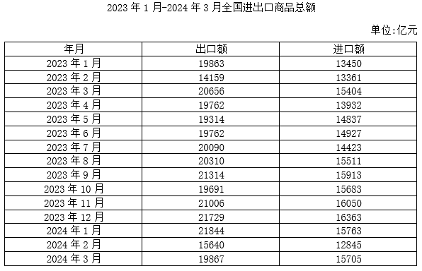
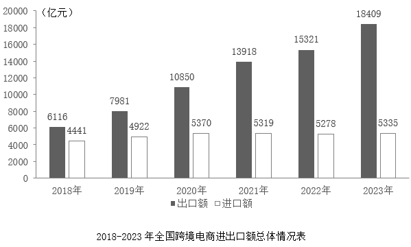

# 材料 · 全国对外贸易与跨境电商双口径统计：一张月度表给出2023年1月-2024年3月全

> 关联 5 道小题

**时间口径**：表1为月度当期值（非累计），覆盖2023年1月至2024年3月共15个月，2023年全年12个月齐全、2024年仅有第一季度3个月；图2为年度值，覆盖2018-2023年共6年；全部为实际统计数据，无预测年份；两图时间口径不同（月度vs年度），交叉使用时须自行按季度/年度加总

**单位与换算**：两张图单位统一为'亿元'；最大陷阱在第1题题干要求以'万亿元'作答，需做亿元→万亿元换算（除以10000，量级缩小4位）；其余计算均在亿元量级内，数值多为4-5位数，注意加总时别漏月、别串列

## 结构拆解
- 表1《2023年1月-2024年3月全国进出口商品总额》（单位：亿元）：三列结构——年月、出口额、进口额，共15行月度数据；关键数值如2023年1月出口19863/进口13450，2023年12月出口21729/进口16363，2024年1月出口21844/进口15703，2024年2月出口15640/进口12845，2024年3月出口19867/进口15705；2023年出口额大致在14000-22000亿元/月区间波动，进口额大致在12800-16400亿元/月区间波动
- 图2《2018-2023年全国跨境电商进出口额总体情况表》（单位：亿元）：双柱图，深色柱为出口额、浅色柱为进口额，需对照图例；出口额逐年递增：6116→7981→10850→13918→15321→18409；进口额2018-2020年递增（4441→4922→5370），2021-2023年基本走平（5319→5278→5335），说明总额增长几乎全由出口拉动

## 阅读陷阱
- ⚠ 两图指标名称高度相似（都有'出口额/进口额'），但口径完全不同：表1是全国进出口商品总额，图2仅是跨境电商口径，跨境电商进口额只占全部商品进口额的约3%，二者绝不能互相替代或相加
- ⚠ 第2题必须跨图表拼接：分子取图2的2023年跨境电商进口额5335，分母需将表1中2023年12个月的进口额逐月加总，一处取错即全盘错
- ⚠ 第4题判断'双指标环比增长'须逐月与上月比较两个列：如2024年1月出口环比增（21844>21729）但进口环比减（15703<16363），不能通过，易被单看出口列误判
- ⚠ 第1、5题的季度数据表中并未直接给出，须自行将3个月出口、进口分别加总再求差（顺差=出口-进口），注意2024年第一季度只能加到3月、2023年各季度是完整3个月
- ⚠ 图2为双柱图，深浅柱易看混，读数前先确认图例：深色=出口额、浅色=进口额
- ⚠ 亿元与万亿元的换算是第1题的显性考点，数值算对但单位不换算会直接失分

## 小题群关系
5道题围绕两大模型：①'顺差=出口额-进口额'配合'月度数据→季度加总'（第1题算2024年Q1顺差并做亿元→万亿元换算；第5题算2023年四个季度顺差后排序），两题共享'三月加总再相减'的步骤，属于同一链条的两次调用；②增长率类：第2题是跨图表'比重=跨境电商进口额÷全部商品进口总额'（分子取图2、分母取表1十二个月加总）；第3题是图2内部'进出口总额同比增速'比较（出口+进口加总后再算增长率，2021-2023年进口额几乎不变，是增速判断的关键区分点）；第4题是表1内部'双指标环比增长月份计数'。各题所需数据基本独立，无严格连环复用（上一题答案不被下一题直接使用），但第1、5题共享季度加总技巧，第2、3题共享'图2进口额数据'，做题时可顺带核对

## 关联真题
- [[10-真题/资料分析/其他/14096272 贸易顺差计算（顺差=出口额-进口额）＋月度数据季度加总＋亿元→万亿元单位换算|14096272]] 选调 2025 — 贸易顺差计算（顺差=出口额-进口额）＋月度数据季度加总＋亿元→万亿元单位换算
- [[10-真题/资料分析/比重/14096273 现期比重计算（跨图表拼接：跨境电商进口额÷全部商品进口总额）|14096273]] 选调 2025 — 现期比重计算（跨图表拼接：跨境电商进口额÷全部商品进口总额）
- [[10-真题/资料分析/其他/14096276 贸易顺差（出口额-进口额）季度加总与排序比较|14096276]] 选调 2025 — 贸易顺差（出口额-进口额）季度加总与排序比较
- [[10-真题/资料分析/增长/14096274 增长率计算与比较（进出口总额同比增速判断）|14096274]] 选调 2025 — 增长率计算与比较（进出口总额同比增速判断）
- [[10-真题/资料分析/增长/14096275 环比增长判断与双指标月份计数|14096275]] 选调 2025 — 环比增长判断与双指标月份计数

---

### 材料原文

