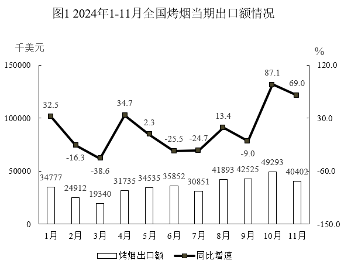
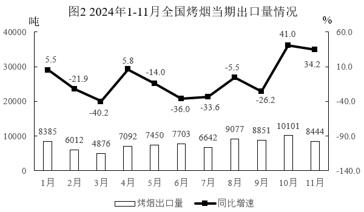

# 材料 · 2024年1-11月全国烤烟各月当期出口额（千美元）与当期出口量（吨）及各自的同

> 关联 5 道小题

**时间口径**：现期为2024年1-11月各月'当期值'（当月发生额，非1-11月累计），每月均配同比增速；基期为2023年同月，材料未直接给出，需用'基期量=现期量/(1+同比增速)'反推；无预测年份

**单位与换算**：图1出口额单位为千美元，图2出口量单位为吨，两图增速单位均为%；核心换算陷阱：出口均价=出口额÷出口量，所得单位是'千美元/吨'，若选项给'美元/吨'需×1000（如约4.1千美元/吨≈4100美元/吨）；千美元量级本身较大（3-5万千美元），注意与'万美元'、'亿美元'选项的量级区分

## 结构拆解
- 图1 柱线双轴图《2024年1-11月全国烤烟当期出口额情况》：左轴千美元(0-150000)，右轴同比增速%；柱为各月出口额，线为同比增速。数据：1月34777(+32.5%)、2月24912(-16.3%)、3月19340(-38.6%)、4月31735(+34.7%)、5月34535(+2.3%)、6月35852(-25.5%)、7月30851(-24.7%)、8月41893(+13.4%)、9月42525(-9.0%)、10月49293(+87.1%)、11月40402(+69.0%)，覆盖2024年1-11月逐月
- 图2 柱线双轴图《2024年1-11月全国烤烟当期出口量情况》：左轴吨(0-40000)，右轴同比增速%；柱为各月出口量，线为同比增速。数据：1月8385(+5.5%)、2月6012(-21.9%)、3月4876(-40.2%)、4月7092(+5.8%)、5月7450(-14.0%)、6月7703(-36.0%)、7月6642(-33.6%)、8月9077(-5.5%)、9月8851(-26.2%)、10月10101(+41.0%)、11月8444(+34.2%)，覆盖2024年1-11月逐月，与图1月份一一对应

## 阅读陷阱
- ⚠ 两图柱值单位不同（千美元 vs 吨），图例名称仅一字之差（'烤烟出口额'/'烤烟出口量'），跨图取数时极易取错列
- ⚠ 每图均为柱+线双轴结构，柱是当期量、线是同比增速，读数时易把柱值当增速或把增速点高度当柱值
- ⚠ 同比增速正负交替（如出口额10月+87.1%、6月-25.5%），反推基期时(1+r)必须带符号，负增速是除以小于1的数
- ⚠ 题干强调'当期'，即当月值而非累计值；增速线是同比，但第5题要求环比增速，需相邻两月柱值相除，同比环比口径不能混用
- ⚠ 均价=额÷量，须从两张图分别取数拼接；均价的同比增速绝不能直接用出口额增速（69.0%）冒充，需用平均数增长率公式(a-b)/(1+b)
- ⚠ 计算季度均价时须分子分母分别求和再相除（总额÷总量），不能将各月均价简单平均
- ⚠ 第5题7月的环比需借6月数据（跨月拼接），判断折线趋势时注意8月由负转正大幅抬升、9月回落至小幅正值

## 小题群关系
这组题围绕'当期量+同比增速'的反推与衍生计算模型群：题1是基期量计算（35852/(1-25.5%)）；题2是基期量比较/同比判断（6642与6642/(1-33.6%)比大小）；题3是平均数增长率模型（(69.0%-34.2%)/(1+34.2%)≈26%，同时用到图1、图2的11月增速）；题4是跨图汇总求平均数（Q1三月出口额之和÷出口量之和）；题5是环比增速计算与折线趋势识别（7月约-13.9%、8月约+35.8%、9月约+1.5%）。五题之间不连环复用（上一题结果不被下一题直接引用），但共用同一组图形数据，题3、题4、题5均需跨图1、图2或跨月份拼数，属于'一材多模型'的并列考查结构

## 关联真题
- [[10-真题/资料分析/增长/13504643 基期量计算（负增长反推）|13504643]] 辽宁 2025 — 基期量计算（负增长反推）
- [[10-真题/资料分析/增长/13504644 增长量计算（负增长减少量）|13504644]] 辽宁 2025 — 增长量计算（负增长减少量）
- [[10-真题/资料分析/平均数/13504645 平均数增长率（均价=出口额÷出口量，用分子分母增速求平均数增速）|13504645]] 辽宁 2025 — 平均数增长率（均价=出口额÷出口量，用分子分母增速求平均数增速）
- [[10-真题/资料分析/平均数/13504646 现期平均数计算（跨图汇总：总额÷总量求区间均价）|13504646]] 辽宁 2025 — 现期平均数计算（跨图汇总：总额÷总量求区间均价）
- [[10-真题/资料分析/增长/13504647 环比增速计算与折线形态匹配|13504647]] 辽宁 2025 — 环比增速计算与折线形态匹配

---

### 材料原文

