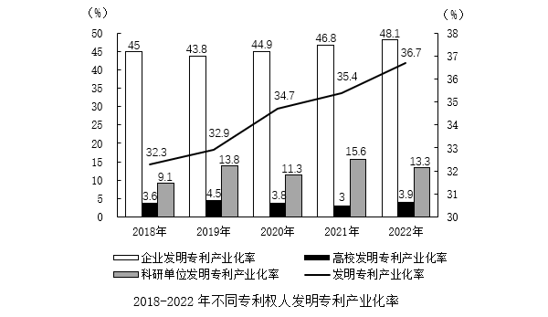
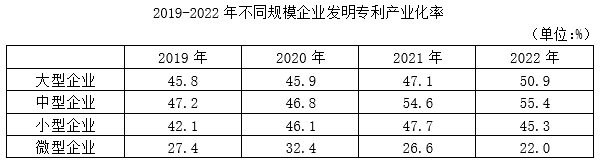

# 材料 · 2022年我国专利产业化率情况：文字段给出发明/实用新型/外观设计三类专利产业化

> 关联 5 道小题

**时间口径**：现期2022年，基期2021年；图1覆盖2018-2022年，图2覆盖2019-2022年，均为逐年当期年度数据，无预测年份、无累计值；文字段只给2022年值加'较上年±X个百分点'，2021年值需用加减法反推

**单位与换算**：全文单位均为%；图1为双轴图：柱形读左轴（0-50%），折线读右轴（30-38%），两轴刻度不同，不能按图中视觉高低比较；文字段'提高/降低1.3、6.4个百分点'为差值口径，推基期用加减而非除法；高校2021年标注'3'即3%（一位小数精度）

## 结构拆解
- 文字段：先给出专利产业化率定义（用于生产出产品并投放市场的专利占全部有效专利的比例），再给2022年数据：发明专利36.7%（+1.3个百分点）、实用新型44.9%（-1.3个百分点）、外观设计58.7%（+6.4个百分点），可还原2021年：发明专利35.4%、实用新型46.2%、外观设计52.3%
- 图1（柱+折线组合图）2018-2022年不同专利权人发明专利产业化率：柱为企业（45/43.8/44.9/46.8/48.1，左轴）、高校（3.6/4.5/3.3/3/3.9，左轴）、科研单位（9.1/13.8/11.3/15.6/13.3，左轴）；折线为我国发明专利产业化率（32.3/32.9/34.7/35.4/36.7，读右轴），数据从2018年到2022年
- 图2（统计表）2019-2022年不同规模企业发明专利产业化率（单位%）：大型企业45.8/45.9/47.1/50.9，中型企业47.2/46.8/54.6/55.4，小型企业42.1/46.1/47.7/45.3，微型企业27.4/32.4/26.6/22.0，数据从2019年到2022年

## 阅读陷阱
- ⚠ 图1双轴陷阱：柱（左轴0-50）与折线（右轴30-38）刻度不同，折线必须读右轴，不能凭图上位置断言'折线低于柱'或直接比大小
- ⚠ 同名指标口径不同：都叫'发明专利产业化率'，但全国（32.3→36.7）、企业（45→48.1）、高校、科研单位以及图2分规模企业数值各异；图1'企业'整体（2021年46.8、2022年48.1）≠图2大型企业（47.1、50.9），跨图不能混用
- ⚠ '增幅/提高X个百分点'（差值）与'增速'（%增长率）两种算法并存：率类指标的同比变化用百分点表述，第1题比'增幅'、第3/4题算'增速'，两种口径混用必错
- ⚠ 文字段需反向推基期：实用新型2022年'降低1.3个百分点'，2021年应加回（44.9+1.3）；外观设计'提高6.4个百分点'，2021年应减去（58.7-6.4），方向搞反即错
- ⚠ 图2中微型企业2021年（26.6）较2020年（32.4）为负增长、2022年（22.0）继续降，小型企业2022年（45.3）低于2021年（47.7），负增长段在'最快/超过X%'类比较中易被忽略或误处理
- ⚠ 图1高校2021年只有一位数字'3'，与3.9、3.6等精度不一致，细算增速时注意

## 小题群关系
四个小题分别绑定一个数据模块，彼此独立、无连环复用（上一题结果不被下一题使用）：第1题用图1折线（全国发明专利产业化率）求2019-2022逐年同比增幅（按百分点差：2019年+0.6、2020年+1.8、2021年+0.7、2022年+1.3；若按增速算结论相同，模型为'百分点差/增长率'）；第2题用文字段做'基期还原（±百分点）+两率作差'，考的是2021年外观设计与实用新型之差；第3题用图1'企业'柱算逐年同比增速并与2.7%阈值比较（模型为'基期增长率比较'）；第4题用图2对大/中/小/微四类规模算2021年同比增速找最快（微型为负增长，大型约2.6%、小型约3.5%、中型最高）。整组题的共同考点是：率类指标中'增幅（百分点）vs 增速（%）'的辨析，以及由'现期+同比变化'还原基期数据；第1、3题虽同用图1，但取不同图元（折线vs企业柱），仍是并列关系而非连环题

## 关联真题
- [[10-真题/资料分析/增长/5510330 增长率（同比增幅）比较|5510330]] 山东 2023 — 增长率（同比增幅）比较
- [[10-真题/资料分析/其他/5510333 基期还原（±百分点）+两率作差|5510333]] 山东 2023 — 基期还原（±百分点）+两率作差
- [[10-真题/资料分析/增长/5510336 增长率计算与超阈值年份计数（同比增速比较）|5510336]] 山东 2023 — 增长率计算与超阈值年份计数（同比增速比较）
- [[10-真题/资料分析/增长/5510341 增长率比较（同比增速最快）|5510341]] 山东 2023 — 增长率比较（同比增速最快）
- [[10-真题/资料分析/综合/5510342 综合判断：两率作差找最大差距年份＋同比增速计算比较＋方差衡量波动性|5510342]] 山东 2023 — 综合判断：两率作差找最大差距年份＋同比增速计算比较＋方差衡量波动性

---

### 材料原文

        2022年，我国发明专利产业化率（专利产业化率是指用于生产出产品并投放市场的专利占全部有效专利的比例）为36.7%，较上年提高1.3个百分点；实用新型专利产业化率为44.9%，较上年降低1.3个百分点；外观设计专利产业化率为58.7%，较上年提高6.4个百分点。

