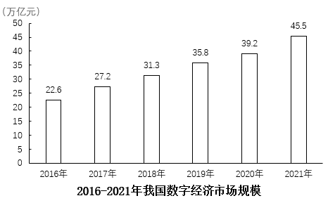

# 材料 · 2021年全球47国与我国数字经济市场规模、内部结构（数字产业化/产业数字化）及

> 关联 5 道小题

**时间口径**：现期年为2021年；文字段通过同比增速（15.6%、16.2%、11.9%、17.2%）可反推2020年基期值；柱状图给出2016-2021年逐年当期值（非累计）；无预测年份

**单位与换算**：全球数据用'万亿美元'（38.1、5.7、32.4），我国数据用'万亿元'（45.5、8.35、37.2），图单位为'万亿元'——'美元'与'元'一字之差，第1题须按1美元=6.5元换算（38.1万亿美元≈247.65万亿元）；比重类均用%，增速差用'个百分点'；数据均为万亿量级，注意勿错位到'亿'

## 结构拆解
- 文字段1（全球部分）：2021年全球47国数字经济规模38.1万亿美元、同比增15.6%（高于GDP增速2.5个百分点）、占GDP比重45.0%（同比提升1个百分点）；内部结构：数字产业化5.7万亿美元、产业数字化32.4万亿美元（占数字经济85%、占GDP约38.2%、较上年提升1个百分点）
- 文字段2（我国部分）：2021年我国数字经济规模45.5万亿元、同比增16.2%（高于GDP增速3.4个百分点）、占GDP比重39.8%；数字产业化8.35万亿元（同比增11.9%、占GDP 7.3%）；产业数字化37.2万亿元（同比增17.2%、占GDP 32.5%）
- 统计图（柱状图）：标题'2016-2021年我国数字经济市场规模'，单位万亿元，6根柱子依次为2016年22.6、2017年27.2、2018年31.3、2019年35.8、2020年39.2、2021年45.5；其中2021年45.5与文字段我国数据一致，2020年39.2是第4题的关键基期值

## 阅读陷阱
- ⚠ 币种陷阱：全球为'万亿美元'、我国为'万亿元'，直接用45.5÷38.1会算出超100%的荒谬比重，必须×6.5汇率换算（第1题专属条件）
- ⚠ 分母陷阱：'占数字经济比重85%'（分母=数字经济规模）与'占GDP比重38.2%'（分母=GDP）是两个不同口径，第3题需先统一到'占GDP'口径再用45.0%拆分
- ⚠ 自洽校验：5.7+32.4=38.1、8.35+37.2≈45.5，两段内部'数字产业化+产业数字化=数字经济规模'可用来核对读数
- ⚠ 跨图拼接：第4题的2020年产业数字化规模需用文字增速17.2%反推（37.2÷1.172≈31.7），2020年数字经济规模需取图中39.2（与45.5÷1.162≈39.2互验）
- ⚠ 增速需自算：图中只给规模不给增速，第2题2018-2021各年增速须逐柱相除，且2018年增速的基期是2017年27.2而非图外数据
- ⚠ '高于GDP增速X个百分点'与'占GDP比重同比提升X个百分点'均为百分点差，勿与百分比增速混淆

## 小题群关系
本组题围绕'比重+增速'双模型群：第1题为跨币种比重模型（45.5万亿元÷(38.1万亿美元×6.5)）；第2题为图算型同比增速比较模型（逐柱求增速后比较，2021年最快）；第3题为结构占比差模型（用45.0%×85%≈38.2%与45.0%×15%≈6.75%求差约31.5个百分点）；第4题为两期比重差模型（现期37.2/45.5 vs 基期31.7/39.2，约提升0.8个百分点）。四题无严格连环套用（上一题答案不作下一题条件），但共享同一套核心数据：第1、3题依赖文字段全球数据，第2、4题依赖柱状图，第4题还需文字增速反推基期，属于'一材多用、图文互补'的典型布局

## 关联真题
- [[10-真题/资料分析/比重/5510343 现期比重差值（整体占比=各部分占比之和的反推模型）|5510343]] 山东 2023 — 现期比重差值（整体占比=各部分占比之和的反推模型）
- [[10-真题/资料分析/比重/5510335 现期比重计算（跨币种换算）|5510335]] 山东 2023 — 现期比重计算（跨币种换算）
- [[10-真题/资料分析/增长/5510339 同比增长率比较（多年份增速快慢排序）|5510339]] 山东 2023 — 同比增长率比较（多年份增速快慢排序）
- [[10-真题/资料分析/比重/5510344 两期比重差（比重变化量）|5510344]] 山东 2023 — 两期比重差（比重变化量）
- [[10-真题/资料分析/综合/5510345 综合判断题（两期比重差为主，辅以基期比重、现期比重比较、增速差逆推GDP增速）|5510345]] 山东 2023 — 综合判断题（两期比重差为主，辅以基期比重、现期比重比较、增速差逆推GDP增速）

---

### 材料原文

        2021年全球47个国家数字经济市场规模达到38.1万亿美元，同比增长15.6%，高于GDP增速2.5个百分点，占GDP比重为45.0%，同比提升1个百分点。数字产业化规模为5.7万亿美元；产业数字化规模为32.4万亿美元，占数字经济比重为85%，占GDP比重较上年提升1个百分点，约为38.2%。

        2021年我国数字经济市场规模达45.5万亿元，同比增长16.2%，高于GDP增速3.4个百分点，占GDP比重达到39.8%。数字产业化规模为8.35万亿元，同比增长11.9%，占GDP比重为7.3%。产业数字化规模达到37.2万亿元，同比增长17.2%，占GDP比重为32.5%。

